# Byredo 18色 BOREALIS 极光眼影盘

*发布：2026*

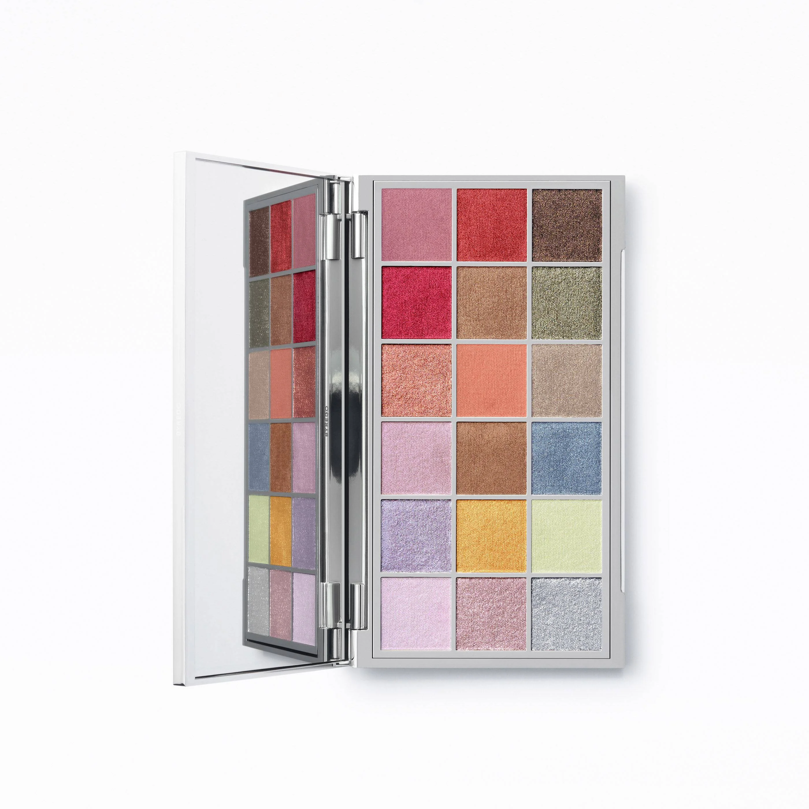

[Official Page](https://www.byredo.com/eu_de/p/borealis-palette-eyeshadow-18-colours)

18色眼影盘，灵感来源于北欧天幕上极光的奇幻光彩。涵盖暖棕、卡其金与深森绿等大地色调，搭配柔粉、覆盆子红、虹彩银与馥郁紫等极光色系。质地绵密柔滑，持妆可达12小时。2026年限量节日发行。

---

## Shade 1: Polar Blush - Dusty Rose Mauve Shimmer

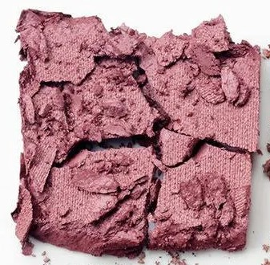

Use: A soft, dusty rose-mauve shimmer with a delicate, romantic luminosity. Wear across the lid for an effortless, aurora-kissed look. Blend into the outer corner for a soft moody depth, or use on the lower lash line as a subtle shimmer liner.

##### 色号 1：Polar Blush（极光腮红）—— 雾感玫瑰粉棕珠光色。
用途：全眼铺色打造柔美极光感；晕染至眼尾增添雾感深度；或沿下睫毛根部轻扫，作珠光感眼线使用。

---

## Shade 2: Solar Flare - Deep Crimson Red Metallic

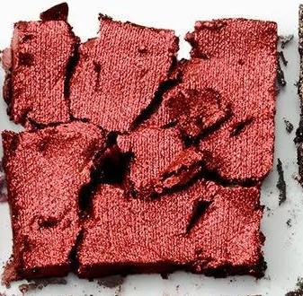

Use: A vivid, warm crimson-red metallic — bold and fiery. Apply on the lid for a high-impact statement look, or concentrate on the outer corner and crease for a dramatic red-eye effect. Pairs beautifully with deeper bronzes and neutral bases.

##### 色号 2：Solar Flare（极焰）—— 鲜活深红金属色。
用途：全眼铺色打造大胆炙热感宣言妆；集中于眼尾和眼窝打造戏剧红色眼妆；与深铜色或中性底色搭配效果绝佳。

---

## Shade 3: Twilight Bronze - Deep Cool Chocolate Bronze Metallic

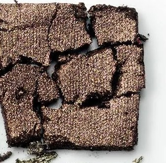

Use: A deep, cool-toned chocolate bronze metallic, evoking the darkening of the Nordic sky at twilight. Apply on the outer lid and crease for shadowy depth, or work as a rich liner on the upper or lower lash line. Layer over warmer shades at the lid centre for dimensional contrast.

##### 色号 3：Twilight Bronze（晨暮铜）—— 深邃冷调巧克力铜金属色。
用途：用于眼尾和眼窝打造阴翳深度；贴合上下睫毛根部可作浓郁眼线；与眼皮中央的暖色叠搭，制造反差层次。

---

## Shade 4: Borealis Red - Vivid Raspberry Magenta Metallic

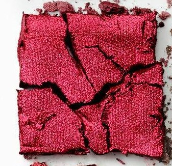

Use: A vivid, electric raspberry-magenta metallic — the most saturated statement shade of the palette. Apply across the lid for a graphic, high-voltage look, or concentrate at the outer corner for a bold, glamorous depth. Works as a striking accent over neutral bases.

##### 色号 4：Borealis Red（极光红）—— 亮眼覆盆子品红金属色。
用途：全眼铺色打造强烈视觉冲击；集中于眼尾打造华丽覆盆子深邃感；搭配中性色作跳色亮点使用。为全盘最饱和色号。

---

## Shade 5: Tundra Warmth - Warm Light Copper Bronze Metallic

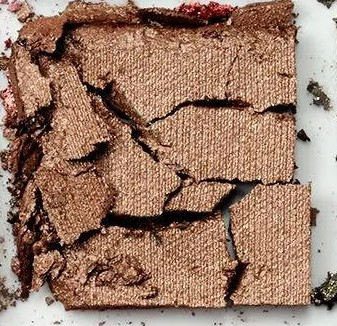

Use: A warm, light copper-bronze metallic with a sun-touched luminosity, like light glinting off frozen tundra. A versatile metallic base across the lid for a natural bronzed glow. Blend at the crease as a transitional metallic, or use at the centre of the lid as an understated focal point.

##### 色号 5：Tundra Warmth（冻原暖光）—— 温暖浅铜金属色。
用途：全眼铺色打造健康铜色光泽；晕染于眼窝作金属感过渡色；也可点于眼皮中央作简约视觉焦点。

---

## Shade 6: Forest Aurora - Khaki Olive Gold Metallic

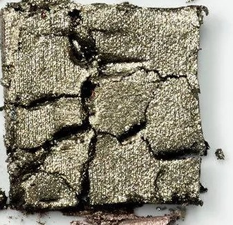

Use: A deep khaki-olive metallic with a golden shimmer, evoking dark evergreen forests beneath the dancing Northern Lights. Apply across the lid for an earthy, metallic forest-inspired look. Blend at the outer corner or crease for a unique olive dimension. Pairs well with coral and bronze shades.

##### 色号 6：Forest Aurora（森林极光）—— 深橄榄卡其金属色。
用途：全眼铺色打造大地金属感，呈现北欧森林主题；晕染于眼尾或眼窝，为暖调妆容增添独特橄榄层次；与珊瑚色和铜色搭配效果尤佳。

---

## Shade 7: Copper Dawn - Warm Rose Gold Copper Metallic

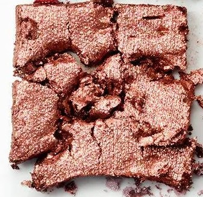

Use: A warm, luminous rose-gold copper metallic, evoking the blush of polar dawn light breaking across ice and snow. A flattering all-over lid colour for a warm, radiant look. Apply at the inner corner and brow bone as a rose-gold highlight, or layer over neutral bases for a copper-dusted finish.

##### 色号 7：Copper Dawn（晨曦铜）—— 温暖玫瑰金铜色金属质地。
用途：全眼铺色打造暖调发光感；点于眼头和眉骨作玫瑰金提亮；叠加于中性底色之上，呈现铜粉感妆效。

---

## Shade 8: Arctic Coral - Warm Terracotta Coral Matte

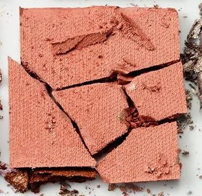

Use: A warm, earthy terracotta-coral matte — a sun-soaked tone among the cool Nordic hues, like the glow of a distant fire. Blend through the crease as a warming transition shade, or apply all over the lid for a natural, earthy daytime look. Use at the outer corner to deepen and warm up metallic finishes.

##### 色号 8：Arctic Coral（北极珊瑚）—— 温暖陶土珊瑚色哑光质地。
用途：晕染于眼窝作暖调过渡色；全眼铺色打造自然大地感日妆；用于眼尾，为金属色妆效增添暖意。

---

## Shade 9: Nordic Dusk - Warm Champagne Beige Metallic

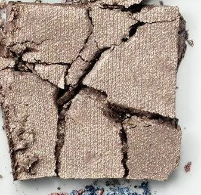

Use: A warm, champagne-beige metallic with a satin-soft luminosity, like the gentle glow of the last light before arctic night falls. A versatile all-over lid base that brightens and primes for other shades. Use on the brow bone and inner corner as a flattering, warm highlight. Blends seamlessly with every shade in the palette.

##### 色号 9：Nordic Dusk（北欧暮光）—— 温暖香槟米金属色。
用途：作全眼铺底色，提亮双眸并为其他色铺垫；点于眉骨和眼头作贴肤感暖调高光；可与全盘所有色号无缝融合。

---

## Shade 10: Aurora Lilac - Soft Pale Pink Lilac Shimmer

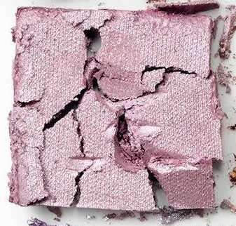

Use: A soft, pale pink-lilac shimmer with an ethereal, otherworldly glow — the palest reflection of aurora light. Wear all over the lid for a dreamy, luminous finish. Use as a subtle base beneath other shimmers to add delicate luminosity. Apply at the inner corner as a delicate highlight.

##### 色号 10：Aurora Lilac（极光藕荷）—— 柔嫩淡粉藕荷珠光色。
用途：全眼铺色打造梦幻飘渺感；作为其他珠光色的底色，增添细腻发光感；点于眼头作轻盈提亮。

---

## Shade 11: Amber Wave - Warm Caramel Chocolate Metallic

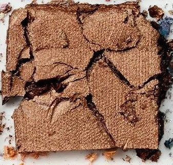

Use: A warm, medium caramel-chocolate metallic with a rich, burnished depth — like amber light rippling across frozen water. Apply across the lid for a burnished, autumnal glow, or blend into the crease for definition. Deepen the outer corners for added intensity, or use as an eyeliner along the lash line.

##### 色号 11：Amber Wave（琥珀涟漪）—— 温暖焦糖巧克力金属色。
用途：全眼铺色打造温暖秋日感光泽；晕染于眼窝作定型过渡色；叠加于眼尾增添深度；配合细刷可作眼线使用。

---

## Shade 12: Polar Blue - Cool Steel Blue Metallic

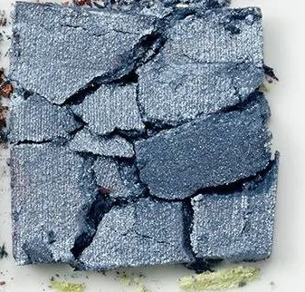

Use: A cool, steel-grey blue metallic with a smoky depth, evoking the mysterious hues at the edge of the polar sky. Apply across the lid for a cool, editorial metallic look. Layer with Arctic Silver at the centre for a dimensional steel effect. Blend into the outer corner for a smoky, arctic depth.

##### 色号 12：Polar Blue（极夜蓝）—— 冷钢蓝金属色。
用途：全眼铺色打造冷调编辑感金属妆；与Arctic Silver在眼皮中央叠搭呈现多层钢感；晕染至眼尾打造烟熏极地深邃感。

---

## Shade 13: Aurora Violet - Medium Amethyst Violet Shimmer

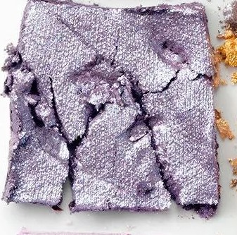

Use: A medium amethyst-violet shimmer — the radiant violet arc of the aurora borealis in shadow form. Apply across the lid as the palette's signature violet statement. Blend into the outer corner and crease for a romantic, aurora-inspired look. Pairs with Aurora Lilac and Arctic Silver for a luminous night sky effect.

##### 色号 13：Aurora Violet（极光紫）—— 中等紫水晶珠光色。
用途：全眼铺色作全盘标志性紫调宣言妆；晕染至眼尾和眼窝打造浪漫极光感；与Aurora Lilac和Arctic Silver搭配，呈现星空夜幕感。

---

## Shade 14: Midnight Gold - Rich Saffron Golden Yellow Metallic

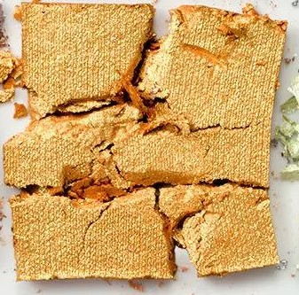

Use: A rich, vibrant saffron-gold metallic that blazes like the golden glow at the darkest edge of the northern night sky. Apply at the centre of the lid for a radiant focal point. Use as a bold pop colour across the full lid for a maximalist look. Blend at the inner corner for a warm, luminous highlight.

##### 色号 14：Midnight Gold（子夜黄金）—— 浓郁番红花黄金属色。
用途：点于眼皮中央作耀眼视觉焦点；大胆全眼铺色打造极繁主义妆效；晕染于眼头，作暖调流光提亮。

---

## Shade 15: Nordic Jade - Pale Mint Green Matte

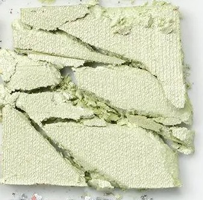

Use: A soft, pale mint-green matte — a delicate whisper of aurora green, subtle and unexpected. Wear as an all-over lid shade for a fresh, cool pop of colour. Blend at the inner corner with silver or lilac for an ethereal dimension. Apply through the crease for a unique pale-green editorial depth.

##### 色号 15：Nordic Jade（北欧翡翠）—— 柔嫩薄荷绿哑光色。
用途：全眼铺色打造清新冷调跳色感；与银色或藕荷色晕染于眼头，增添冰凉飘渺感；渲染于眼窝，打造独特浅绿编辑感层次。

---

## Shade 16: Snowdrift - Pale Pink Lavender Matte

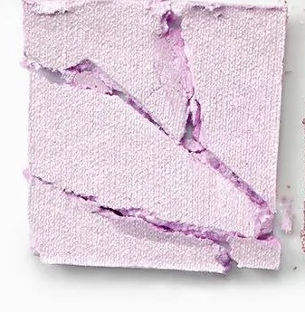

Use: A barely-there pale pink-lavender matte, as pristine and luminous as fresh arctic snowfall. The perfect all-over lid base to prime and brighten before applying deeper shades. Apply on the brow bone as a crisp, clean highlight. Use to soften and blend out edges throughout the look.

##### 色号 16：Snowdrift（雪漂）—— 极浅粉藕哑光色。
用途：适合作全眼铺底色，在涂抹深色前提亮打底；用于眉骨作干净清透的高光；也可用于晕染柔化边界。

---

## Shade 17: Aurora Pink - Dusty Rose Pink Metallic

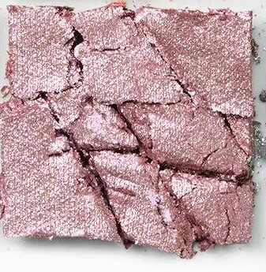

Use: A dusty rose-pink metallic with a warm, feminine luminosity — a softer, rosy reflection of the aurora's hues. A beautiful all-over lid colour for a romantic, feminine look. Pair with Aurora Lilac and Arctic Silver for a full aurora-pink eye. Layer over matte neutrals for a shimmer-kissed finish.

##### 色号 17：Aurora Pink（极光粉）—— 柔雾玫粉金属色。
用途：全眼铺色打造温柔浪漫感；与Aurora Lilac和Arctic Silver组合，呈现完整极光粉色系妆效；叠加于中性哑光色之上，增添玫粉发光感。

---

## Shade 18: Arctic Silver - Iridescent Chrome Silver Metallic

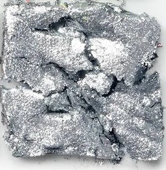

Use: A brilliant, iridescent chrome silver metallic — the palette's coolest and most dazzling shade, like moonlight reflected off Arctic ice. Apply at the centre of the lid for a radiant, high-impact highlight. Use as an inner corner brightener or brow bone highlighter. Overlay over any other shade for an electrifying metallic finish.

##### 色号 18：Arctic Silver（北极银）—— 虹彩铬银金属色。
用途：点于眼皮中央作耀眼高能提亮；用于眼头或眉骨打亮；叠加于任意色号之上，打造电光金属感。为全盘最闪耀色号。
