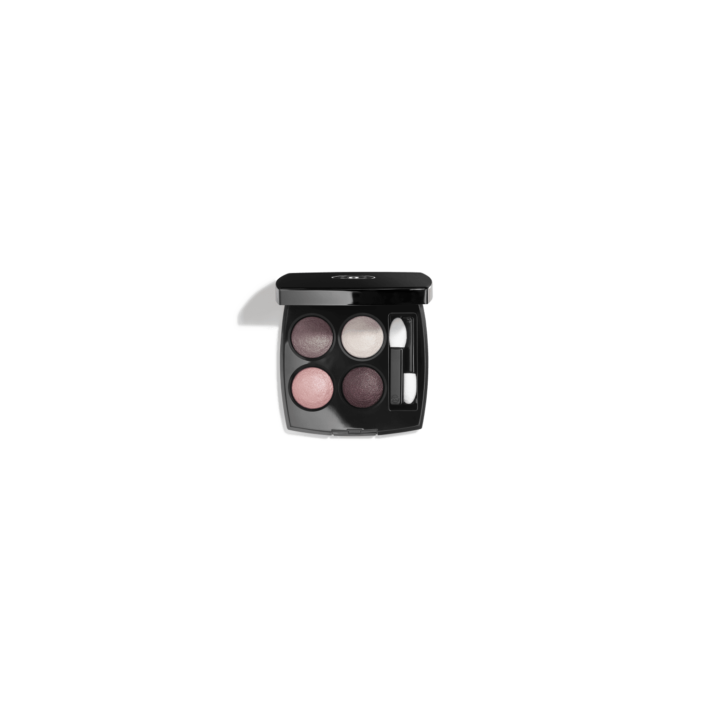
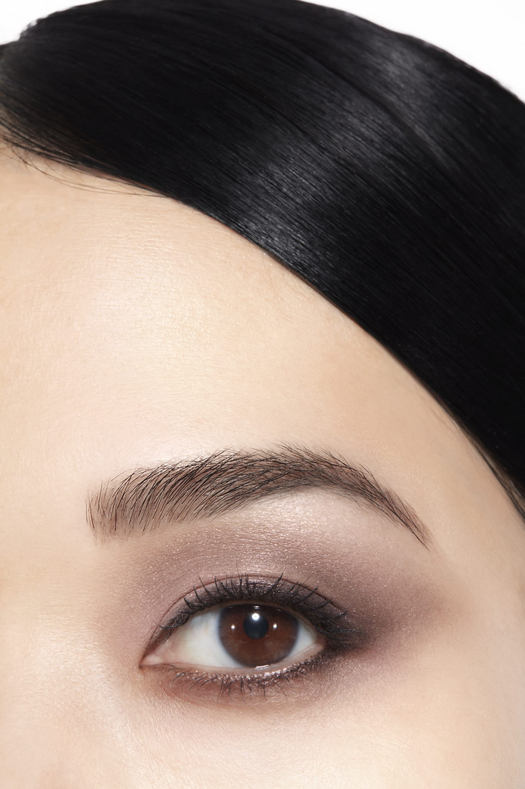
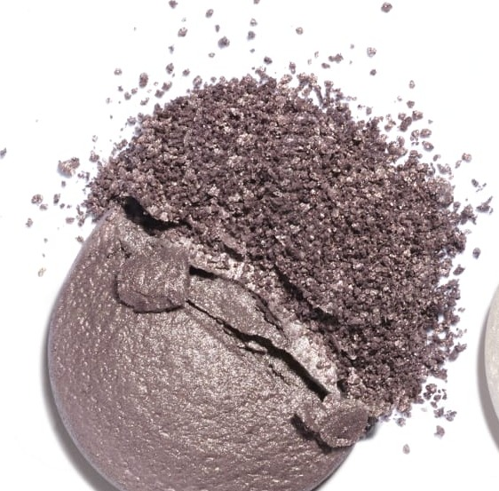
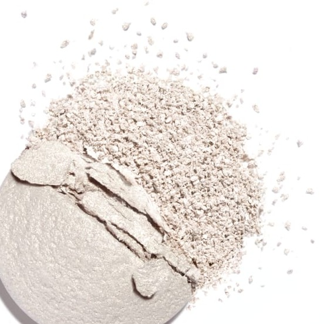
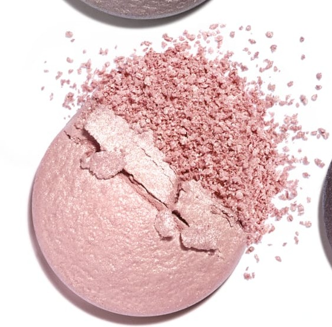
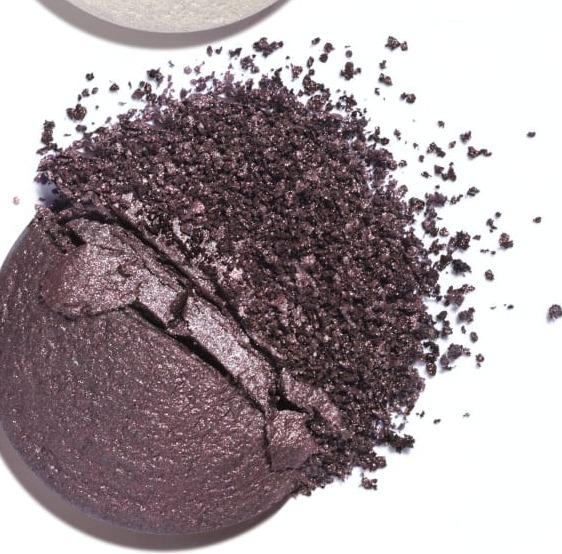

# Chanel Les 4 Ombres 202 TISSÉ CAMÉLIA 山茶花织纹盘

*发布：常规系列*

[Official Page](https://www.chanel.com/de/make-up/p/164202/les-4-ombres-lidschatten-mit-vielfaeltigen-effekten/)

> 以CHANEL标志性山茶花为灵感，调色盘将柔雅粉紫与耀眼珠光编织成精致的时装织物质感。由沉着的灰紫底调出发，经由薰衣草粉与流光蔷薇白逐层递进，最终以深邃的茄紫棕收束——如同一朵山茶花在清晨光线下的色彩变奏。

> *Inspired by CHANEL's iconic camellia, this palette weaves soft purple and radiant pearl into the texture of refined Parisian fabric. A sophisticated layering of grey-mauve, lavender pink, iridescent rose, and deep aubergine evokes the play of light on a camellia petal.*

---

## Shade 1: Iridescent Rose Mauve — 左上 / Top Left

Use: A cool grey-mauve with a delicate pink-rose iridescence. Apply across the lid as a versatile base. Blend into the crease as a soft transition shade. The palette's elegant foundation tone.

##### 色号 1：虹彩玫瑰灰紫（Iridescent Rose Mauve）—— Top Left / 左上
用途：冷调灰紫底色，带细腻粉玫瑰虹彩。全眼铺色作万能底色；晕染于眼窝作柔和过渡；为全盘优雅打底。

---

## Shade 2: Iridescent Luminous Rose White — 右上 / Top Right

Use: A brilliant luminous pearlescent white with a rosy-pink iridescence. Apply at the inner corner and brow bone for a wide-eye brightening effect. Layer over any shade as a dazzling topcoat.

##### 色号 2：流光蔷薇白（Iridescent Luminous Rose White）—— Top Right / 右上
用途：耀眼流光蔷薇白，带粉红虹彩。点于眼头和眉骨开阔眼型；叠加于任意色号之上，作极致发光盖彩。

---

## Shade 3: Shimmering Lavender Pink — 左下 / Bottom Left

Use: A warm lavender-pink with a luminous golden shimmer. Apply across the lid for a romantic radiance. Use at the centre of the lid as a focal point.

##### 色号 3：闪光薰衣草粉（Shimmering Lavender Pink）—— Bottom Left / 左下
用途：温暖薰衣草粉，带发光金色珠光。全眼铺色打造浪漫光泽；点于眼皮中央作发光焦点。

---

## Shade 4: Silky Aubergine Brown — 右下 / Bottom Right

Use: A deep velvety aubergine-brown with a silky satin finish. Apply across the outer lid and crease for smoky depth. The palette's defining shade.

##### 色号 4：丝绒茄紫棕（Silky Aubergine Brown）—— Bottom Right / 右下
用途：深邃丝绒茄紫棕，缎光质地。用于眼尾和眼窝打造烟熏深度。为全盘最深色号。

---

## 搭配建议 / Application Guide

**日常精致妆（Polished Everyday）**
虹彩玫瑰灰紫全眼铺色 → 流光蔷薇白提亮眼头与眉骨

**立体烟熏妆（Smoky Definition）**
虹彩玫瑰灰紫全眼铺色 → 丝绒茄紫棕加深眼窝与眼尾

**全盘叠搭（Full Quad Look）**
虹彩玫瑰灰紫打底 → 闪光薰衣草粉过渡 → 丝绒茄紫棕加深眼尾 → 流光蔷薇白点亮眼头
