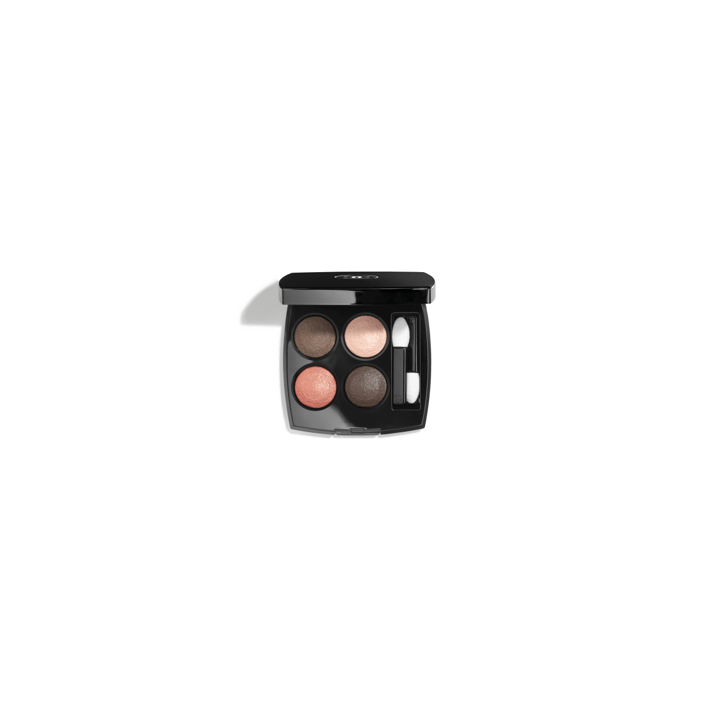
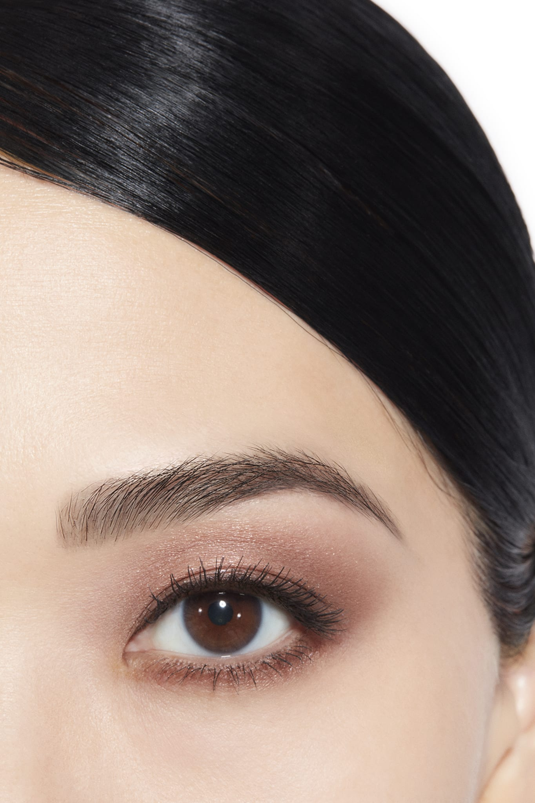
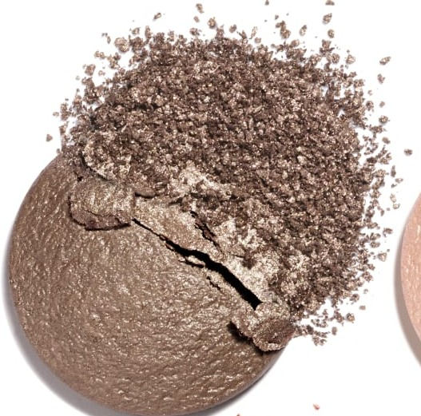
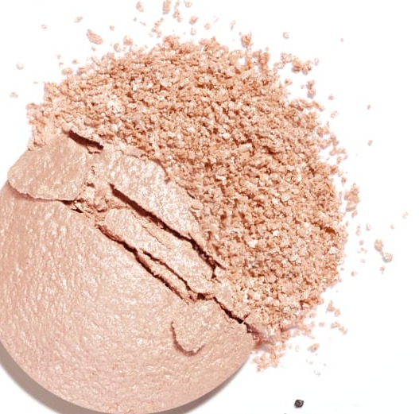
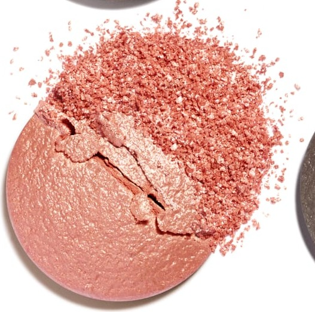
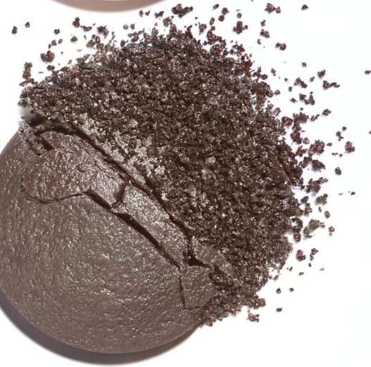

# Chanel Les 4 Ombres 204 TISSÉ VENDÔME 芳登广场织纹盘

*发布：常规系列*

[Official Page](https://www.chanel.com/de/make-up/p/164204/les-4-ombres-lidschatten-mit-vielfaeltigen-effekten/)

> 以巴黎芳登广场的金色光华为调色灵感，将暖棕、珍珠桃与闪金杏色精心编织。金棕底色沉稳奠基，珠光蜜桃柔和过渡，缤纷杏色画龙点睛，深灰棕收束轮廓——再现芳登广场在光与影之间交织的优雅风情。

> *Drawing inspiration from the golden radiance of the Place Vendôme, this palette weaves warm browns, pearl peach, and shimmering apricot into a harmonious Parisian composition. From a grounding golden base to a deep grey-brown finish, each shade evokes the timeless elegance of this iconic square.*

---

## Shade 1: Warm Golden Brown — 左上 / Top Left

Use: A warm medium golden brown with a satin sheen. Apply across the lid as the grounding base shade. Blend into the crease as a natural transition.

##### 色号 1：暖调金棕（Warm Golden Brown）—— Top Left / 左上
用途：温暖中深金棕，缎光质地。全眼铺色作打底色；晕染于眼窝作自然过渡。

---

## Shade 2: Luminous Pearlescent Peach — 右上 / Top Right

Use: A luminous soft pearlescent peach. Apply across the lid for a fresh warm glow. Use at the brow bone and inner corner as a warm highlight.

##### 色号 2：珠光蜜桃（Luminous Pearlescent Peach）—— Top Right / 右上
用途：柔和珠光蜜桃色。全眼铺色打造清新暖光；用于眉骨和眼头作暖调高光。

---

## Shade 3: Intense Apricot Pink-Gold — 左下 / Bottom Left

Use: An intense warm apricot with pink and golden shimmer. Apply at the centre of the lid for a radiant focal point. Layer over the golden brown base for a dimensional effect.

##### 色号 3：炙热杏色粉金（Intense Apricot Pink-Gold）—— Bottom Left / 左下
用途：浓郁暖调杏色，带粉色和金色珠光。点于眼皮中央作耀眼视觉焦点；叠加于金棕底色，呈现多维妆效。

---

## Shade 4: Matte Intense Grey-Brown — 右下 / Bottom Right

Use: A deep intense matte grey-brown. Define the crease and outer corner for smoky depth. Blend along the lower lash line as a smudged liner effect.

##### 色号 4：深邃哑光灰棕（Matte Intense Grey-Brown）—— Bottom Right / 右下
用途：深邃哑光灰棕。加深眼窝和眼尾打造烟熏立体感；沿下睫毛根部晕扫，打造晕染眼线效果。

---

## 搭配建议 / Application Guide

**日常精致妆（Polished Everyday）**
暖调金棕全眼铺色 → 珠光蜜桃提亮眼头与眉骨

**立体烟熏妆（Smoky Definition）**
暖调金棕全眼铺色 → 深邃哑光灰棕加深眼窝与眼尾

**全盘叠搭（Full Quad Look）**
暖调金棕打底 → 炙热杏色粉金过渡 → 深邃哑光灰棕加深眼尾 → 珠光蜜桃点亮眼头
