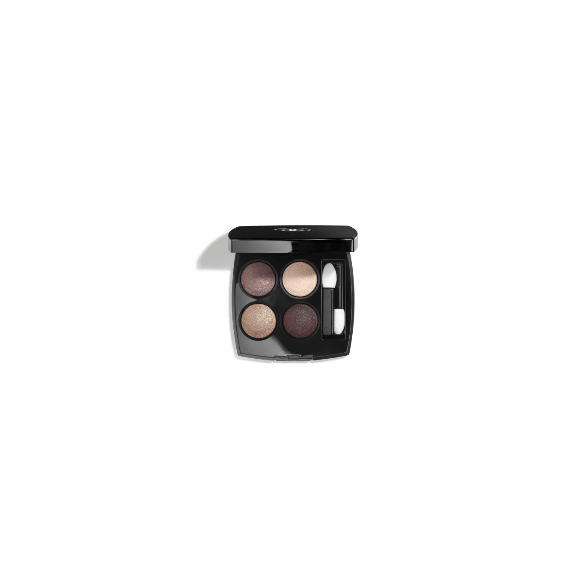
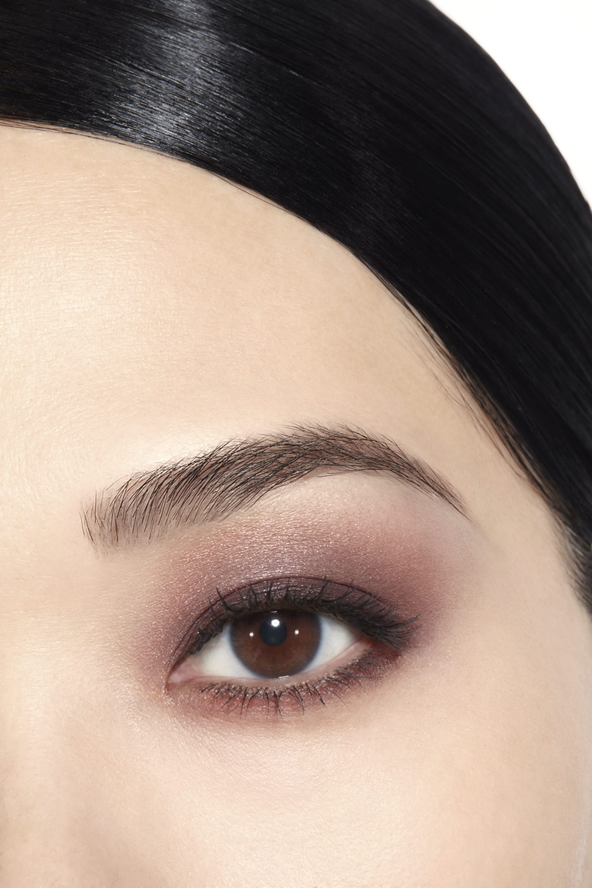
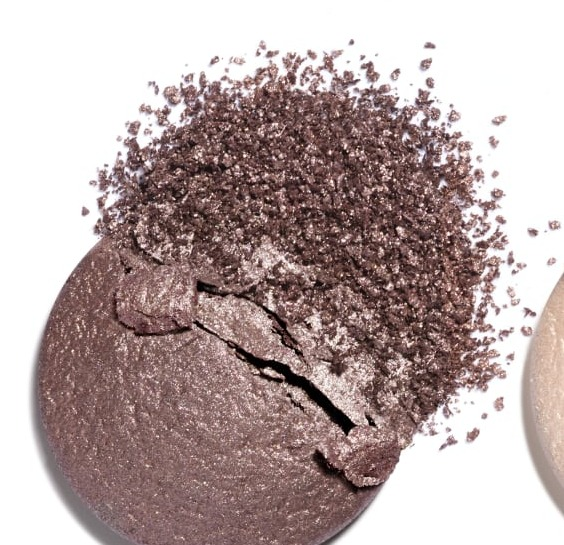
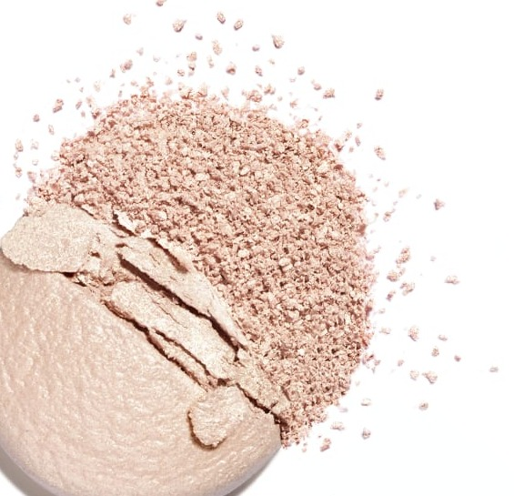
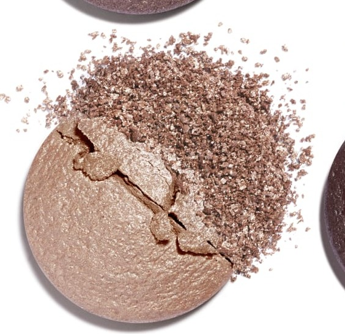
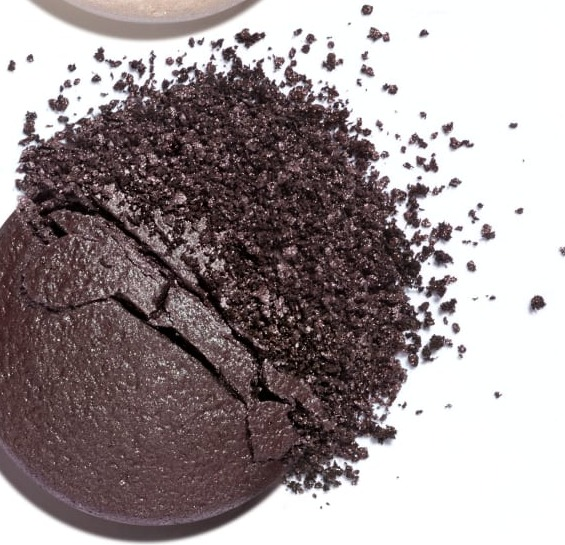

# Chanel Les 4 Ombres 226 TISSÉ RIVOLI 里沃利街织纹盘

*发布：常规系列*

[Official Page](https://www.chanel.com/de/make-up/p/164226/les-4-ombres-lidschatten-mit-vielfaeltigen-effekten/)

> 以巴黎里沃利街的拱廊美学为调色灵感，由金光塔普和玫瑰金米色层层递进，演绎优雅的暖调大地系妆效。丝光玫瑰米打造立体层次，深邃哑光棕红作精准收尾——如同拱廊下洒落的金色日光，在棕调与玫瑰之间优雅流动。

> *Inspired by the elegant arcades of the Rue de Rivoli, this palette builds from a gold-shimmer taupe base through rose-beige shimmering tones, culminating in a rich matte red-brown. A masterclass in warm, architectural depth.*

---

## Shade 1: Gold-Shimmer Taupe — 左上 / Top Left

Use: A warm taupe with a rich golden shimmer. Apply across the lid as a flattering all-over base. Blend into the crease for warm transitional depth.

##### 色号 1：流金塔普（Gold-Shimmer Taupe）—— Top Left / 左上
用途：温暖塔普，带浓郁金色珠光。全眼铺色作贴肤底色；晕染于眼窝增添暖调层次。

---

## Shade 2: Light Rose Beige Golden Shimmer — 右上 / Top Right

Use: A soft light rose-beige with a delicate golden shimmer. Apply at the brow bone and inner corner for brightening. Use across the lid for a luminous everyday look.

##### 色号 2：玫瑰金米光（Light Rose Beige Golden Shimmer）—— Top Right / 右上
用途：柔嫩玫瑰米，带细腻金色珠光。用于眉骨和眼头提亮；全眼铺色打造清新发光日妆。

---

## Shade 3: Silky Rose-Tinted Intense Beige — 左下 / Bottom Left

Use: A medium silky beige with a warm rosy tint. Apply across the full lid for a polished warm-toned look. Blend at the crease for definition.

##### 色号 3：丝光玫瑰深米（Silky Rose-Tinted Intense Beige）—— Bottom Left / 左下
用途：中等深度丝光米色，带温暖玫瑰色调。全眼铺色打造精致暖调妆；晕染于眼窝定型。

---

## Shade 4: Intense Matte Red-Brown — 右下 / Bottom Right

Use: An intense rich matte red-brown. Deepen the outer corner and crease for a smouldering sculpted finish. Apply as a precise liner along the upper lash line.

##### 色号 4：深邃哑光棕红（Intense Matte Red-Brown）—— Bottom Right / 右下
用途：浓郁深邃哑光棕红。加深眼尾和眼窝，打造灼热立体感；沿上睫毛根部勾勒精准线条。

---

## 搭配建议 / Application Guide

**日常精致妆（Polished Everyday）**
流金塔普全眼铺色 → 玫瑰金米光提亮眼头与眉骨

**立体烟熏妆（Smoky Definition）**
流金塔普全眼铺色 → 深邃哑光棕红加深眼窝与眼尾

**全盘叠搭（Full Quad Look）**
流金塔普打底 → 丝光玫瑰深米过渡 → 深邃哑光棕红加深眼尾 → 玫瑰金米光点亮眼头
