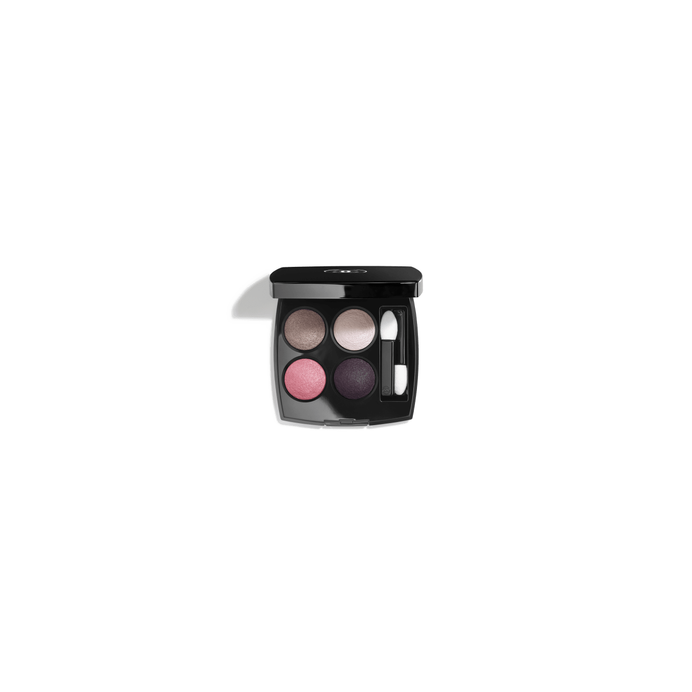
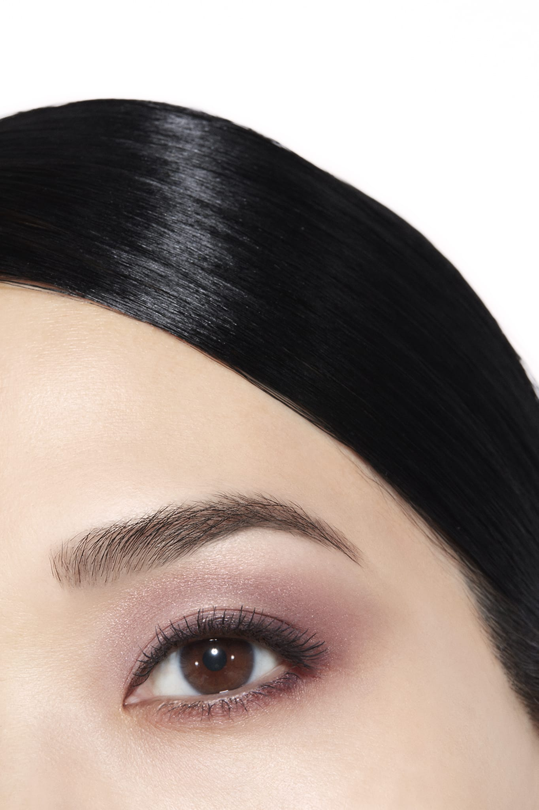
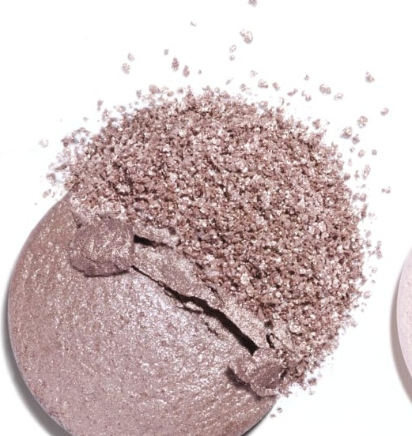
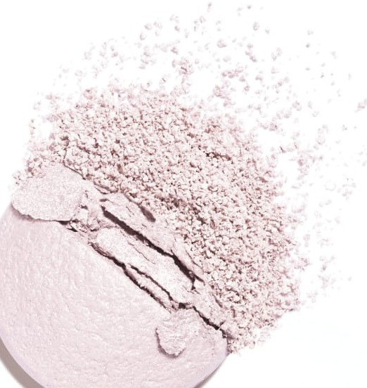
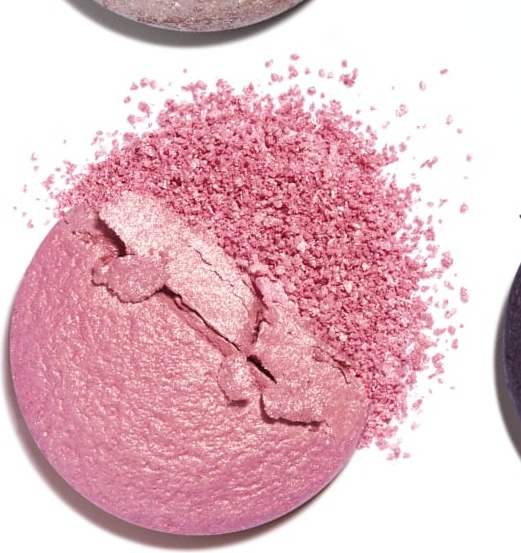
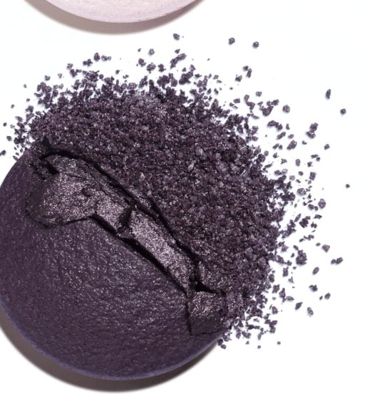

# Chanel Les 4 Ombres 228 TISSÉ CAMBON 康朋街织纹盘

*发布：常规系列*

[Official Page](https://www.chanel.com/de/make-up/p/164228/les-4-ombres-lidschatten-mit-vielfaeltigen-effekten/)

> 以CHANEL总部康朋街31号为灵感，调色盘将清雅莫夫玫瑰编织成巴黎女性的专属优雅。由银光莫夫打底，经由淡蓝蔷薇白与玫瑰金焦点，在深邃浆果紫中达到高潮——如同康朋街橱窗在清晨映出的玫瑰色光晕。

> *Inspired by the iconic address of 31 Rue Cambon, this palette weaves mauve and rose into an expression of effortless Parisian femininity. A silver-mauve foundation shimmers into pale blue-pink, building toward a luminous rose-gold focal point and a deep berry finale.*

---

## Shade 1: Mauve with Pink-Silver Shimmer — 左上 / Top Left

Use: A cool mauve with delicate pink and silver shimmer. Apply across the lid as a refined versatile base. Blend into the crease as a soft transitional shade.

##### 色号 1：银光莫夫（Mauve with Pink-Silver Shimmer）—— Top Left / 左上
用途：冷调莫夫，带细腻粉色和银色珠光。全眼铺色作精致底色；晕染于眼窝作柔和过渡。

---

## Shade 2: Silky Pale Bluish Pink — 右上 / Top Right

Use: A silky pale bluish-pink, cool luminous and ethereal. Apply at the inner corner and brow bone as a brightening highlight. Use all over the lid for a dreamy look.

##### 色号 2：丝光淡蓝蔷薇（Silky Pale Bluish Pink）—— Top Right / 右上
用途：丝滑淡蓝蔷薇粉，清冷如梦。点于眼头和眉骨提亮；全眼铺色打造梦幻柔焦感。

---

## Shade 3: Luminous Intense Rose with Gold — 左下 / Bottom Left

Use: A luminous intense rose-pink with a golden shimmer. Apply at the centre of the lid for a striking focal point. Layer over deeper shades for a dimensional shimmer.

##### 色号 3：玫瑰金光（Luminous Intense Rose with Gold）—— Bottom Left / 左下
用途：耀眼深玫瑰粉，带金色珠光。点于眼皮中央作抢眼焦点；叠加于深色之上增添多维珠光。

---

## Shade 4: Deep Velvety Berry — 右下 / Bottom Right

Use: A deep velvety berry-plum with a silky-smooth texture. Apply across the outer lid and crease for a smoky sultry depth. The palette's most dramatic shade.

##### 色号 4：深邃丝绒浆果紫（Deep Velvety Berry）—— Bottom Right / 右下
用途：深邃丝绒浆果李紫，质地如绸。用于眼尾和眼窝打造烟熏深度。为全盘最戏剧色号。

---

## 搭配建议 / Application Guide

**日常精致妆（Polished Everyday）**
银光莫夫全眼铺色 → 丝光淡蓝蔷薇提亮眼头与眉骨

**立体烟熏妆（Smoky Definition）**
银光莫夫全眼铺色 → 深邃丝绒浆果紫加深眼窝与眼尾

**全盘叠搭（Full Quad Look）**
银光莫夫打底 → 玫瑰金光过渡 → 深邃丝绒浆果紫加深眼尾 → 丝光淡蓝蔷薇点亮眼头
