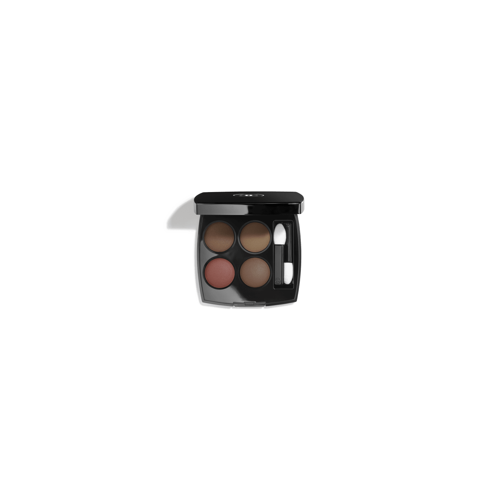
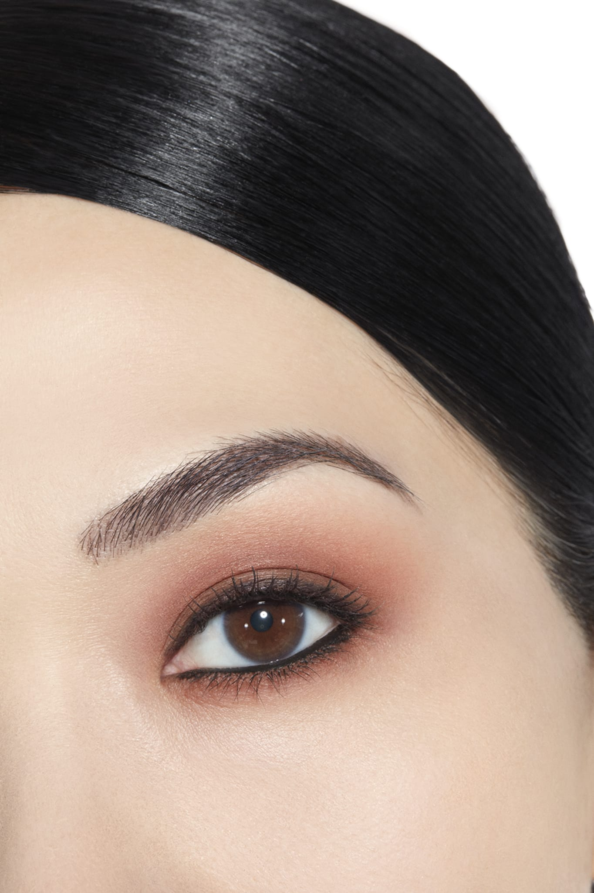
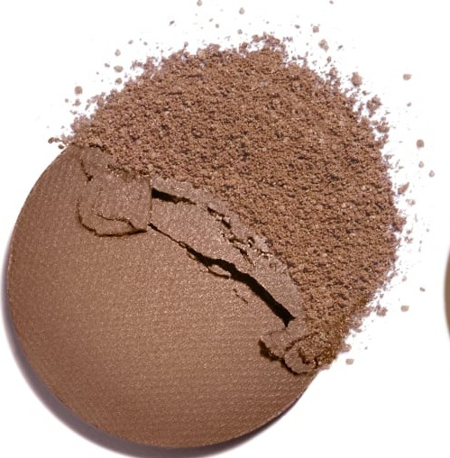
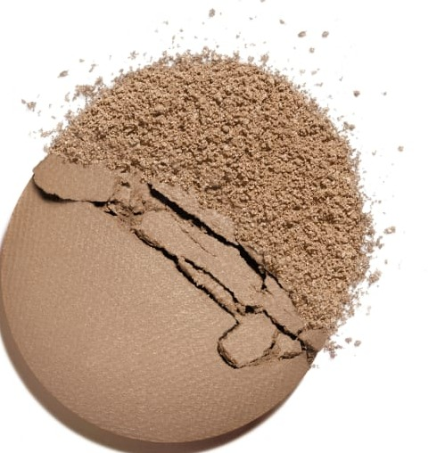
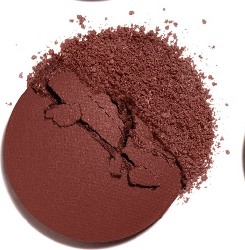
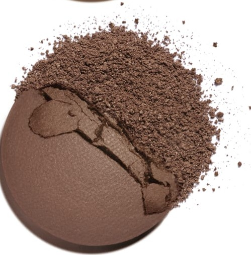

# Chanel Les 4 Ombres 268 CANDEUR ET EXPÉRIENCE 坦率与阅历盘

*发布：常规系列*

[Official Page](https://www.chanel.com/de/make-up/p/164268/les-4-ombres-lidschatten-mit-vielfaeltigen-effekten/)

> 以「坦率与阅历」为名，调色盘在暖棕大地系中构筑一种成熟而真实的美感。由明快棕与石灰米奠定底调，配以哑光暗棕红点睛定型，深邃可可棕收束烟熏——演绎一种无需炫技的自信妆效，简洁、精准、深刻。

> *Named Candeur et Expérience — Candour and Experience — this palette builds a sophisticated naturalistic look from warm earth tones. Light brown and stone beige create a polished base, while a matte brownish red provides definition and a deep chocolate brown delivers the final depth.*

---

## Shade 1: Light Brown — 左上 / Top Left

Use: A light warm brown with a satin shimmer. Apply across the lid as a natural polished base shade. Blend into the crease as a warm transition.

##### 色号 1：暖调浅棕（Light Brown）—— Top Left / 左上
用途：温暖浅棕，缎光质地。全眼铺色作自然精致底色；晕染于眼窝作暖调过渡。

---

## Shade 2: Stone Beige — 右上 / Top Right

Use: A cool stone-beige with a soft natural finish. Apply on the brow bone and inner corner as a clean neutral highlight. Layer under deeper shades for a refined finish.

##### 色号 2：石灰米（Stone Beige）—— Top Right / 右上
用途：冷调石灰米，质地自然清透。用于眉骨和眼头作干净中性高光；作为其他色号的底层打底。

---

## Shade 3: Matte Brownish Red — 左下 / Bottom Left

Use: A warm matte brownish-red. Define the crease and outer corner for subtle earthy depth. Apply along the lower lash line for a smudged warm definition.

##### 色号 3：哑光暗棕红（Matte Brownish Red）—— Bottom Left / 左下
用途：温暖哑光暗棕红。加深眼窝和眼尾，打造内敛大地感深度；沿下睫毛根部晕扫，打造自然模糊感轮廓。

---

## Shade 4: Matte Chocolate Brown — 右下 / Bottom Right

Use: A rich deep matte chocolate brown. Apply across the outer lid and crease for a classic smoky depth. Use as a liner along the upper lash line.

##### 色号 4：哑光可可棕（Matte Chocolate Brown）—— Bottom Right / 右下
用途：浓郁深邃哑光可可棕。用于眼尾和眼窝打造经典烟熏深度；沿上睫毛根部勾勒为精准眼线。

---

## 搭配建议 / Application Guide

**日常精致妆（Polished Everyday）**
暖调浅棕全眼铺色 → 石灰米提亮眼头与眉骨

**立体烟熏妆（Smoky Definition）**
暖调浅棕全眼铺色 → 哑光可可棕加深眼窝与眼尾

**全盘叠搭（Full Quad Look）**
暖调浅棕打底 → 哑光暗棕红过渡 → 哑光可可棕加深眼尾 → 石灰米点亮眼头
