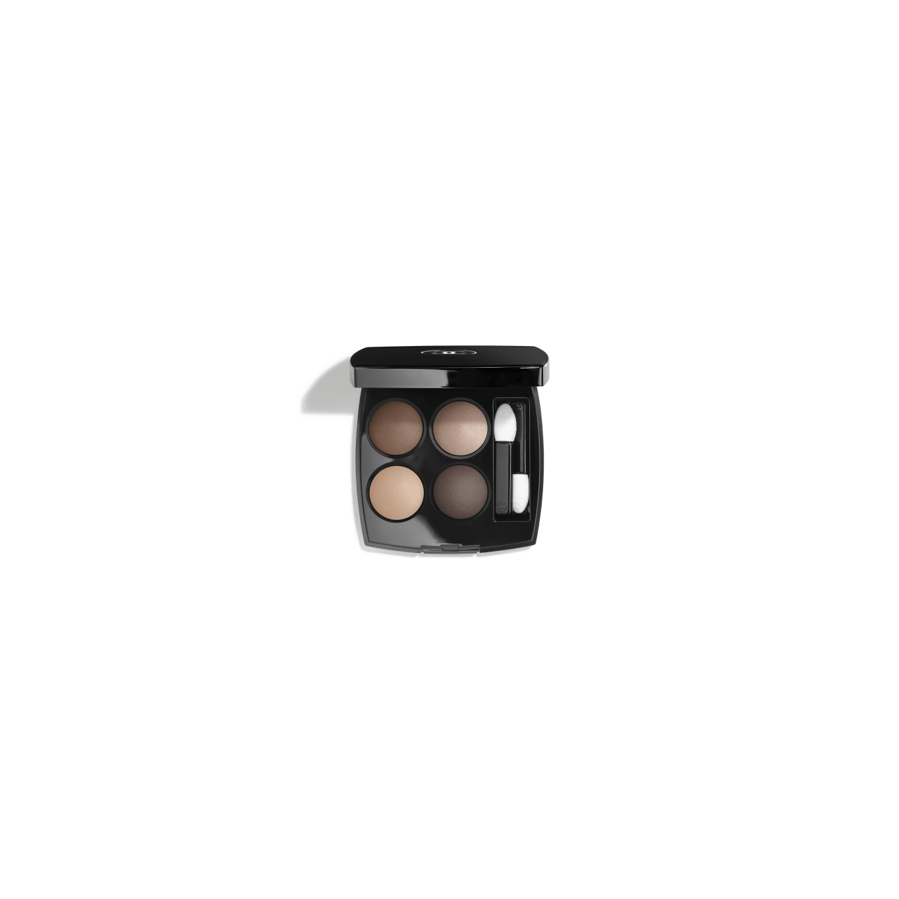
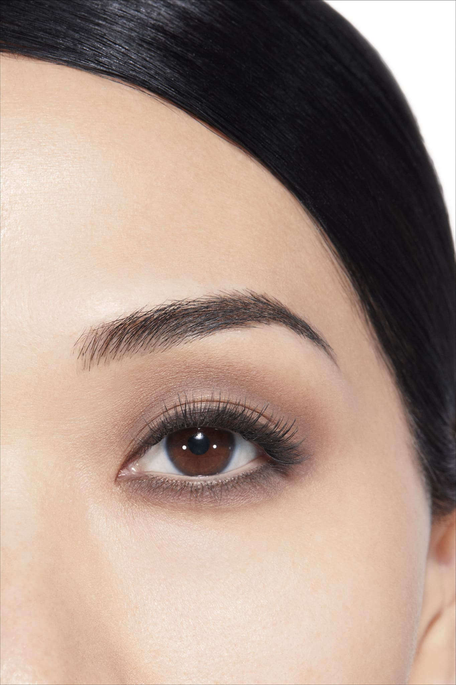
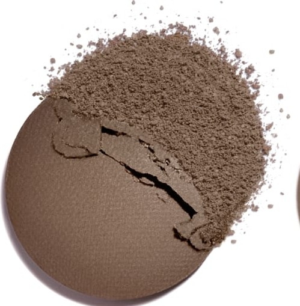
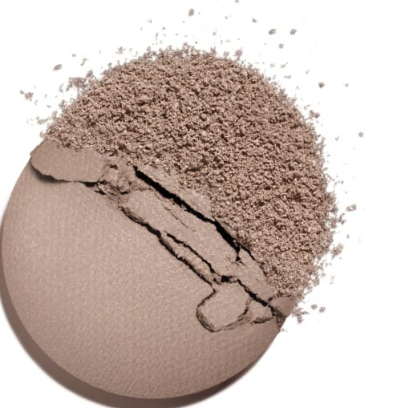
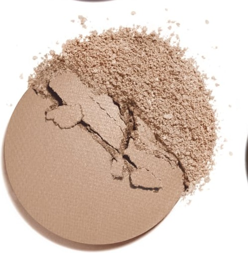
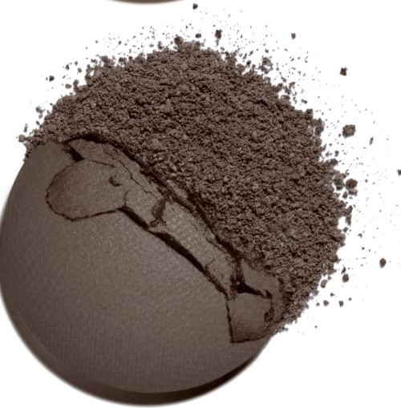

# Chanel Les 4 Ombres 308 CLAIR-OBSCUR 明暗对比盘

*发布：常规系列*

[Official Page](https://www.chanel.com/de/make-up/p/164308/les-4-ombres-lidschatten-mit-vielfaeltigen-effekten/)

> 以绘画术语「明暗对比」为名，调色盘将裸棕、混凝土米与暖亮米精心排列，以黑棕作最终收束，如同光线在建筑空间中投下的光影切割。一款专注于明暗层次构建的大地系中性盘，适合追求精准轮廓与立体感的妆效。

> *Named after the painterly technique of chiaroscuro — the art of contrasting light and dark — this palette constructs depth with a precise palette of warm brown, concrete beige, luminous highlight, and deep noir-brown. A study in sculptural precision.*

---

## Shade 1: Medium Warm Brown — 左上 / Top Left

Use: A versatile medium warm brown with a satin finish. Apply across the lid as the palette's base shade. Blend into the crease for natural definition.

##### 色号 1：中性暖棕（Medium Warm Brown）—— Top Left / 左上
用途：百搭中深暖棕，缎光质地。全眼铺色作全盘底色；晕染于眼窝增添自然立体感。

---

## Shade 2: Concrete Beige — 右上 / Top Right

Use: A cool muted concrete beige with a satin-smooth texture. Apply on the brow bone and inner corner as an architectural highlight. Use all over for a minimalist modern look.

##### 色号 2：混凝土米（Concrete Beige）—— Top Right / 右上
用途：冷调哑感混凝土米，质地柔滑。用于眉骨和眼头作立体感提亮；全眼铺色打造极简现代感。

---

## Shade 3: Luminous Highlight Beige — 左下 / Bottom Left

Use: A brightening luminous beige with a soft shimmer. Apply at the inner corner and brow bone for a radiant open-eye effect. Layer over matte shades for luminosity.

##### 色号 3：发光米（Luminous Highlight Beige）—— Bottom Left / 左下
用途：提亮发光米色，带柔和珠光。点于眼头和眉骨，打造开阔明眸效果；叠加于哑光色之上增添维度。

---

## Shade 4: Noir-Brown — 右下 / Bottom Right

Use: A deep intense noir-brown. Deepen the outer corner and crease for dramatic chiaroscuro depth. Apply along the lash lines for a sharp defining liner.

##### 色号 4：黑棕（Noir-Brown）—— Bottom Right / 右下
用途：深邃浓重黑棕。加深眼尾和眼窝，打造明暗对比感强烈的戏剧深度；沿睫毛根部勾勒，作精准定义眼线。

---

## 搭配建议 / Application Guide

**日常精致妆（Polished Everyday）**
中性暖棕全眼铺色 → 混凝土米提亮眼头与眉骨

**立体烟熏妆（Smoky Definition）**
中性暖棕全眼铺色 → 黑棕加深眼窝与眼尾

**全盘叠搭（Full Quad Look）**
中性暖棕打底 → 发光米过渡 → 黑棕加深眼尾 → 混凝土米点亮眼头
