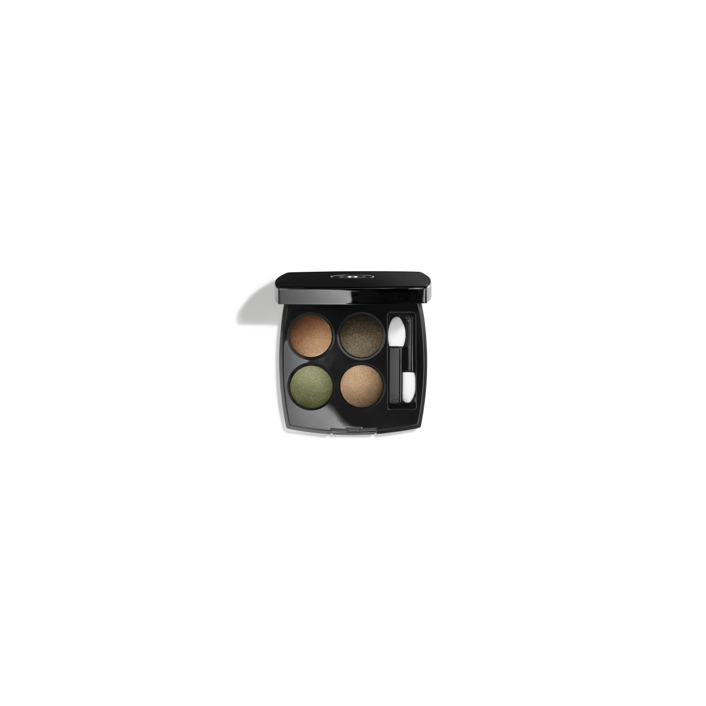
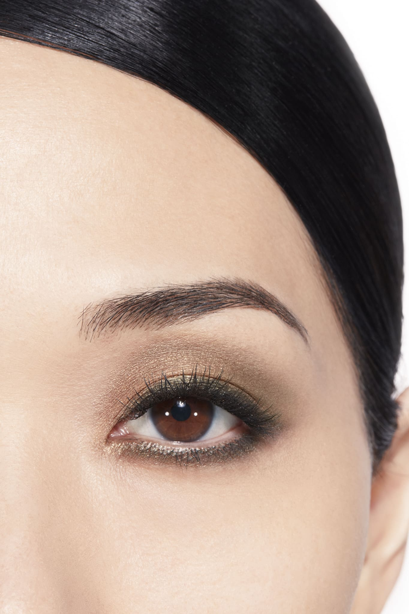
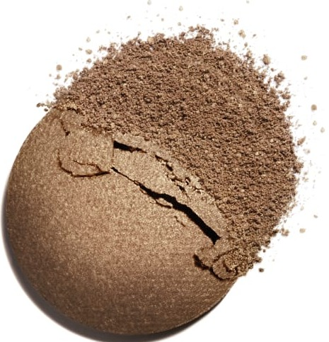
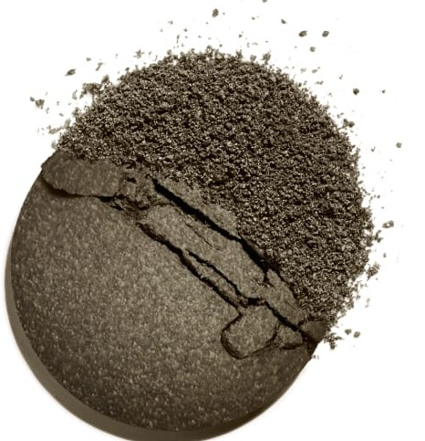
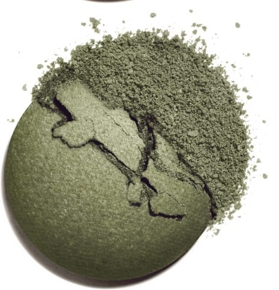
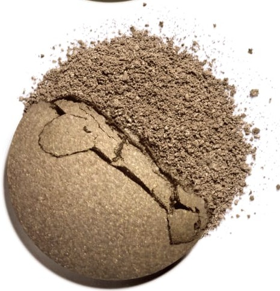

# Chanel Les 4 Ombres 318 BLURRY GREEN 朦胧绿盘

*发布：常规系列*

[Official Page](https://www.chanel.com/de/make-up/p/164318/les-4-ombres-lidschatten-mit-vielfaeltigen-effekten/)

> 以朦胧绿意为主题，调色盘在玫瑰古铜与幽深森绿之间构建了一场独特的色彩对话。丝绒金绿作流光焦点，灰调古金收束神秘质感——呈现一种介于大地与自然绿调之间的现代妆效，模糊边界，柔化轮廓，打造充满层次的雾感绿意。

> *A unique play of warm bronze and deep botanical green, Blurry Green blurs the boundary between earth tones and nature's verdure. Silky golden-green shimmers against a rosy bronze base while antique grey-gold adds a mysterious, textured finish.*

---

## Shade 1: Rosy Bronze — 左上 / Top Left

Use: A warm rosy-bronze with a metallic shimmer. Apply across the lid as a versatile warm base. Blend into the crease for warm transitional depth.

##### 色号 1：玫瑰古铜（Rosy Bronze）—— Top Left / 左上
用途：温暖玫瑰古铜，金属光泽。全眼铺色作暖调底色；晕染于眼窝增添暖感过渡层次。

---

## Shade 2: Deep Forest Green — 右上 / Top Right

Use: A deep rich forest green with intense depth. Apply across the outer lid and crease for a statement botanical look. Pair with the golden-green for a layered green effect.

##### 色号 2：幽深森绿（Deep Forest Green）—— Top Right / 右上
用途：深邃浓郁森林绿。用于眼尾和眼窝打造植物感深度；与金绿色搭配，呈现层叠绿调效果。

---

## Shade 3: Silky Golden Green — 左下 / Bottom Left

Use: A silky warm golden-green with a lustrous shimmer. Apply at the centre of the lid as a dazzling focal point. Layer over the forest green for a multidimensional look.

##### 色号 3：丝绒金绿（Silky Golden Green）—— Bottom Left / 左下
用途：丝绒温暖金绿，光泽丰盈。点于眼皮中央作耀眼绿色焦点；叠加于森绿之上，打造多维闪光绿调妆效。

---

## Shade 4: Grey Antique Gold — 右下 / Bottom Right

Use: A unique grey-toned antique gold with a textured metallic finish. Apply across the lid for an editorial metallic look. Use at the outer corner for mysterious depth.

##### 色号 4：灰调古金（Grey Antique Gold）—— Bottom Right / 右下
用途：独特灰调古金，金属质地带复古肌理感。全眼铺色打造编辑感金属妆；用于眼尾增添神秘深邃感。

---

## 搭配建议 / Application Guide

**日常精致妆（Polished Everyday）**
玫瑰古铜全眼铺色 → 幽深森绿提亮眼头与眉骨

**立体烟熏妆（Smoky Definition）**
玫瑰古铜全眼铺色 → 灰调古金加深眼窝与眼尾

**全盘叠搭（Full Quad Look）**
玫瑰古铜打底 → 丝绒金绿过渡 → 灰调古金加深眼尾 → 幽深森绿点亮眼头
