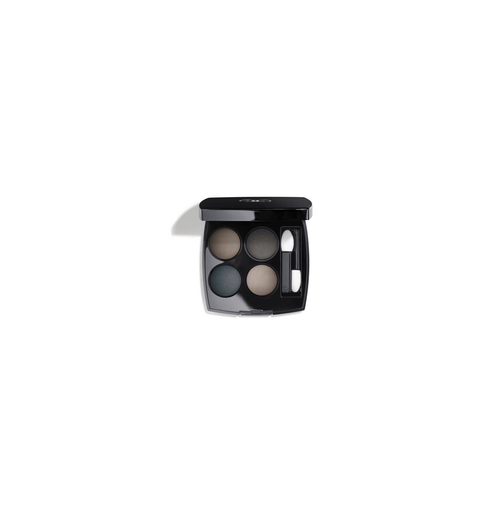
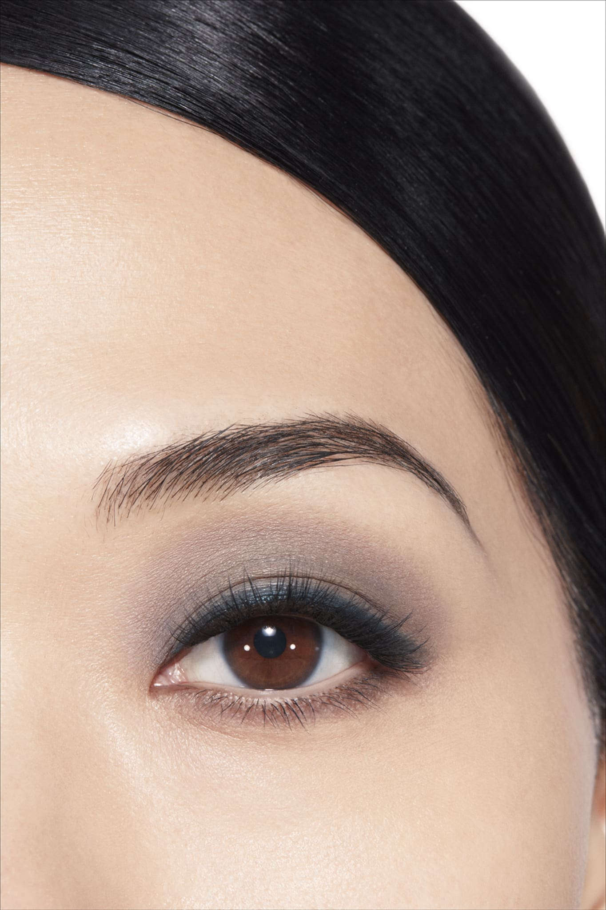
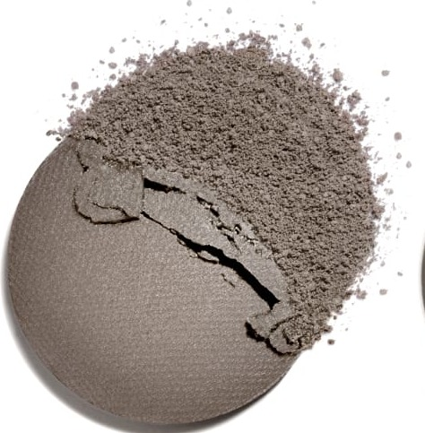
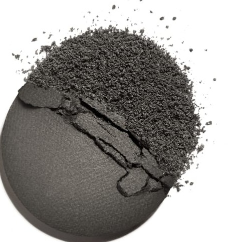
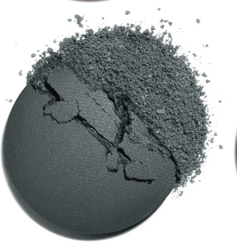
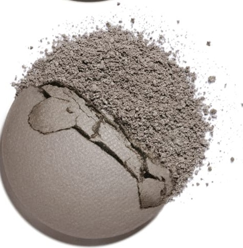

# Chanel Les 4 Ombres 324 BLURRY BLUE 朦胧蓝盘

*发布：常规系列*

[Official Page](https://www.chanel.com/de/make-up/p/164324/les-4-ombres-lidschatten-mit-vielfaeltigen-effekten/)

> 调色盘以晕染与朦胧为创作哲学，将暖灰调、哑光蓝灰、微绿蓝灰与浅玫瑰灰精心排列，在蓝调与中性之间创造出柔焦般的朦胧感。每一格色彩都如同轻雾笼罩，界限模糊——打造一种低调而精妙的烟熏层次，无需鲜艳的颜色，只需光与影的微妙变奏。

> *Blurry Blue creates a soft-focus, blurred effect through a carefully graduated spectrum of grey-blues. From warm taupe-grey to barely-there muted tones, it conjures a hazy, dreamy look that blurs the line between cool neutrals and subtle blues.*

---

## Shade 1: Warm Taupe Grey — 左上 / Top Left

Use: A warm taupe-grey with a satin finish. Apply across the lid as a versatile wearable base. Blend into the crease as a warm transitional shade.

##### 色号 1：暖调灰棕（Warm Taupe Grey）—— Top Left / 左上
用途：温暖缎光灰棕。全眼铺色作百搭底色；晕染于眼窝作暖感过渡。

---

## Shade 2: Matte Blue-Grey — 右上 / Top Right

Use: A cool matte blue-grey with soft depth. Apply across the lid for a modern blue-grey look. Blend into the crease for subtle cool definition.

##### 色号 2：哑光蓝灰（Matte Blue-Grey）—— Top Right / 右上
用途：冷调哑光蓝灰，温和深邃。全眼铺色打造现代蓝灰妆效；晕染于眼窝增添冷调轮廓。

---

## Shade 3: Subtle Green-Tinted Grey-Blue — 左下 / Bottom Left

Use: A muted complex grey-blue with a subtle green tint. Apply across the outer lid for a unique blurred editorial look. Blend into the crease for a layered blurry effect.

##### 色号 3：微绿蓝灰（Subtle Green-Tinted Grey-Blue）—— Bottom Left / 左下
用途：复杂微绿蓝灰调。用于眼尾打造独特朦胧编辑感；与哑光蓝灰在眼窝处融合，呈现层叠晕染感。

---

## Shade 4: Soft Rosy Light Grey — 右下 / Bottom Right

Use: A barely-there light grey with a delicate rosy tint. Apply on the brow bone and inner corner as a soft cool highlight. Blend over deeper shades to diffuse edges.

##### 色号 4：微玫浅灰（Soft Rosy Light Grey）—— Bottom Right / 右下
用途：若有若无微玫浅灰。用于眉骨和眼头作柔和冷调提亮；叠扫于深色之上柔化边缘，制造朦胧效果。

---

## 搭配建议 / Application Guide

**日常精致妆（Polished Everyday）**
暖调灰棕全眼铺色 → 哑光蓝灰提亮眼头与眉骨

**立体烟熏妆（Smoky Definition）**
暖调灰棕全眼铺色 → 微玫浅灰加深眼窝与眼尾

**全盘叠搭（Full Quad Look）**
暖调灰棕打底 → 微绿蓝灰过渡 → 微玫浅灰加深眼尾 → 哑光蓝灰点亮眼头
