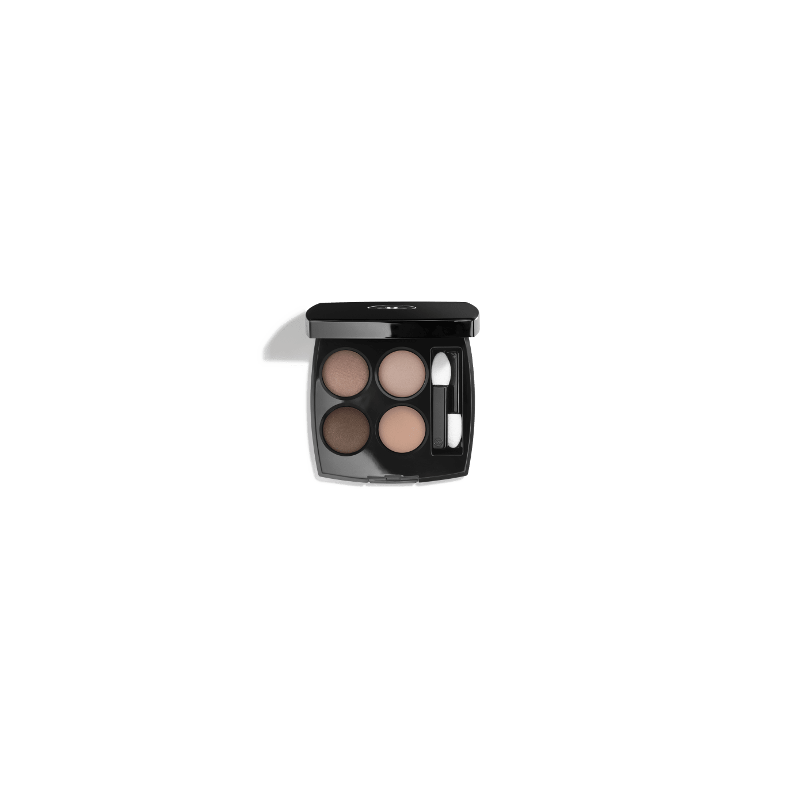
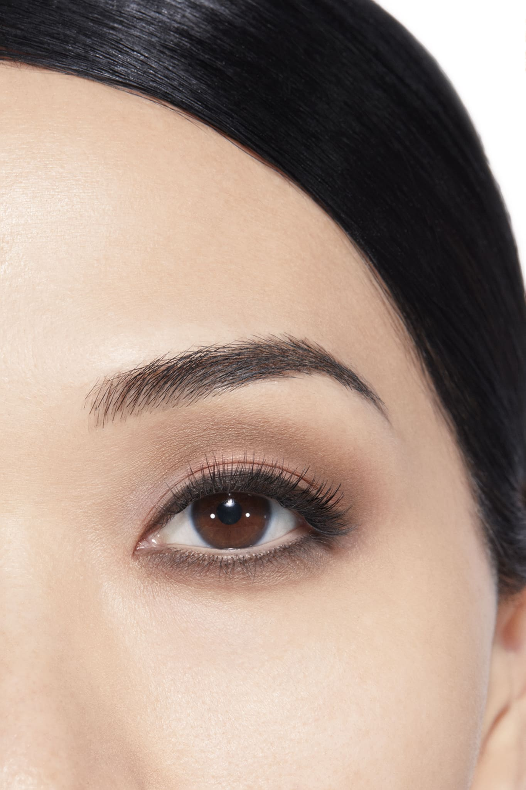
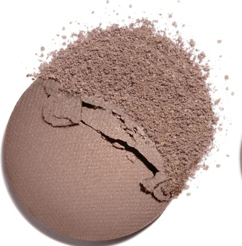
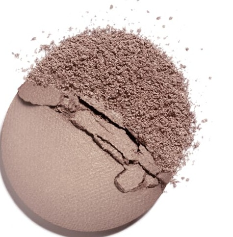
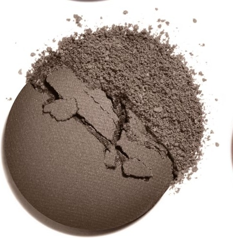
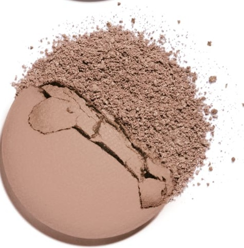

# Chanel Les 4 Ombres 352 ELEMENTAL 元素盘

*发布：常规系列*

[Official Page](https://www.chanel.com/de/make-up/p/164352/les-4-ombres-lidschatten-mit-vielfaeltigen-effekten/)

> 以「元素」为名，调色盘将莫夫焦糖与粉调大地系色彩汇聚成一盘充满质地感的中性妆效。丝滑莫夫焦糖与哑光莫夫米相辅相成，丝绒灰塔普棕作定型，哑光玫瑰米柔化收束——演绎一种经得住细看的精妙平衡，如同自然元素在光线下的安静共存。

> *Elemental distills the essence of understated sophistication into four perfectly balanced tones. Silky mauve-caramel and muted mauve-beige layer over taupe-brown, finished with a soft rosy beige — a palette of quiet, elemental beauty.*

---

## Shade 1: Silky Mauve Caramel — 左上 / Top Left

Use: A silky medium mauve-caramel with a warm satin shimmer. Apply across the lid as the warm foundation shade. Blend into the crease for natural flattering definition.

##### 色号 1：丝滑莫夫焦糖（Silky Mauve Caramel）—— Top Left / 左上
用途：丝滑中性莫夫焦糖，暖调缎光。全眼铺色作暖感底色；晕染于眼窝增添自然立体感。

---

## Shade 2: Matte Mauve Beige — 右上 / Top Right

Use: A muted matte mauve-beige with a soft powdery texture. Apply on the brow bone and inner corner as a neutral highlight. Use all over for a minimal everyday look.

##### 色号 2：哑光莫夫米（Matte Mauve Beige）—— Top Right / 右上
用途：柔和哑光莫夫米，粉雾质地。用于眉骨和眼头作中性高光；全眼铺色打造极简日常感。

---

## Shade 3: Silky Taupe Brown — 左下 / Bottom Left

Use: A medium silky taupe-brown with a warm polished finish. Apply across the crease and outer corner for a sculpted defined look.

##### 色号 3：丝绒塔普棕（Silky Taupe Brown）—— Bottom Left / 左下
用途：中等深度丝绒塔普棕，温暖光泽。用于眼窝和眼尾打造立体感轮廓。

---

## Shade 4: Matte Rosy Beige — 右下 / Bottom Right

Use: A soft matte rosy-beige with a clean finish. Apply on the brow bone as a subtle elegant highlight. Blend over deeper shades to lighten and soften.

##### 色号 4：哑光玫瑰米（Matte Rosy Beige）—— Bottom Right / 右下
用途：柔和哑光玫瑰米，质地纯净。用于眉骨作精致淡雅高光；叠扫于深色之上，柔化提亮。

---

## 搭配建议 / Application Guide

**日常精致妆（Polished Everyday）**
丝滑莫夫焦糖全眼铺色 → 哑光莫夫米提亮眼头与眉骨

**立体烟熏妆（Smoky Definition）**
丝滑莫夫焦糖全眼铺色 → 哑光玫瑰米加深眼窝与眼尾

**全盘叠搭（Full Quad Look）**
丝滑莫夫焦糖打底 → 丝绒塔普棕过渡 → 哑光玫瑰米加深眼尾 → 哑光莫夫米点亮眼头
