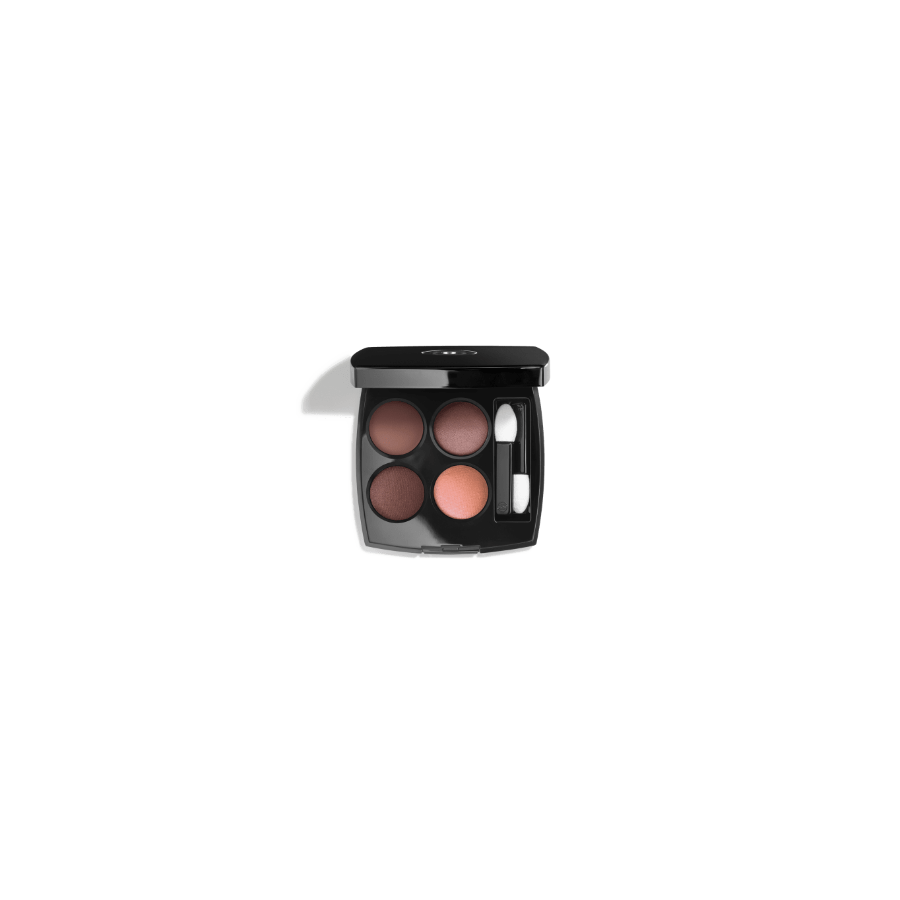
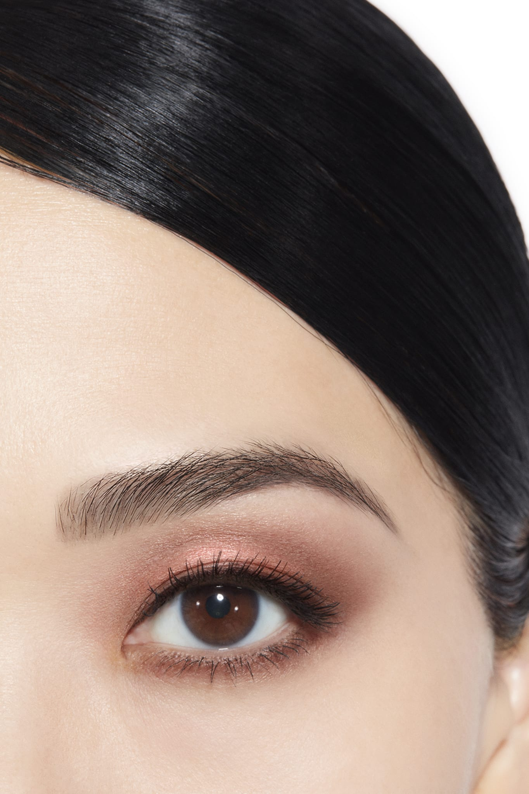
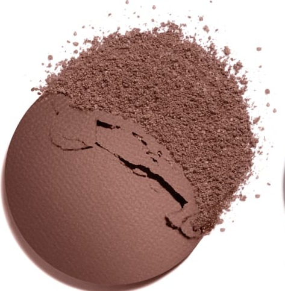
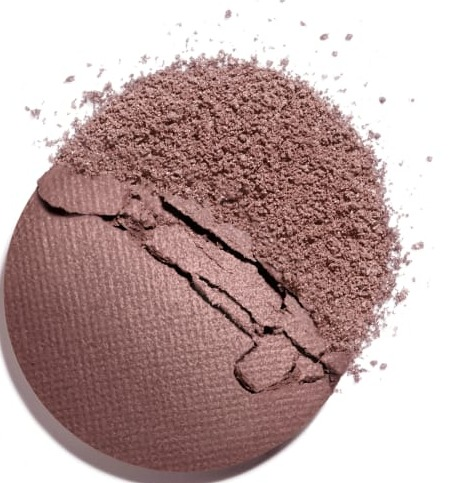
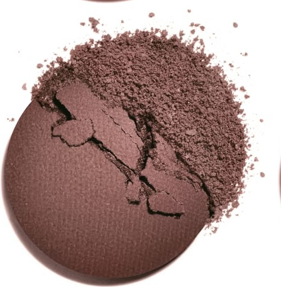
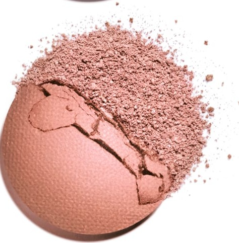

# Chanel Les 4 Ombres 354 WARM MEMORIES 温暖记忆盘

*发布：常规系列*

[Official Page](https://www.chanel.com/de/make-up/p/164354/les-4-ombres-lidschatten-mit-vielfaeltigen-effekten/)

> 以温暖记忆为主题，调色盘将浪漫莫夫玫瑰木色调以柔美层次编织成一种感性而内敛的妆效。哑光莫夫玫瑰木奠定复古底调，丝滑蜜桃玫瑰苞带来温柔焦点，棕玫瑰木加深层次，粉珊瑚以玫瑰光晕轻柔收束——如同一段温存的旧日回忆，在时光中愈加柔软迷人。

> *Warm Memories gathers the soft blush of rosewood, peach, and coral into a nostalgic palette suffused with warmth and romance. From matte mauve-rosewood through silky peach rosebuds and brownish rosewood, finishing with a soft rosy coral shimmer, it evokes precious memories bathed in a warm pink glow.*

---

## Shade 1: Matte Mauve Rosewood — 左上 / Top Left

Use: A warm matte mauve-rosewood with a powdery finish. Apply across the lid as the warm muted base. Blend into the crease as a transitional rosewood shade.

##### 色号 1：哑光莫夫玫瑰木（Matte Mauve Rosewood）—— Top Left / 左上
用途：温暖哑光莫夫玫瑰木，粉雾质地。全眼铺色作暖调雾感底色；晕染于眼窝作玫瑰木过渡。

---

## Shade 2: Silky Peach Rosebud — 右上 / Top Right

Use: A silky light peach with a rosy luminous shimmer. Apply at the inner corner and brow bone as a warm glowing highlight. Press onto the centre of the lid as a fresh focal point.

##### 色号 2：丝滑蜜桃玫瑰苞（Silky Peach Rosebud）—— Top Right / 右上
用途：丝滑浅蜜桃，带玫瑰发光珠光。点于眼头和眉骨作暖感发光高光；按压于眼皮中央作清新浪漫焦点。

---

## Shade 3: Silky Brownish Rosewood — 左下 / Bottom Left

Use: A silky medium brownish-rosewood with a warm polished finish. Apply across the outer lid and crease for warm definition and depth.

##### 色号 3：丝绒棕调玫瑰木（Silky Brownish Rosewood）—— Bottom Left / 左下
用途：丝绒中等棕调玫瑰木，温暖光泽。用于眼尾和眼窝增添暖感定型轮廓。

---

## Shade 4: Soft Rosy Coral with Pink Shimmer — 右下 / Bottom Right

Use: A soft warm rosy-coral with a delicate pink shimmer. Apply at the inner corner and lid centre for a warm rosy glow. Layer over deeper shades as a shimmering topcoat.

##### 色号 4：柔玫珊瑚光（Soft Rosy Coral with Pink Shimmer）—— Bottom Right / 右下
用途：柔和暖调玫瑰珊瑚，带细腻粉色珠光。点于眼头和眼皮中央，打造暖感玫瑰光晕；叠加于深色之上作发光盖彩。

---

## 搭配建议 / Application Guide

**日常精致妆（Polished Everyday）**
哑光莫夫玫瑰木全眼铺色 → 丝滑蜜桃玫瑰苞提亮眼头与眉骨

**立体烟熏妆（Smoky Definition）**
哑光莫夫玫瑰木全眼铺色 → 柔玫珊瑚光加深眼窝与眼尾

**全盘叠搭（Full Quad Look）**
哑光莫夫玫瑰木打底 → 丝绒棕调玫瑰木过渡 → 柔玫珊瑚光加深眼尾 → 丝滑蜜桃玫瑰苞点亮眼头
