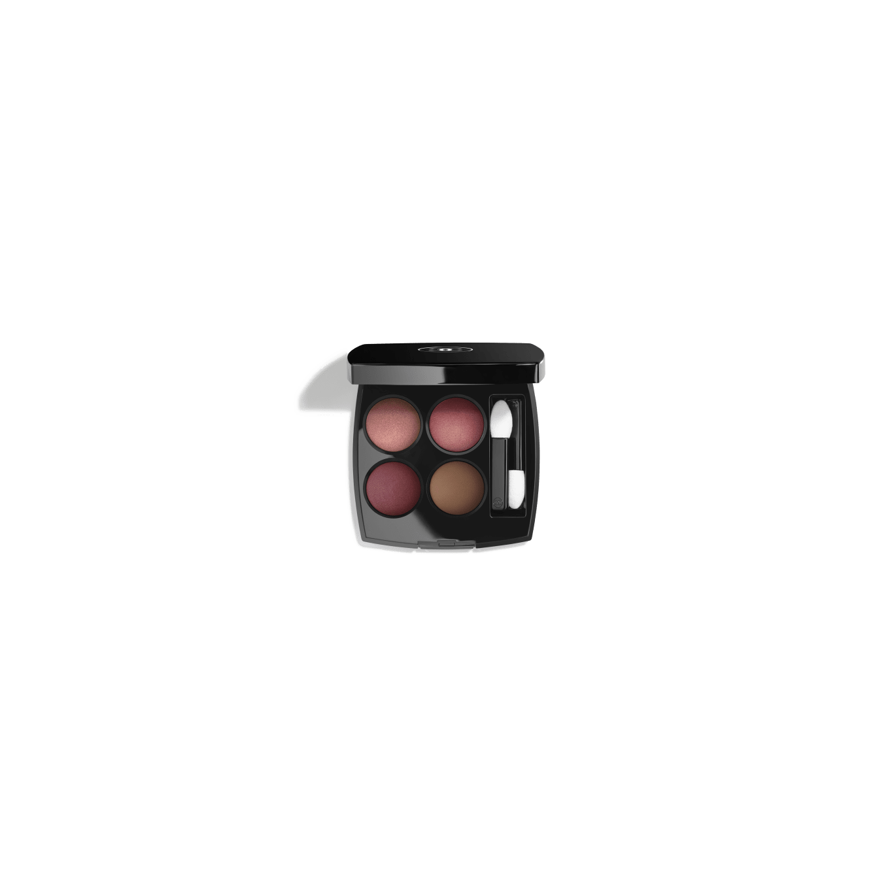
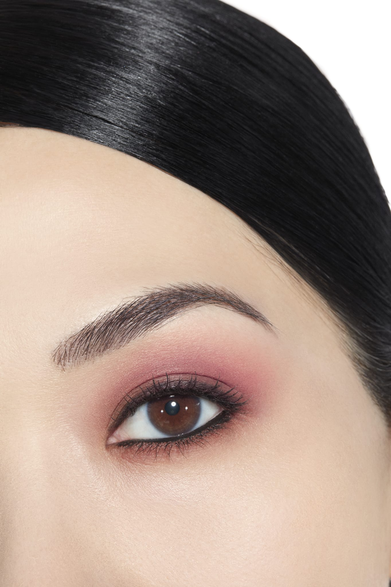
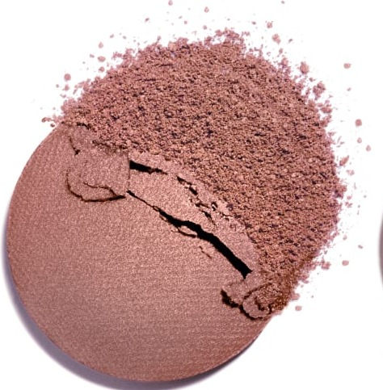
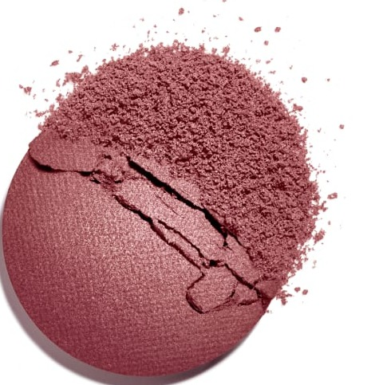
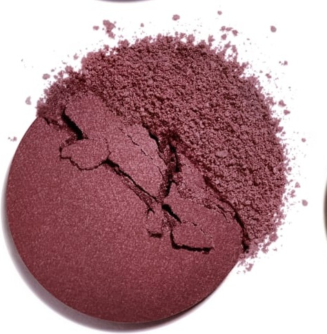
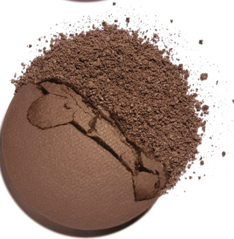

# Chanel Les 4 Ombres 362 CANDEUR ET PROVOCATION 坦率与挑衅盘

*发布：常规系列*

[Official Page](https://www.chanel.com/de/make-up/p/164362/les-4-ombres-lidschatten-mit-vielfaeltigen-effekten/)

> 以「坦率与挑衅」为名，调色盘大胆地将丝滑蜜桃粉、珍珠玫瑰与鲜艳的李紫蓝汇聚一盘。柔嫩蜜桃粉奠定基调，浓郁珍珠玫瑰逐步加深，温暖的红紫蓝如同挑衅的惊叹号，哑光棕低调收束——在甜美与冲突之间，演绎一种属于现代女性的大胆宣言。

> *Candeur et Provocation — Candour and Provocation — this palette balances silky peach-pink softness with a daring reddish plum-blue, creating a palette that moves from innocent to bold. It is an invitation to step beyond one's comfort zone and embrace contrasts.*

---

## Shade 1: Silky Peach Pink — 左上 / Top Left

Use: A silky luminous peach-pink with a delicate shimmer. Apply across the lid as a flattering brightening base. Use at the inner corner as a warm pink highlight.

##### 色号 1：丝滑蜜桃粉（Silky Peach Pink）—— Top Left / 左上
用途：丝滑发光蜜桃粉，带细腻珠光。全眼铺色作提亮底色；点于眼头作暖粉提亮。

---

## Shade 2: Muted Intense Iridescent Rose — 右上 / Top Right

Use: A muted intense rose with a rich pearlescent iridescence. Apply across the lid for a sophisticated romantic statement. Use at the outer corner for bold intense depth.

##### 色号 2：浓郁珍珠玫瑰（Muted Intense Iridescent Rose）—— Top Right / 右上
用途：浓郁带珍珠虹彩的玫瑰色。全眼铺色打造精致浪漫宣言妆；用于眼尾打造大胆深邃感。

---

## Shade 3: Warm Shimmering Plum-Blue — 左下 / Bottom Left

Use: A unique warm shimmering reddish plum-blue — the palette's most provocative shade. Apply across the lid for a dramatic statement. Concentrate at the outer corner for sultry smoky depth.

##### 色号 3：温暖红紫蓝光（Warm Shimmering Plum-Blue）—— Bottom Left / 左下
用途：独特温暖闪光红紫蓝，全盘最大胆挑衅色号。全眼铺色打造戏剧性宣言妆；集中于眼尾打造性感烟熏感。

---

## Shade 4: Matte Brown — 右下 / Bottom Right

Use: A rich deep matte brown. Define the crease and outer corner for grounding depth. Use as a precise liner along the upper lash line.

##### 色号 4：哑光棕（Matte Brown）—— Bottom Right / 右下
用途：浓郁深邃哑光棕。加深眼窝和眼尾作沉稳收束；沿上睫毛根部勾勒精准眼线。

---

## 搭配建议 / Application Guide

**日常精致妆（Polished Everyday）**
丝滑蜜桃粉全眼铺色 → 浓郁珍珠玫瑰提亮眼头与眉骨

**立体烟熏妆（Smoky Definition）**
丝滑蜜桃粉全眼铺色 → 哑光棕加深眼窝与眼尾

**全盘叠搭（Full Quad Look）**
丝滑蜜桃粉打底 → 温暖红紫蓝光过渡 → 哑光棕加深眼尾 → 浓郁珍珠玫瑰点亮眼头
