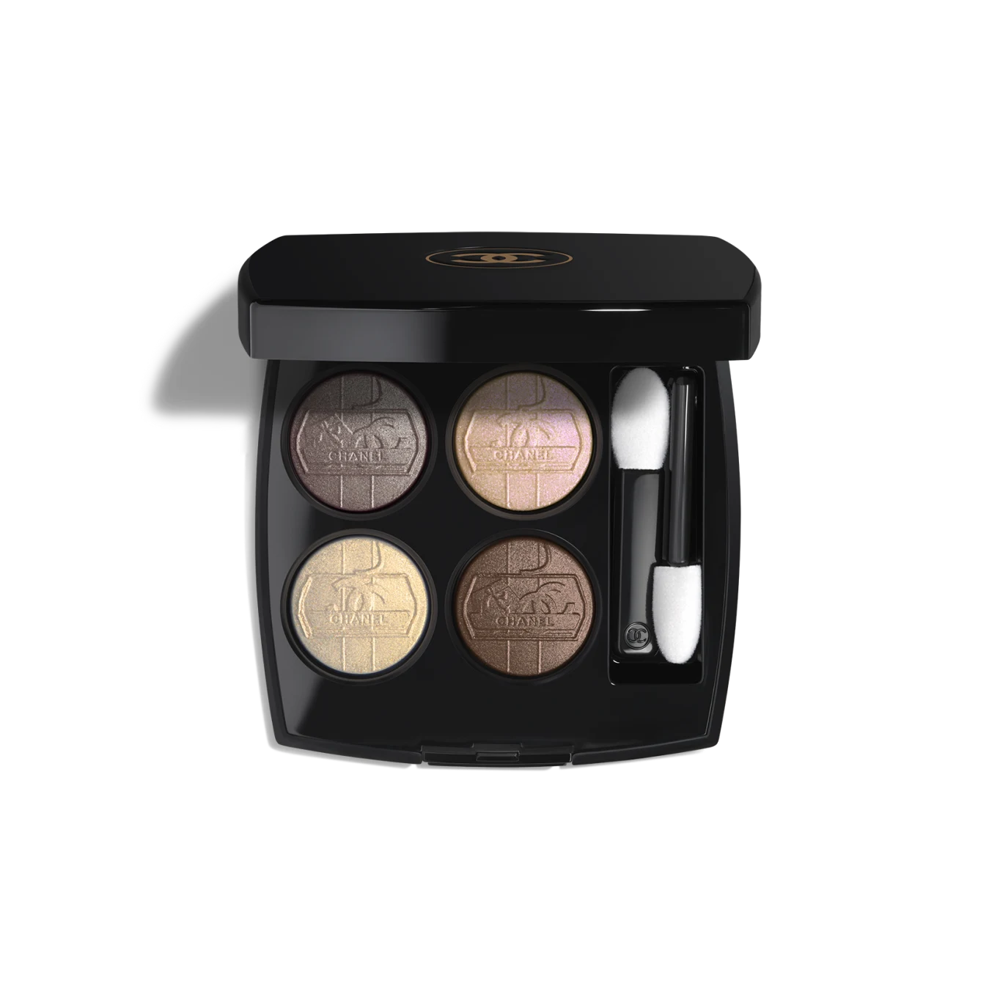
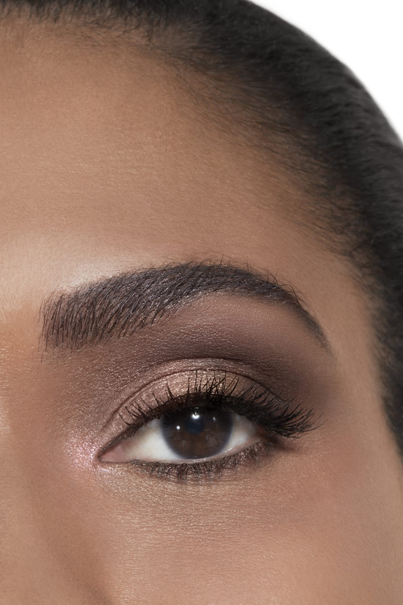
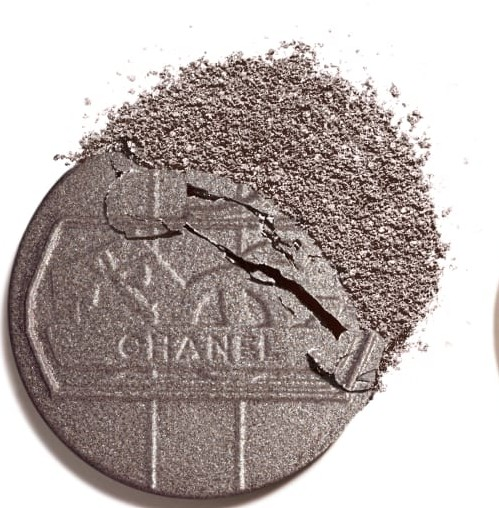
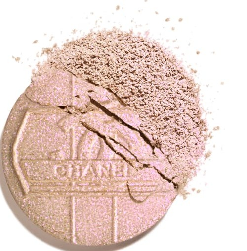
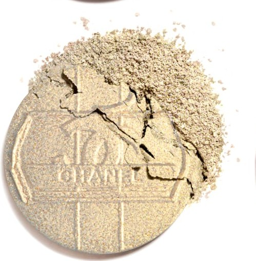
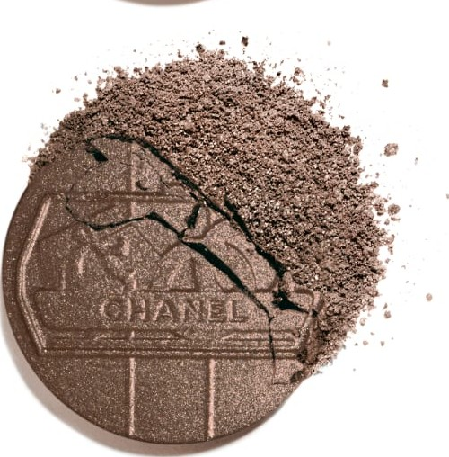

 # Chanel Les 4 Ombres 39 OMBRE D'OR 金光眼影盘

*发布：2026*

[Official Page](https://www.chanel.com/de/make-up/p/151039/les-4-ombres-ombre-dor-lidschatten-mit-vielfaeltigen-effekten/)

> 2026年HOLIDAY假日系列，灵感源自时光仿佛静止的偏远雪山村落。四色眼影盘将入夜时分弥漫于村庄的神秘光影化为色彩：缎光摩卡灰奠定底调，珠光深棕勾勒烟熏，珠光闪金与珠光玫瑰盖彩点亮内眦与眉弓，共同演绎一场冬夜的流光之诗。每格均饰以浮雕冬日村景图案，附针织白绒随行袋。限量发行。

> *For the HOLIDAY 2026 collection, CHANEL's Make-up Creation Studio drew inspiration from the enchanting charm of a remote mountain village where time seems to have stood still. This Les 4 Ombres exclusive creation evokes the magical shimmer of light as night falls over the village — a satin taupe, a glittering gold, a pearlescent deep brown, and a pearlescent rose topcoat. Each shade bears an embossed winter village motif. Limited Edition.*

---

## Shade 1: Satin Taupe — Cool Grey-Taupe Satin (左上 / Top Left)

Use: A cool grey-taupe with a satin shimmer. Apply across the entire lid for a polished, defined everyday look. Blend into the crease as a soft transitional shade for gentle depth. The palette's versatile grounding shade.

##### 色号 1：缎光摩卡灰（Satin Taupe）—— 冷调灰棕缎光色。
用途：全眼铺色，打造精致日常妆效；晕染于眼窝，增添柔和立体层次。为全盘百搭打底色。

---

## Shade 2: Pearlescent Rose Topcoat — Champagne Beige with Pink Iridescence (右上 / Top Right)

Use: A luminous champagne-beige with a pearlescent pink iridescence. Apply at the inner corner and brow bone for a brightening, wide-eye effect. Dab at the centre of the lid for a radiant focal point. Layer over any shade as a shimmering topcoat.

##### 色号 2：珠光玫瑰盖彩（Rose Topcoat）—— 香槟底珠光玫瑰虹彩色。
用途：点于眼头和眉骨提亮放大眼神；按压于眼皮中央作流光焦点；叠加于任意色号之上，增添珠光盖彩效果。

---

## Shade 3: Pearlescent Gold — Warm Sage-Gold Glitter (左下 / Bottom Left)

Use: A warm sage-gold with a glittering pearlescent shimmer. Apply at the inner corner, under the brow arch, or at the centre of the lid as a highlighter. Use all over the lid for a gilded, festive look.

##### 色号 3：珠光闪金（Pearlescent Gold）—— 暖调珠光炫金色。
用途：点于眼头、眉弓下方或眼皮中央，作高光提亮；全眼铺色打造节日感镀金妆效。

---

## Shade 4: Pearlescent Deep Brown — Rich Warm Brown Pearlescent (右下 / Bottom Right)

Use: A rich, deep warm brown with a pearlescent shimmer. Apply across the entire lid and blend outward for a smoky effect. Deepen the outer corner and crease for dramatic dimension. Apply along the lower lash line for an intense, defining finish.

##### 色号 4：珠光深棕（Deep Brown）—— 深邃珠光暖棕色。
用途：全眼铺色后向外晕染，打造烟熏感；叠加于眼尾和眼窝，增强立体轮廓；沿下睫毛根部晕扫，打造强烈深邃感。

---

## 搭配建议 / Application Guide

**日常精致妆（Defined Everyday Look）**
缎光摩卡灰铺满全眼 → 珠光闪金点亮眼头与眉骨

**烟熏妆（Smoky Eye）**
珠光深棕铺满全眼后向外晕染 → 叠加于眼窝与眼尾

**全盘叠搭（Full Quad Look）**
缎光摩卡灰打底 → 珠光深棕加深眼尾 → 珠光闪金提亮眼头 → 珠光玫瑰盖彩叠加盖彩
