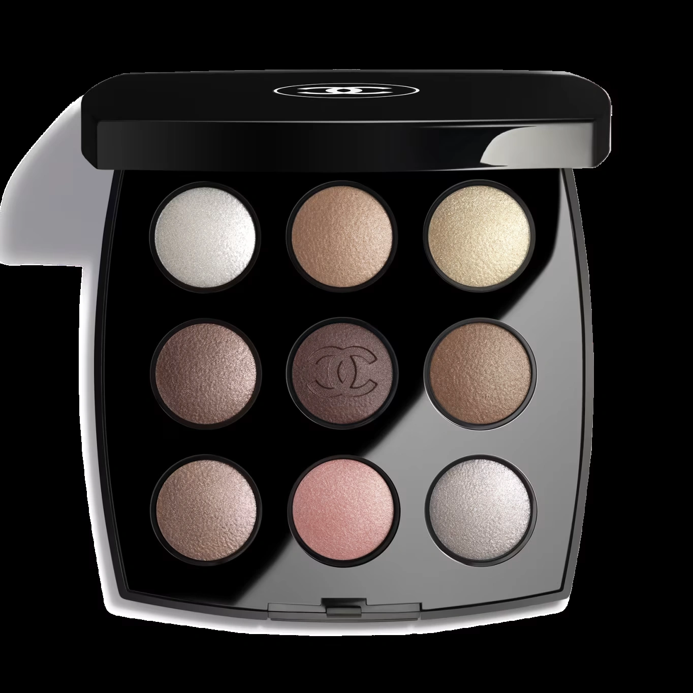
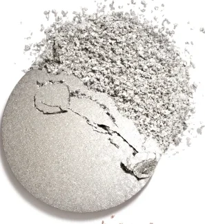
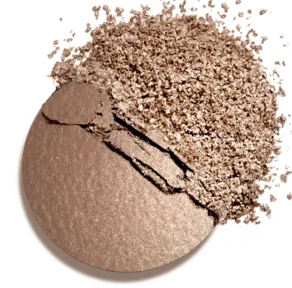
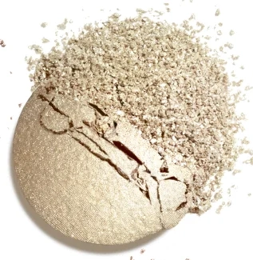
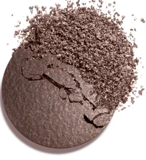
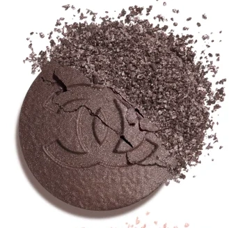
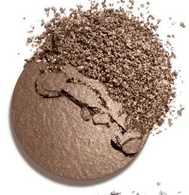
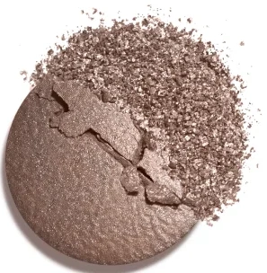
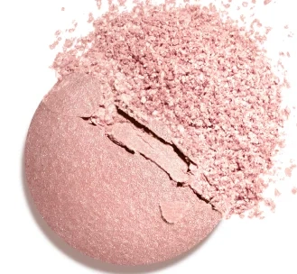
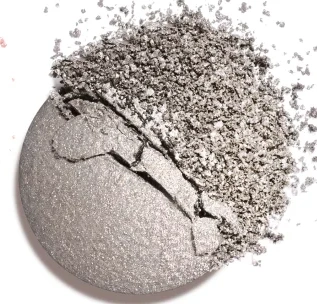

# Chanel Les 9 Ombres THE NEW SMOKY 九色限量烟熏眼影盘

*发布：2026*

[Official Page](https://www.chanel.com/de/make-up/p/151587/les-9-ombres-hochintensiver-lidschatten-mit-vielfaeltigen-effekten/)

> 以COCO MADEMOISELLE的大胆精神为灵感，CHANEL彩妆创意工作室打造限量烟熏眼影盘THE NEW SMOKY。五色高显色眼影（哑光与微闪质地）构成丰富底调，四色珠光盖彩画龙点睛，无论轻盈日常还是极致深邃，九格之间藏有无限可能。

> *Inspired by the boldness of COCO MADEMOISELLE, CHANEL's Make-up Creation Studio presents THE NEW SMOKY — a limited-edition palette redefining the modern smoky eye. Five high-intensity shadows in matte and shimmer finishes pair with four pearlescent topcoats, offering looks from effortlessly natural to dramatically intense.*

---

## Shade 1: Pearl White Topcoat — Shimmering Pearl White (左上 / Top Left)

Use: A shimmering, light-diffusing pearl white topcoat. Dab at the inner corner or brow bone to open and brighten the eye. Layer over any shadow to add a luminous, glass-like finish.

##### 色号 1：珠光亮白盖彩（Pearl White Topcoat）—— 柔光珠白盖彩色。
用途：点于眼头或眉骨提亮放大眼神；叠加于任意色号之上，增添如玻璃般的通透光泽感。

---

## Shade 2: Beige — Warm Light Beige (顶中 / Top Center)

Use: A warm, buildable light beige with a soft satin sheen. Apply across the entire lid to create a polished, luminous base. Use alone for a refined, everyday look.

##### 色号 2：暖调浅米色（Beige）—— 暖米缎光色。
用途：全眼铺色，打造精致光感底妆；单独使用即可完成低调优雅日常妆效。

---

## Shade 3: Platinum Topcoat — Pearlescent Platinum (右上 / Top Right)

Use: A warm champagne-toned pearlescent platinum topcoat. Apply at the inner corner and centre lid for a wide-open, radiant highlight. Layer over deeper shades to add a sophisticated metallic shimmer.

##### 色号 3：珠光铂金盖彩（Platinum Topcoat）—— 香槟铂金珠光盖彩色。
用途：点于眼头与眼皮中央，打造开阔明亮妆效；叠加于深色底影之上，增添高级金属光泽。

---

## Shade 4: Taupe Lilac — Warm Taupe with Muted Lilac Depth (左中 / Middle Left)

Use: A warm taupe with a subtle muted lilac undertone. Apply in the crease to add depth and define the eye contour. Blend outward for a soft, modelled smoky effect.

##### 色号 4：玫棕雾紫（Taupe Lilac）—— 暖棕带哑紫调过渡色。
用途：晕染于眼窝，增添立体轮廓深度；向外晕开，打造柔雾轮廓感。

---

## Shade 5: Red Brown — Deep Smoky Red-Brown (正中 / Center)

Use: A deep, warm red-brown for a bold, smouldering effect. Apply across the lid and blend into the crease for an intense smoky eye. Deepen the outer corner for maximum drama.

##### 色号 5：深邃红棕（Red Brown）—— 浓郁暖调红棕烟熏色。
用途：全眼铺色后向外晕染，打造强烈烟熏感；叠加于眼窝与眼尾，营造最大深邃度。

---

## Shade 6: Medium Beige — Soft Blending Beige (右中 / Middle Right)

Use: A versatile medium beige for seamless blending. Sweep over the transition zone to soften and diffuse deeper shades. Use with a fluffy blending brush for an effortless, hazy smoky effect.

##### 色号 6：中调暖米（Medium Beige）—— 百搭中调融合色。
用途：在过渡区大范围晕扫，自然衔接深浅色号；配合蓬松刷头轻扫，打造无痕雾感烟熏效果。

---

## Shade 7: Powdery Pink Topcoat — Pearlescent Powdery Pink (左下 / Bottom Left)

Use: A soft, dusty pearlescent pink topcoat. Apply at the inner corner or centre lid for a delicate, feminine glow. Layer over the rose base for an intensified, romantic shimmer.

##### 色号 7：珠光玫粉盖彩（Powdery Pink Topcoat）—— 柔雾珠光玫瑰粉盖彩色。
用途：点于眼头或眼皮中央，增添柔美少女光感；叠加于玫瑰底色之上，强化浪漫闪烁质感。

---

## Shade 8: Rose — Soft Warm Rose (底中 / Bottom Center)

Use: A soft, warm rose with a sheer satin finish. Apply across the entire lid for a rosy, fresh everyday look. Blend into the lower lash line for a subtle, flattering finish.

##### 色号 8：柔雾玫瑰粉（Rose）—— 温柔暖调玫瑰粉缎光色。
用途：全眼铺色，打造清新玫瑰系日常妆；晕扫于下睫毛根部，增添自然柔美感。

---

## Shade 9: Silver Violet Topcoat — Pearlescent Silvery Violet (右下 / Bottom Right)

Use: A cool, silvery-violet pearlescent topcoat. Apply at the inner corner or along the lower lash line for an edgy, modern accent. Layer over darker shades for a mysterious, dimensional finish.

##### 色号 9：珠光银紫盖彩（Silver Violet Topcoat）—— 冷调银紫珠光盖彩色。
用途：点于眼头或下眼睑，增添先锋现代感；叠加于深色底影，打造神秘多维烟熏质感。

---

## 搭配建议 / Application Guide

**日常精致妆（Polished Natural Look）**
浅米色（2）铺满全眼 → 珠光铂金（3）或珠光亮白（1）点亮眼头与眉骨

**柔雾烟熏妆（Soft Smoky Eye）**
浅米色（2）或玫瑰粉（8）打底 → 玫棕雾紫（4）晕染眼窝 → 中调暖米（6）扩散边界

**极致烟熏妆（Intense Smoky Eye）**
深邃红棕（5）全眼铺色 → 玫棕雾紫（4）加深眼窝 → 中调暖米（6）扩散边界 → 珠光盖彩点睛
