# Danessa Myricks Beauty 光绘系列横向对比

比较范围：
- **LW VI** — [光绘第六章·自由盘 Lightwork VI Freedom](./lightwork-vi-freedom/README.md)（18色，2024）
- **LW VII** — [光绘第七章·自由盘 Lightwork VII Freedom](./lightwork-vii-freedom/README.md)（18色，2024）
- **LW VIII** — [光绘第八章·自由盘 Lightwork VIII Freedom](./lightwork-viii-freedom/README.md)（18色，2026）
- **Pastel** — [梦幻迷你自由盘 Pastel Dream Mini Freedom](./pastel-dreams-freedom-mini/README.md)（6色，2025）
- **EM** — [日常魔法迷你自由盘 Everyday Magic Mini Freedom](./everyday-magic-mini-freedom/README.md)（6色，2025）

> 注：LW VI 第一排色号（第1-6格）照片截自半被盖遮挡的盘面，颜色参考仅供大致辨识，参见正盘图。

---

## 一、近乎相同 Near-Identical

### 日常魔法迷你 = 光绘七章精选六色

Everyday Magic Mini 的六个色号是从 Lightwork VII 中直接提取的同款色号，切片来源相同。

| LW VII | Everyday Magic |
|:---:|:---:|
| 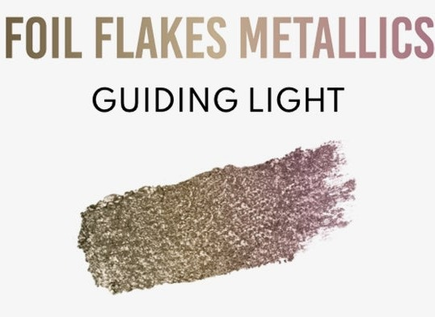 |  |
| **07** Guiding Light | **EM 01** Guiding Light |
| 暖金橄榄色，箔片金属色 | 同款 |

| LW VII | Everyday Magic |
|:---:|:---:|
|  | 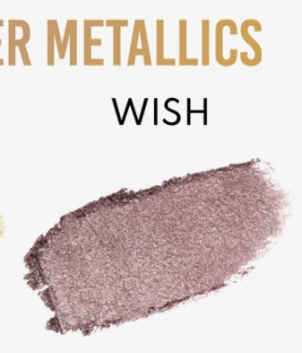 |
| **04** Wish | **EM 02** Wish |
| 柔和玫粉色，弹性透光金属色 | 同款 |

| LW VII | Everyday Magic |
|:---:|:---:|
|  | 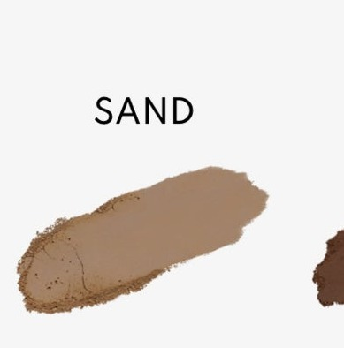 |
| **07** Sand | **EM 03** Sand |
| 暖驼裸色，丝柔哑光 | 同款 |

| LW VII | Everyday Magic |
|:---:|:---:|
| 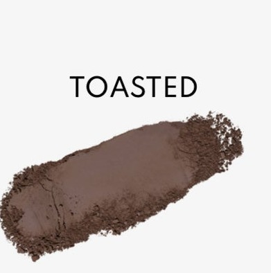 |  |
| **15** Toasted | **EM 04** Toasted |
| 暖调中棕色，精准色哑光 | 同款 |

| LW VII | Everyday Magic |
|:---:|:---:|
|  | 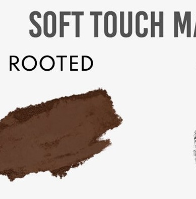 |
| **13** Rooted | **EM 05** Rooted |
| 深暖棕色，丝柔哑光 | 同款 |

| LW VII | Everyday Magic |
|:---:|:---:|
| 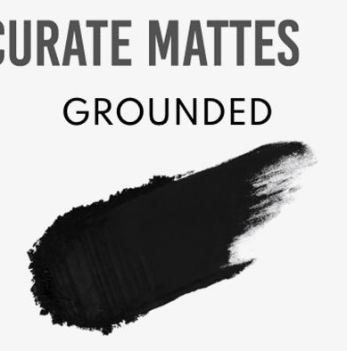 |  |
| **17** Grounded | **EM 06** Grounded |
| 正黑色，精准色哑光 | 同款 |

---

### 深暖棕哑光 Deep Warm Brown Matte

LW VII Rooted 与 LW VIII Bedrock 视觉几乎一致——均为深暖棕色哑光，肉眼难以区分。

| LW VII | LW VIII |
|:---:|:---:|
|  | 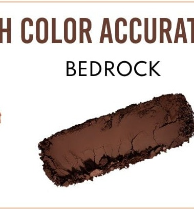 |
| **13** Rooted | **14** Bedrock |
| 深暖棕，丝柔哑光 | 深暖棕，精准色哑光 |

---

## 二、同系相似 Similar Family

### 2.1 暖中性哑光渐层 Warm Neutral Mattes

四个浅至深的暖棕/驼哑光，分布于三个盘中，搭配可形成完整渐层。

| 色系位置 | LW VII | LW VIII | Pastel |
|:---:|:---:|:---:|:---:|
| 浅 Light |  | 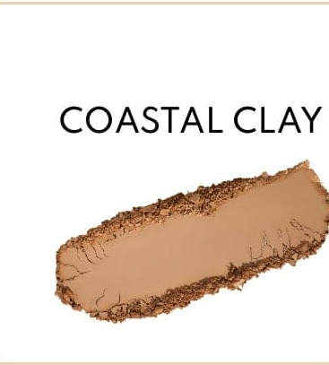 | — |
| | **07** Sand（暖驼裸色） | **02** Coastal Clay（暖蜜桃赭石色，偏暖/橙） | |
| 中浅 Med-light | — | 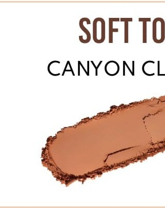 |  |
| | | **16** Canyon Clay（暖赭石色，更橙） | **03** Moondust（暖玫棕裸色） |
| 中深 Med-dark |  | 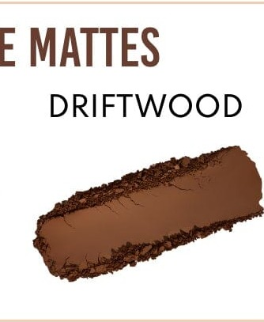 | — |
| | **15** Toasted（暖中棕，偏冷） | **10** Driftwood（暖焦糖棕，偏深偏暖） | |

> Sand/Coastal Clay 同为浅暖哑光，但 Coastal Clay 更偏橙/蜜桃；Toasted 与 Driftwood 深度接近但 Driftwood 稍深稍暖；Canyon Clay 与 Toasted 同为中深棕，但 Canyon Clay 明显更偏赭石橙调。

### 2.2 暖金/铜金属色 Warm Gold & Copper Metallics

| LW VI | LW VI | LW VII | LW VII | LW VIII | LW VIII | Pastel |
|:---:|:---:|:---:|:---:|:---:|:---:|:---:|
|  |  |  | 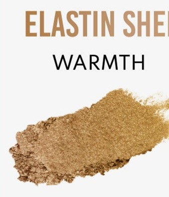 | 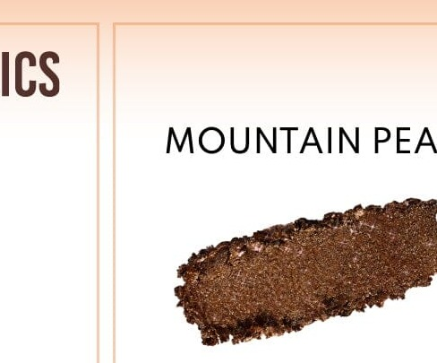 | 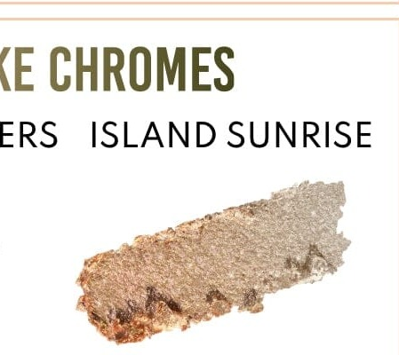 |  |
| **02** Rise | **14** Nirvana | **09** Guiding Light | **02** Warmth | **15** Mountain Peak | **11** Island Sunrise | **06** Gilded Dream |
| 亮金黄，箔片 | 暖铜橙，金属色 | 暖金橄榄，箔片（移色） | 暖金铜，弹性透光 | 深琥珀金，箔片 | 蜜桃金，箔片铬光 | 暖金，箔片 |

> Rise 最黄最亮；Nirvana 偏铜橙；Guiding Light 有橄榄移色；Warmth 最透薄；Mountain Peak 最深暗琥珀；Island Sunrise 偏蜜桃；Gilded Dream 居中暖金。

### 2.3 橄榄绿金属色 Olive Green Metallics

| LW VII | LW VIII |
|:---:|:---:|
| 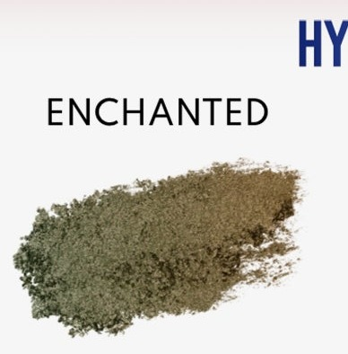 | 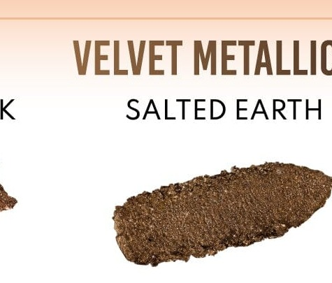 |
| **08** Enchanted | **05** Salted Earth |
| 橄榄卡其绿，超闪金属色（偏冷/灰） | 深橄榄绿，丝绒金属色（偏暖/铜金） |

> LW VI 08 Gleaming 为鲜亮草绿，与两者明显不同（见独有色号区）。

### 2.4 电光蓝金属色 Electric Blue Metallics

| LW VI | LW VII |
|:---:|:---:|
|  | 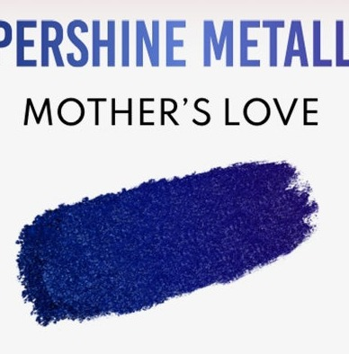 |
| **15** Unbound | **12** Mother's Love |
| 电光钴蓝铬金属色 | 电光钴蓝，超闪金属色 |

> 均为鲜亮电光钴蓝，整体色调相近；Mother's Love 显色更强烈/闪耀，Unbound 在盘面显稍深（海军蓝调）。不同系列产品，实际应用效果可能有差异。

### 2.5 深靛蓝紫金属色 Deep Indigo-Violet Metallics

| LW VI | LW VIII |
|:---:|:---:|
|  | 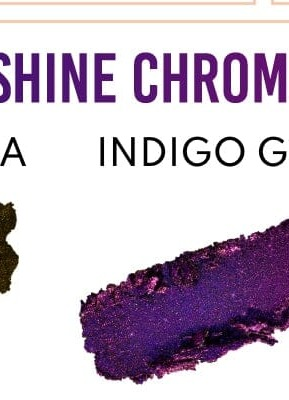 |
| **16** Empowered | **17** Indigo Glow |
| 深靛蓝紫金属色 | 电光深紫，超闪铬金属色 |

> 同为深靛紫家族；Indigo Glow 更鲜艳/电光，Empowered 在盘面偏沉稳蓝紫。

### 2.6 深酒红/暗紫金属色 Dark Wine/Plum Metallics

| LW VII | LW VIII |
|:---:|:---:|
| 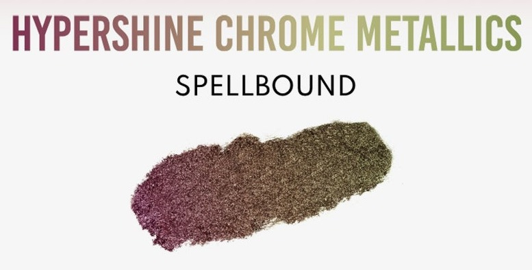 | 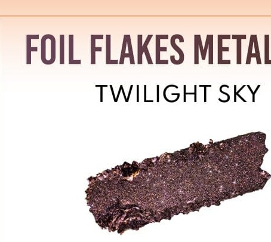 |
| **10** Spellbound | **12** Twilight Sky |
| 深勃艮第酒红铬金属（变色：酒红→橄榄） | 深酒红李子色，箔片金属色 |

> 均为深酒红/暗紫，但 Spellbound 为双变色（铬光），Twilight Sky 为静态深李子箔片，风格差异显著。

### 2.7 冷调银灰金属色 Cool Silver-Grey Metallics

| LW VI | LW VII |
|:---:|:---:|
|  | 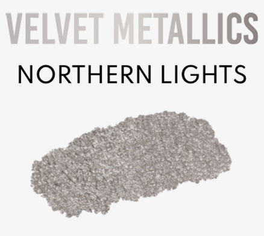 |
| **05** Serenity | **05** Northern Lights |
| 淡香槟银灰色（半透明叠涂） | 冷调银灰，丝绒金属色（更饱和） |

> 同为冷调银灰系；Serenity 更透薄，Northern Lights 更饱和浓郁。

### 2.8 浅玫粉透光金属色 Sheer Pink/Rose Metallics

| LW VI | LW VII |
|:---:|:---:|
|  |  |
| **06** Dance | **04** Wish |
| 极透薄淡粉（半遮挡） | 柔和玫粉，弹性透光金属色 |

> 均为浅粉透光金属色；Wish 显色度更高更饱和（可从图标清晰辨认），Dance 在盘面因盖遮颜色参考有限。

### 2.9 珊瑚橙粉金属色 Coral-Orange Pink Metallics

| LW VI | LW VIII |
|:---:|:---:|
|  | 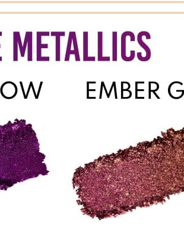 |
| **11** Joy | **13** Ember Glow |
| 暖珊瑚橙粉金属色 | 暖粉红色，超闪铬金属色 |

> 均为暖调粉橙家族；Ember Glow 偏粉红/铜玫，Joy 在盘面呈珊瑚玫粉，色温相近。

### 2.10 极浅透明叠涂色 Sheer Near-Invisible Toppers

| LW VI | LW VIII |
|:---:|:---:|
|  | 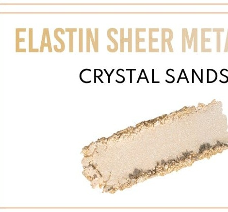 |
| **03** Release | **04** Crystal Sands |
| 透薄暖金铬光叠涂色 | 极透薄暖奶白色，弹性透光金属色 |

> 均为极透薄近乎透明的叠涂提亮色，叠加效果相似；Release 有暖金调，Crystal Sands 更中性奶白。

---

## 三、各盘独有 Unique to Each Palette

### LW VI 光绘六章独有

LW VI 以完整彩虹光谱为主题，是唯一拥有鲜亮蓝绿/蓝紫/洋红全谱色的盘。

| 色号 | 切片 | 特色 |
|:---:|:---:|---|
| **04** Free |  | 极透薄珍珠白，弹性透光金属色（半遮挡） |
| **07** Higher |  | 暖橙→草绿移变多变色（彩虹叠涂色） |
| **08** Gleaming |  | 鲜亮草绿金属色（与系列中橄榄绿截然不同） |
| **09** Fluid |  | 电光蓝绿铬金属色 |
| **10** Euphoria |  | 矢车菊蓝紫金属色 |
| **12** Rejoice |  | 鲜玫粉金属色 |
| **17** Love |  | 鲜亮玫紫红铬金属色（最深最艳洋红） |
| **18** Bliss |  | 深浓紫金属色 |

> 另：**01** Proud（淡薄荷灰叠涂）、**02** Rise（亮金黄）、**11** Joy（珊瑚橙粉）、**13** Unapologetic（暖赭石金属）、**14** Nirvana（暖铜金）、**15** Unbound（电光蓝）、**16** Empowered（深靛紫）仅在同系相似表中有近似色，不存在真正重复。

### LW VII 光绘七章独有

| 色号 | 切片 | 特色 |
|:---:|:---:|---|
| **01** Golden Child | 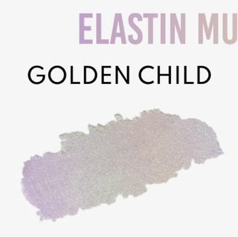 | 淡薰衣草紫，弹性多变色（移彩） |
| **02** Warmth |  | 暖金铜，弹性透光金属色（最透薄暖金） |
| **03** Love Potion | 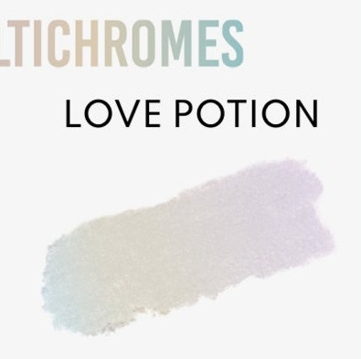 | 珠光白，弹性多变色（幻彩） |
| **06** Dreamer | 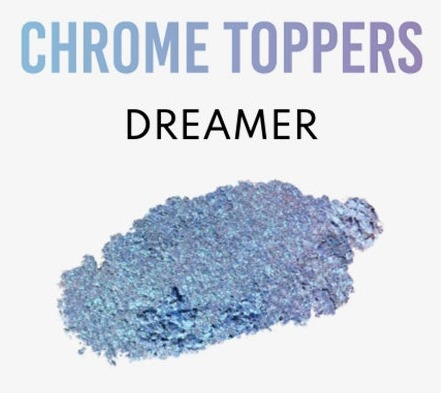 | 矢车菊蓝银，铬光叠涂色 |
| **10** Spellbound |  | 深勃艮第酒红，超闪铬金属色（双变色） |
| **11** Magic Moon | 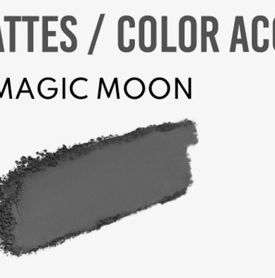 | 炭灰色，精准色哑光 |
| **14** Mother Earth | 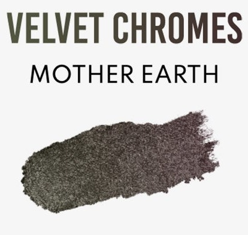 | 深铜橄榄，丝绒铬光色（深暗橄榄） |
| **16** Open Heart | 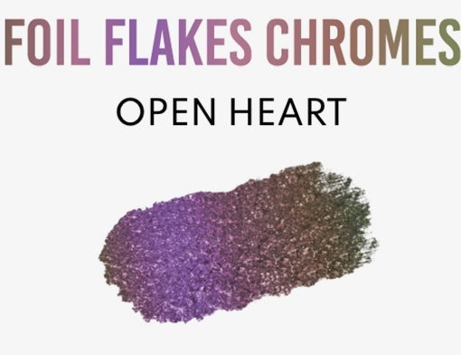 | 紫罗兰色，箔片铬光色（变色：紫→铜） |
| **18** Star Power | 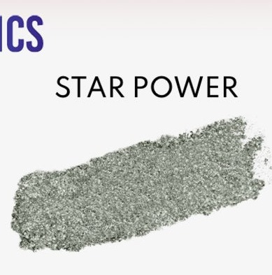 | 铂银色，超闪金属色 |

### LW VIII 光绘八章独有

| 色号 | 切片 | 特色 |
|:---:|:---:|---|
| **01** Horizon Kiss | 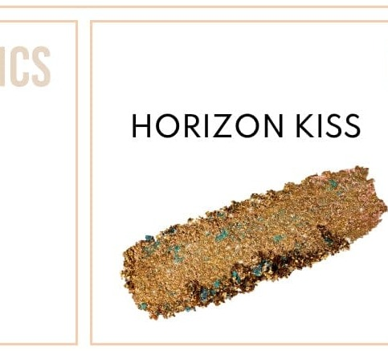 | 暖金铜→青绿移变，大理石多变色 |
| **03** Sparkling Glaciers | 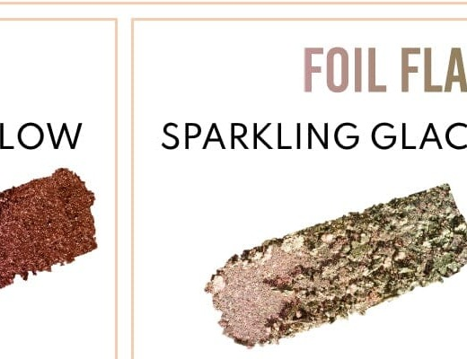 | 淡香槟底+青绿箔片，箔片铬光色 |
| **07** Crystal Flame | 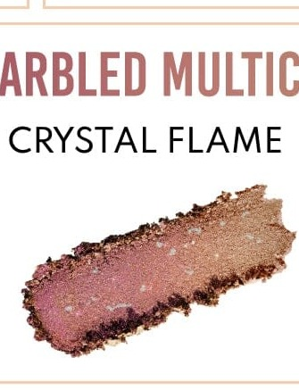 | 玫瑰粉→银白移变，大理石多变色 |
| **08** Molten Magma | 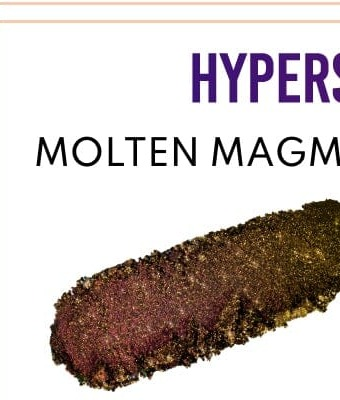 | 极深暗色，超闪铬金属色（极强变色） |
| **09** Crystal Sky Lagoon | 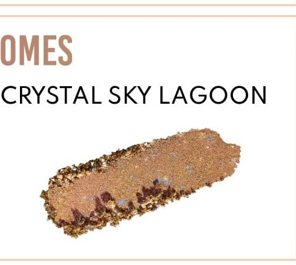 | 暖金底+大颗粒青蓝片，大理石多变色 |
| **12** Twilight Sky |  | 深酒红李子色，箔片金属色 |
| **17** Indigo Glow |  | 电光深紫，超闪铬金属色 |
| **18** Night Rock | 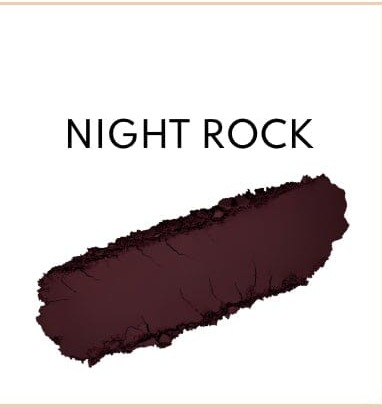 | 深暗李子棕，丝柔精准色哑光 |

### 梦幻迷你独有

| 色号 | 切片 | 特色 |
|:---:|:---:|---|
| **01** Aqua Dream |  | 亮薄荷绿，精准色哑光（全系唯一薄荷绿哑光） |
| **02** Pink Mirage |  | 柔和兰花紫，精准色哑光（全系唯一紫调哑光） |
| **04** Galaxy Crush |  | 紫→绿移变箔片金属色（全系唯一紫绿变色） |
| **05** Pixie Quartz |  | 粉→金移变箔片金属色（全系唯一粉金移色） |

---

## 四、速查总表 Quick Reference

| 色彩家族 | LW VI | LW VII | LW VIII | Pastel | EM |
|---|---|---|---|---|---|
| **极浅透明叠涂** | 01 Proud · 03 Release · 04 Free | 03 Love Potion | 04 Crystal Sands | — | — |
| **冷调银灰** | 05 Serenity | **05 Northern Lights** | — | — | — |
| **浅玫粉透光** | 06 Dance | **04 Wish** | — | — | **EM 02 Wish** |
| **淡薰衣草多变色** | — | 01 Golden Child | — | — | — |
| **亮金黄** | 02 Rise | — | — | — | — |
| **暖金橄榄** | — | **09 Guiding Light** | — | — | **EM 01 Guiding Light** |
| **暖金（综合）** | — | 02 Warmth | 11 Island Sunrise | 06 Gilded Dream | — |
| **深琥珀金** | — | — | 15 Mountain Peak | — | — |
| **暖铜橙** | 14 Nirvana | — | — | — | — |
| **暖橙多变色** | 07 Higher | — | — | — | — |
| **橄榄绿/深橄榄** | — | 08 Enchanted | 05 Salted Earth | — | — |
| **鲜亮草绿** | 08 Gleaming | — | — | — | — |
| **电光蓝绿** | 09 Fluid | — | — | — | — |
| **矢车菊蓝紫** | 10 Euphoria | 06 Dreamer | — | — | — |
| **电光钴蓝** | 15 Unbound | 12 Mother's Love | — | — | — |
| **深靛蓝紫** | 16 Empowered | — | 17 Indigo Glow | — | — |
| **深酒红/暗紫** | — | 10 Spellbound | 12 Twilight Sky | — | — |
| **深暗铬光** | — | — | 08 Molten Magma | — | — |
| **珊瑚橙粉** | 11 Joy | — | 13 Ember Glow | — | — |
| **鲜玫粉** | 12 Rejoice | — | — | — | — |
| **鲜亮洋红** | 17 Love | — | — | — | — |
| **深浓紫** | 18 Bliss | — | — | — | — |
| **暖金铜多变色** | — | — | 01 Horizon Kiss | — | — |
| **香槟+蓝绿箔片** | — | — | 03 Sparkling Glaciers | — | — |
| **玫粉+银多变色** | — | — | 07 Crystal Flame | — | — |
| **暖金+青蓝多变色** | — | — | 09 Crystal Sky Lagoon | — | — |
| **暗李子箔片** | — | — | — | — | — |
| **紫→绿移变** | — | — | — | 04 Galaxy Crush | — |
| **粉→金移变** | — | — | — | 05 Pixie Quartz | — |
| **薄荷绿哑光** | — | — | — | 01 Aqua Dream | — |
| **兰花紫哑光** | — | — | — | 02 Pink Mirage | — |
| **浅暖哑光** | — | 07 Sand | 02 Coastal Clay | — | **EM 03 Sand** |
| **暖棕中性哑光** | — | — | 16 Canyon Clay | 03 Moondust | — |
| **暖中深棕哑光** | — | 15 Toasted | 10 Driftwood | — | **EM 04 Toasted** |
| **深暖棕哑光** | — | **13 Rooted ≈** | **14 Bedrock ≈** | — | **EM 05 Rooted** |
| **炭灰哑光** | — | 11 Magic Moon | — | — | — |
| **真黑哑光** | — | 17 Grounded | — | — | **EM 06 Grounded** |
| **深暗李子棕哑光** | — | — | 18 Night Rock | — | — |
| **铂银超闪** | — | 18 Star Power | — | — | — |
| **深铜橄榄丝绒铬** | — | 14 Mother Earth | — | — | — |
| **紫→铜铬光** | — | 16 Open Heart | — | — | — |

> **≈** 表示视觉近乎相同。**粗体**表示该家族的代表色 / 原始来源。
