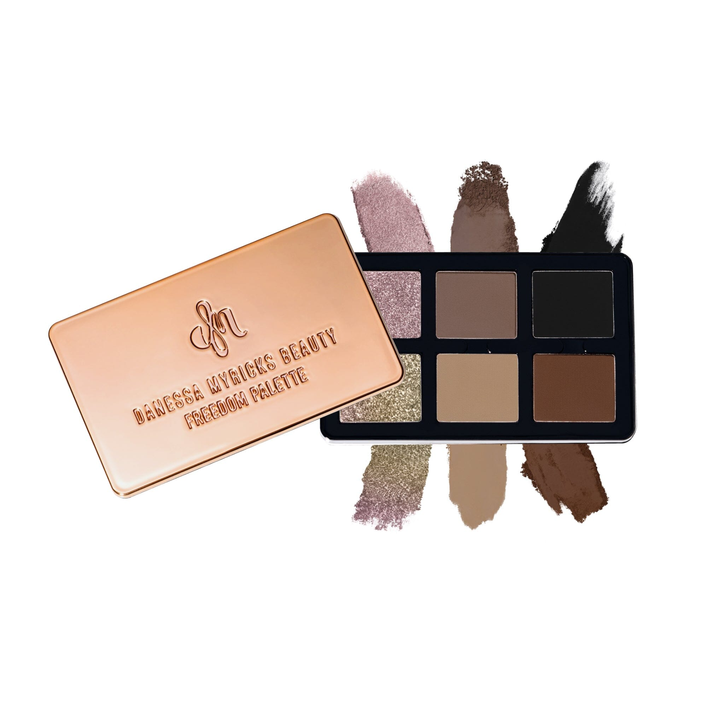
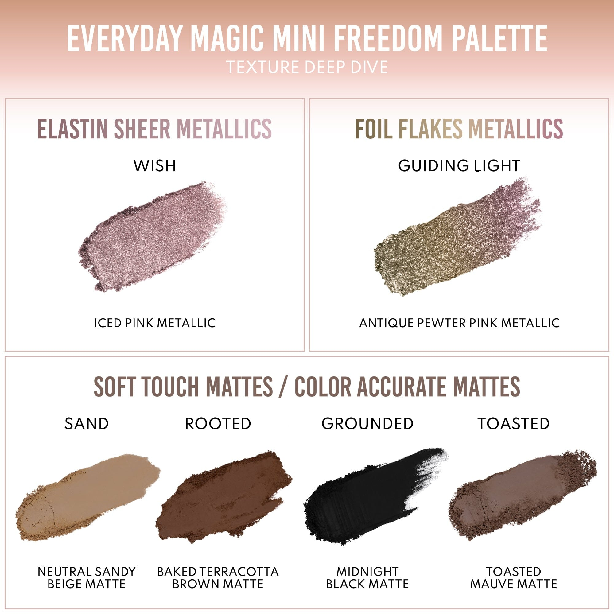

# Danessa Myricks Beauty 6色 日常魔法迷你自由盘 Everyday Magic Mini Freedom Palette
*发布：2025*

> Everyday Magic Mini Freedom Palette 是 Danessa Myricks Beauty 从 Lightwork VII Freedom 系列精选而来的六色迷你全脸盘——汇聚两枚闪耀金属色与四枚百搭中性哑光，以极简出行格式封存日常魔法。箔片金属与弹性透光金属打造层次光感，四款哑光从裸米到沉黑，涵盖打底、过渡、定型全需求。弹性配方触手即化，指尖即笔，无需额外工具，随时随地成妆。

> *Everyday Magic Mini Freedom Palette distills six essential shades from the Lightwork VII Freedom collection into a compact, travel-ready all-over face palette. Two luminous metallics — a foil-flake gold and a sheer iced pink — pair with four versatile neutral mattes ranging from sandy beige to midnight black. The elastin-infused formula melts at the touch of a finger, delivering effortless, brush-optional wearability wherever the day takes you.*

**专利设计 Patent Pending Palette Design**

- 全磁性、可定制、可叠放的便携全脸盘
- 6款百搭色号，适用于眼部、面部及唇部
- 3种突破性质地工艺
- 弹性配方，触手即化，刷具可选
- 适合所有肤色与妆容风格
- 可与 Lightwork VII Freedom 自由搭配

---

- Fully magnetic, customizable, stackable and collectible on-the-go all over face palette
- 6 infinitely wearable shades for eyes, face & lips
- 3 groundbreaking finishes in everyday neutrals
- Finger forward formula, brush optional
- Designed for all skin levels and all makeup styles
- Mix, match & pair with Lightwork Freedom Palettes

---

### 3种质地 3 Finishes

| 质地 Finish | 色号 Shades |
|---|---|
| Foil Flakes Metallics 箔片金属色 | Guiding Light |
| Elastin Sheer Metallics 弹性透光金属色 | Wish |
| Soft Touch Mattes / Color Accurate Mattes 丝柔哑光 / 精准色哑光 | Sand, Toasted, Rooted, Grounded |

---

## Shade 1: Guiding Light — Warm gold-olive with a Foil Flakes Metallic finish.

Use: Apply all over the lid or concentrate on the center for a textured foil finish. Layer over a base for a dimensional metallic effect. Can double as a cheekbone highlighter.

##### 色号 1：引路光 (Guiding Light) —— 暖金橄榄色，箔片金属色质地。
用途：全眼铺色或集中于眼中央打造箔片质感，叠加底色后呈现多维金属效果，亦可用作颧骨高光。

## Shade 2: Wish — Soft blush-pink with an Elastin Sheer Metallic finish.

Use: Layer all over the lid for a whisper-soft metallic blush. Blend into the crease as a transitional tone or use as a brightening inner corner highlight.

##### 色号 2：心愿 (Wish) —— 柔和玫粉色，弹性透光金属色质地。
用途：全眼铺色打造轻柔玫光金属感，可晕染入眼窝作自然过渡，或用于眼头提亮。

## Shade 3: Sand — Warm tan-nude with a Soft Touch Matte finish.

Use: Use as a crease base or transitional shade to build depth. Excellent as a neutral lid shade for everyday wear or as a base beneath metallics.

##### 色号 3：沙漠 (Sand) —— 暖驼裸色，丝柔哑光质地。
用途：可作眼窝底色或过渡色用于打造层次深度，也可作日常中性底色或金属色打底色。

## Shade 4: Toasted — Warm medium brown with a Soft Touch Matte finish.

Use: Use as a crease shade or all-over lid color for a warm, natural look. Excellent as a base beneath chrome and metallic shades for added richness.

##### 色号 4：烘焙棕 (Toasted) —— 暖调中棕色，丝柔哑光质地。
用途：可用于眼窝或全眼打造温暖自然妆感，作为金属色底色可增添醇厚色感。

## Shade 5: Rooted — Deep warm brown with a Color Accurate Matte finish.

Use: Use in the crease for deep definition or along the lash line for a natural liner effect. Blend with Sand or Toasted for a seamless gradient. Also works as a soft contour.

##### 色号 5：扎根 (Rooted) —— 深暖棕色，精准色哑光质地。
用途：可用于眼窝深度定型或沿睫毛根部自然描绘，与沙漠或烘焙棕过渡打造渐变效果，也可用于柔和轮廓修容。

## Shade 6: Grounded — True black with a Color Accurate Matte finish.

Use: Use in the outer corner or along the lash line for dramatic definition. Build for a classic smoky eye or blend softly for a lived-in look. Can also be used as a liner.

##### 色号 6：沉稳 (Grounded) —— 正黑色，精准色哑光质地。
用途：可用于眼尾或睫毛根部打造戏剧性定型，叠加打造经典烟熏眼或柔和晕染出随性感，也可用作眼线。
