# Danessa Myricks Beauty 18色 光绘第六章·自由盘 Lightwork Volume VI Freedom
*发布：2024*

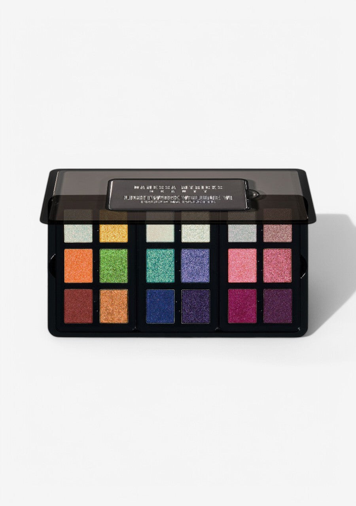

> Lightwork Volume VI Freedom 是 Danessa Myricks Beauty 光绘系列的第六章——以自由彩虹为题，将18枚跨越金属、多变色、箔片与哑光质地的色号汇聚一盘，化光谱为颜彩。三个策展迷你子盘各自讲述一段色彩故事：从暖金橄榄到鲜绿铜棕，从荧光青蓝到幽深靛紫，再到珊瑚橙粉与深邃洋红。"触手即是画笔"的弹性配方随指腹融化，无需刷具，让色彩的自由表达触手可及。

> *Lightwork Volume VI Freedom is the sixth chapter in Danessa Myricks Beauty's Lightwork series — a full-spectrum celebration in 18 shades spanning metallics, multichromes, foil flakes, and mattes. Three curated mini palettes form a living rainbow: warm gold and copper tones, electric teal and indigo chromes, and vivid coral-to-magenta intensities. The elastin-infused formula melts effortlessly with fingers or brushes, unleashing free, expressive color at every touch.*

**专利设计 Patent Pending Palette Design**

- 全磁性、可定制、可叠放的便携全脸盘
- 18款无限百搭色号，适用于眼部、面部及唇部
- 多种突破性质地工艺，满足所有需求
- 内含3个策展迷你子盘
- 弹性配方，触手即化，刷具可选
- 适合所有肤色与妆容风格

---

- Fully magnetic, customizable, stackable and collectible on-the-go all over face palette
- 18 infinitely wearable shades for eyes, face & lips
- Multiple groundbreaking finishes for all
- 3 curated mini palettes
- Finger forward formula, brush optional
- Designed for all skin levels and all makeup styles

---

### 3个色彩故事 3 Color Stories

| 色彩故事 Color Story | 色号 Shades |
|---|---|
| 暖光彩虹 Warm Spectrum | Proud, Rise, Higher, Gleaming, Unapologetic, Nirvana |
| 冷调青蓝 Cool Blues | Release, Free, Fluid, Euphoria, Unbound, Empowered |
| 珊瑚粉紫 Coral & Pink | Serenity, Dance, Joy, Rejoice, Love, Bliss |

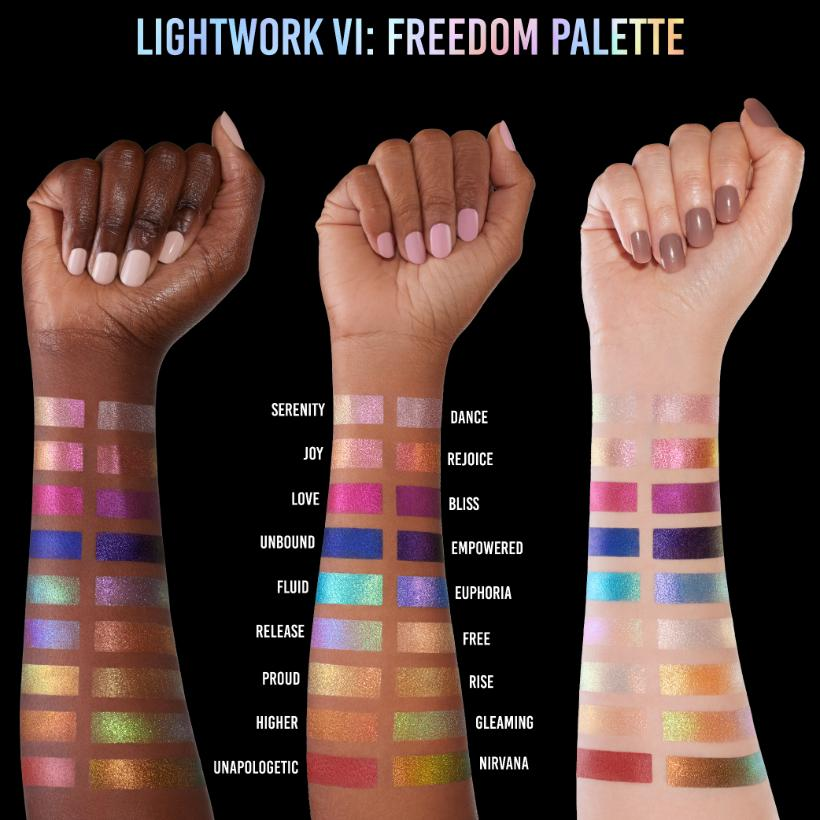

---

## Shade 1: Proud — Warm golden-olive shifting metallic.
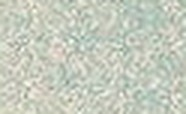

Use: Apply all over lid for a warm olive-gold glow, or concentrate on the inner corner and brow bone as a highlight topper. Layer over any shade to add a warm iridescent dimension.

##### 色号 1：骄傲 (Proud) —— 暖金橄榄色移变金属色。
用途：全眼铺色打造暖橄榄金光感，或集中于眼头与眉骨作叠涂提亮。叠加于任意色号之上可增添暖调虹彩维度。

## Shade 2: Rise — Bright golden-yellow Foil Flakes Metallic.
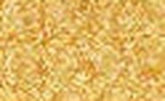

Use: Apply all over lid for a vivid golden-yellow foil effect. Layer over Proud for a warm two-tone metallic look. Can also be used as an inner corner highlight.

##### 色号 2：崛起 (Rise) —— 亮金黄色，箔片金属色质地。
用途：全眼铺色打造鲜亮金黄箔片效果，叠加于骄傲之上可呈现暖调双色金属感，也可用于眼头提亮。

## Shade 3: Release — Sheer warm gold Chrome Topper.
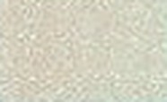

Use: Apply as a topper over any shade to add a warm, light-catching glow. Use alone all over lid for a barely-there metallic warmth. Stunning over Fluid or Unbound for a color-shift effect.

##### 色号 3：释放 (Release) —— 透薄暖金铬光叠涂色。
用途：可叠涂于任意色号之上增添暖调闪光感，单独铺于全眼打造若隐若现的暖金属效果，叠加于流动或无拘之上可产生变色效果。

## Shade 4: Free — Sheer pale pearl Elastin Sheer Metallic.
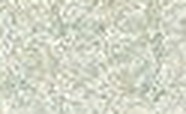

Use: Apply all over lid for a whisper-light pearl veil or layer over any shade to add luminosity. Beautiful on the brow bone and inner corner as a brightening highlight.

##### 色号 4：自由 (Free) —— 极透薄淡珍珠色，弹性透光金属色质地。
用途：全眼铺色打造轻透珍珠薄纱感，也可叠加于任意色号增添光润感；用于眉骨和眼头提亮效果出众。

## Shade 5: Serenity — Pale champagne-pink shimmer.
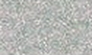

Use: Apply all over lid for a delicate champagne-pink glow. Use as an inner corner highlight or brow bone luminizer. Layer over deeper shades for a soft finishing shimmer.

##### 色号 5：宁静 (Serenity) —— 淡香槟粉色闪光。
用途：全眼铺色打造细腻香槟粉光感，用于眼头提亮或眉骨提亮；叠加于深色之上打造柔和收尾光泽。

## Shade 6: Dance — Sheer pale pink Elastin Sheer Metallic.
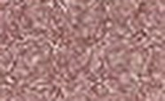

Use: Apply all over lid for a sheer, barely-there pink metallic wash. Layer over any shade for an ethereal pink finish. Excellent as a brightening inner corner or all-over eye veil.

##### 色号 6：舞动 (Dance) —— 极透薄淡粉色，弹性透光金属色质地。
用途：全眼铺色打造若有若无的淡粉金属薄纱感，叠加于任意色号之上增添空灵粉调收尾，也可用于眼头提亮或全眼薄覆。

## Shade 7: Higher — Warm orange-to-lime shifting Elastin Multichrome.
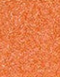

Use: Apply over Unapologetic for a warm orange glow, or over Nirvana for a green-gold dimension. Stunning on its own as an all-over lid color with a warm duochrome effect. Use with fingers for maximum shift.

##### 色号 7：向上 (Higher) —— 暖橙色至黄绿色移变弹性多变色。
用途：叠加于无所顾忌之上打造暖橙光感，叠加于涅槃之上产生绿金维度；单独铺于全眼可呈现暖调双变色效果，指腹涂抹可最大化显色。

## Shade 8: Gleaming — Vivid lime-green metallic.

Use: Apply all over lid for a bold, electric lime-green metallic statement. Blend into the outer corner over a matte base for vivid impact. Can be used as a liner applied with a damp brush.

##### 色号 8：流光溢彩 (Gleaming) —— 鲜亮草绿色金属色。
用途：全眼铺色打造大胆电光草绿金属感，晕染于叠加哑光底色的眼尾可强化视觉冲击；也可用湿刷描绘眼线。

## Shade 9: Fluid — Electric teal-to-turquoise Chrome Metallic.
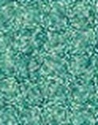

Use: Apply all over lid for a vivid, electric teal chrome effect. Finger application delivers the most intense color payoff. Pairs beautifully with Unbound for a cool blue-teal ombre.

##### 色号 9：流动 (Fluid) —— 电光蓝绿至青蓝铬金属色。
用途：全眼铺色打造鲜亮电光蓝绿铬光效果，指腹涂抹显色最强；与无拘搭配可打造冷调蓝绿渐变眼妆。

## Shade 10: Euphoria — Periwinkle blue-purple metallic.
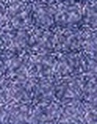

Use: Apply all over lid for a dreamy periwinkle metallic effect. Layer over a matte base for added depth. Stunning between Fluid and Unbound for a cool spectrum gradient.

##### 色号 10：陶醉 (Euphoria) —— 矢车菊蓝紫色金属色。
用途：全眼铺色打造梦幻矢车菊蓝紫金属感，叠加于哑光底色可增加深度；夹在流动和无拘之间可打造冷调光谱渐变。

## Shade 11: Joy — Warm coral-orange metallic.
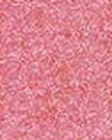

Use: Apply all over lid for a warm, glowing coral metallic. Blend into the crease for a sun-kissed warmth. Layer over a matte nude base for a saturated finish. Stunning on the cheekbones as a highlighter.

##### 色号 11：喜悦 (Joy) —— 暖调珊瑚橙色金属色。
用途：全眼铺色打造温暖发光珊瑚橙金属感，晕染眼窝呈现阳光亲吻感；叠加于裸色哑光底色可提升饱和度，用于颧骨高光效果亦佳。

## Shade 12: Rejoice — Vivid hot pink metallic.
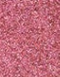

Use: Apply all over lid for a bold, electric hot pink statement. Concentrate on the center lid for maximum pop. Stunning as a liner or mixed with Love for a deep fuchsia gradient.

##### 色号 12：欢庆 (Rejoice) —— 鲜亮玫红粉色金属色。
用途：全眼铺色打造大胆电光玫红感，集中于眼中央可产生最强视觉冲击；用作眼线或与爱混搭打造深粉渐变效果均极佳。

## Shade 13: Unapologetic — Warm terracotta metallic.
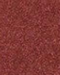

Use: Apply all over lid for a bold terracotta metallic look. Use in the crease for earthy depth or as a base beneath Higher for a warm multichrome effect. Can also work as a soft all-over contour.

##### 色号 13：无所顾忌 (Unapologetic) —— 暖调赭石色金属色。
用途：全眼铺色打造大胆赭石金属感，用于眼窝打造大地系深度，或作为向上的底色打造暖调变色效果；也可用于全脸柔和修容。

## Shade 14: Nirvana — Warm copper-gold metallic.
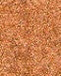

Use: Apply all over lid for a rich, warm copper metallic glow. Layer Higher over Nirvana to reveal a green-gold dimension. Can also be used as a cheekbone highlighter for a sun-kissed bronze.

##### 色号 14：涅槃 (Nirvana) —— 暖调铜金色金属色。
用途：全眼铺色打造丰富暖铜金属光感，叠加向上可显现绿金维度；也可用作颧骨高光打造阳光古铜感。

## Shade 15: Unbound — Electric cobalt blue Chrome Metallic.
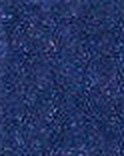

Use: Apply all over lid for a vivid cobalt chrome statement. Finger application delivers maximum intensity. Use as a liner for a graphic look or blend with Fluid for a blue ombre.

##### 色号 15：无拘 (Unbound) —— 电光钴蓝铬金属色。
用途：全眼铺色打造鲜亮钴蓝铬光妆感，指腹涂抹可最大化显色；用作眼线打造图形化妆效，或与流动混搭打造蓝色渐变。

## Shade 16: Empowered — Deep indigo-violet metallic.
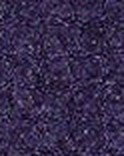

Use: Apply all over lid for a rich deep indigo metallic. Blend into the outer corner for dramatic depth. Layer over Unbound for a cool blue-violet depth. Also stunning as a liner.

##### 色号 16：赋能 (Empowered) —— 深靛蓝紫色金属色。
用途：全眼铺色打造丰富深靛蓝紫金属感，晕染于眼尾可制造戏剧性深度；叠加于无拘之上打造冷调蓝紫层次，用作眼线亦极为惊艳。

## Shade 17: Love — Vivid hot magenta Chrome Metallic.
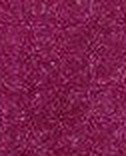

Use: Apply all over lid for a bold, vivid magenta chrome effect. Finger application delivers the most intense payoff. Layer over Rejoice for a pink-to-magenta ombre, or use as a liner for a graphic statement.

##### 色号 17：爱 (Love) —— 鲜亮玫紫红铬金属色。
用途：全眼铺色打造大胆鲜艳玫紫红铬光效果，指腹涂抹显色最强；叠加于欢庆之上打造粉至玫紫渐变，或用作眼线打造图形化妆效。

## Shade 18: Bliss — Deep rich purple metallic.
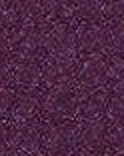

Use: Apply all over lid for a deep purple metallic statement. Use in the outer corner for dramatic depth or as a liner for a bold eye. Pairs beautifully with Love for a fuchsia-to-plum gradient.

##### 色号 18：至福 (Bliss) —— 深沉浓郁紫色金属色。
用途：全眼铺色打造深紫金属妆感，用于眼尾打造戏剧性深度或用作大胆眼线；与爱搭配打造玫紫至深紫渐变效果极为出色。
