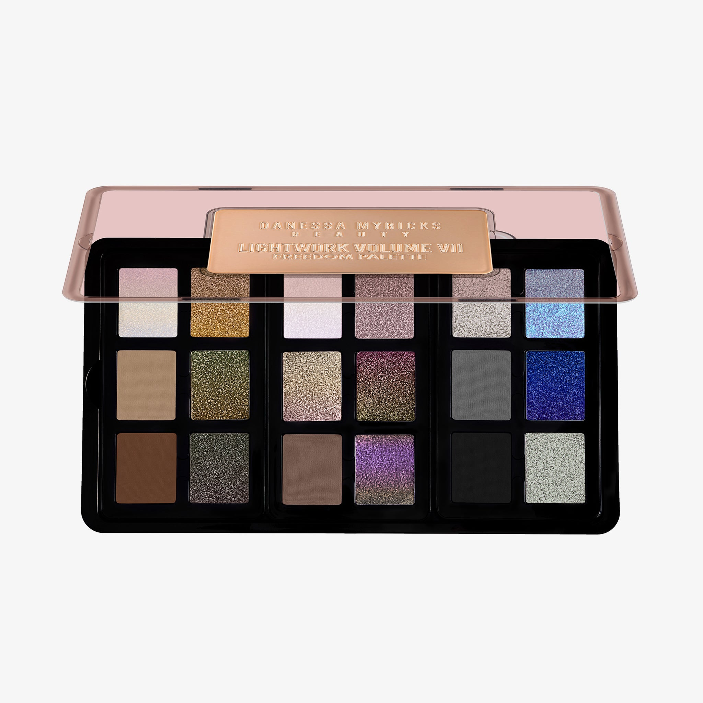
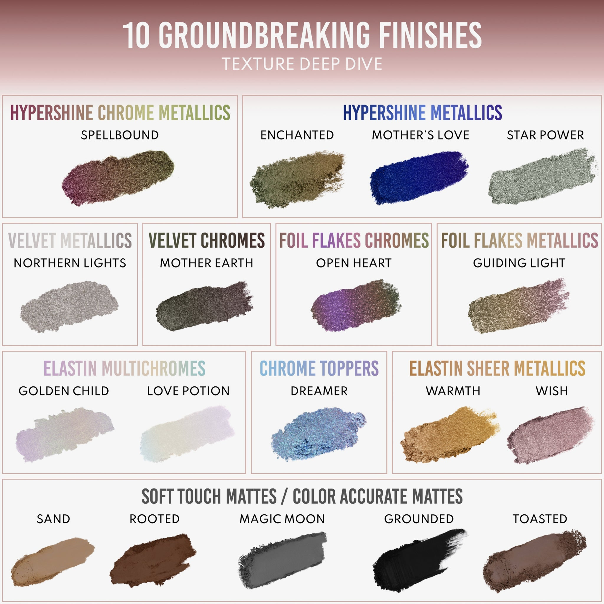
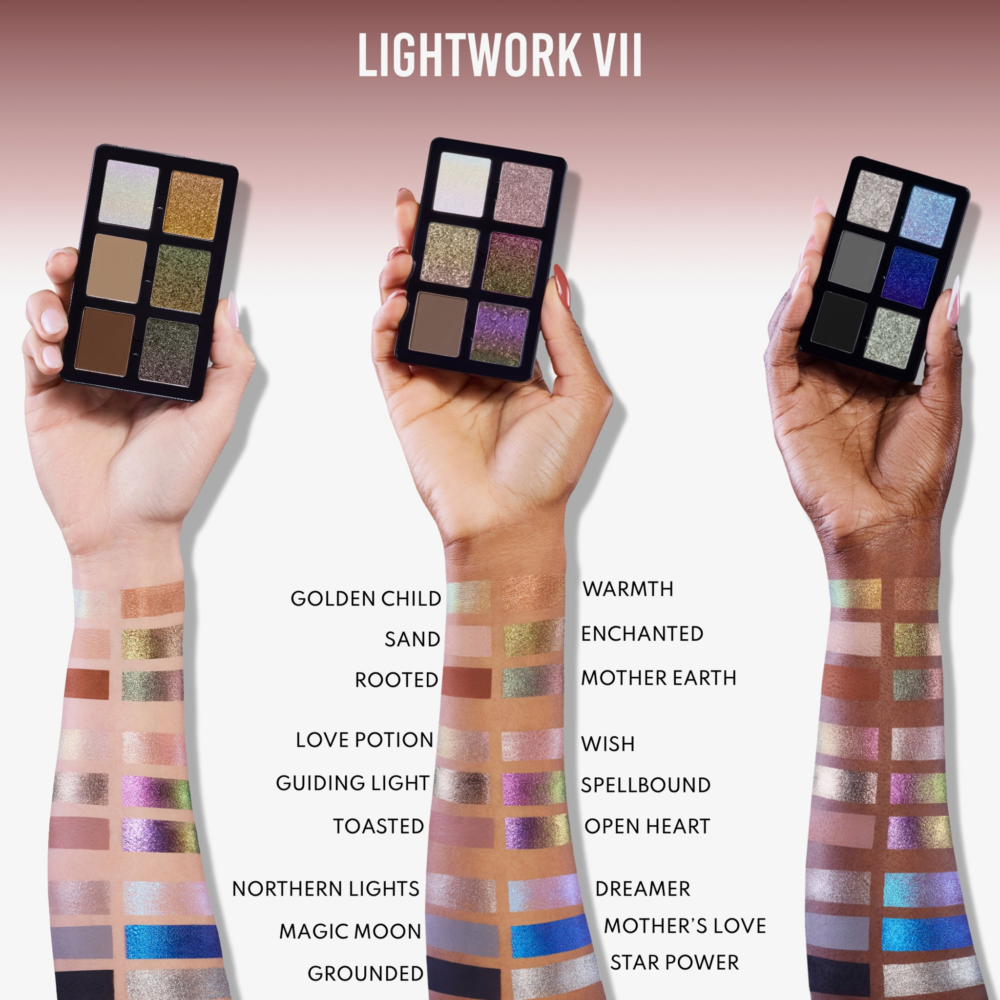

# Danessa Myricks Beauty 18色 光绘第七章·自由盘 Lightwork Volume VII Freedom
*发布：2024*

> Lightwork Volume VII Freedom 是 Danessa Myricks Beauty 光绘系列的第七章——以自由为名，将18枚跨越哑光、金属、箔片与多变色的色号熔于一盘，化光为颜料。三个策展迷你子盘各自成章，浑然一体：从烟棕大地到银灰冷调，从丝绒铬光到超闪蓝焰，每一格皆是对光与色的独立宣言。弹性配方触手即化，指尖亦是画笔，无需刷具，色彩随之自由呈现。

> *Lightwork Volume VII Freedom is the seventh chapter in Danessa Myricks Beauty's Lightwork series — eighteen shades spanning mattes, metallics, foil flakes, and multichromes, united in the name of freedom. Three curated mini palettes nest within one magnetic case, moving from smoky earth tones to cool silver, velvet chrome to electric cobalt blue. An elastin-infused formula blends effortlessly with fingers or brushes, making every application a free and expressive act.*

**专利设计 Patent Pending Palette Design**

- 全磁性、可定制、可叠放的便携全脸盘
- 18款无限百搭色号，适用于眼部、面部及唇部
- 10种突破性质地工艺，满足所有需求
- 内含3个策展迷你子盘
- 弹性配方，触手即化，刷具可选
- 适合所有肤色与妆容风格

---

- Fully magnetic, customizable, stackable and collectible on-the-go all over face palette
- 18 infinitely wearable shades for eyes, face & lips
- 10 groundbreaking finishes for all
- 3 curated mini palettes
- Finger forward formula, brush optional
- Designed for all skin levels and all makeup styles

---

### 10种突破性质地工艺 10 Groundbreaking Finishes

| 质地 Finish | 色号 Shades |
|---|---|
| Hypershine Chrome Metallics 超闪铬金属色 | Spellbound |
| Hypershine Metallics 超闪金属色 | Enchanted, Mother's Love, Star Power |
| Velvet Metallics 丝绒金属色 | Northern Lights |
| Velvet Chromes 丝绒铬光色 | Mother Earth |
| Foil Flakes Chromes 箔片铬光色 | Open Heart |
| Foil Flakes Metallics 箔片金属色 | Guiding Light |
| Elastin Multichromes 弹性多变色 | Golden Child, Love Potion |
| Chrome Toppers 铬光叠涂色 | Dreamer |
| Elastin Sheer Metallics 弹性透光金属色 | Warmth, Wish |
| Soft Touch Mattes / Color Accurate Mattes 丝柔哑光 / 精准色哑光 | Sand, Rooted, Magic Moon, Grounded, Toasted |

---

## Shade 1: Golden Child — Pale lavender-lilac with an Elastin Multichronme finish.

Use: Apply all over lid for an ethereal, color-shifting effect. Layer over a matte base to amplify the shift. Can also be used as a highlighter on cheekbones or inner corners.

##### 色号 1：天选之子 (Golden Child) —— 淡薰衣草丁香色，弹性多变色质地。
用途：可全眼铺色打造空灵变色效果，叠加于哑光底色上可增强变色效果，也可用于颧骨或眼头高光。

## Shade 2: Warmth — Warm golden bronze with an Elastin Sheer Metallic finish.

Use: Apply all over lid for a soft golden glow, or concentrate on the center of the lid for dimension. Excellent as a cheekbone highlighter or inner corner pop.

##### 色号 2：温暖 (Warmth) —— 暖金铜色，弹性透光金属色质地。
用途：可全眼铺色打造柔和金光感，也可集中于眼中央增加层次，亦适合用作颧骨高光或眼头点亮。

## Shade 3: Love Potion — Pearlescent white with an Elastin Multichronme finish.

Use: Use as an all-over lid topper or layered over any shade for an iridescent veil. Stunning as an inner corner highlight or brow bone. Finger application intensifies the shift.

##### 色号 3：爱之魔液 (Love Potion) —— 珠光白，弹性多变色质地。
用途：可作全眼叠涂提亮，或叠加于任意色号之上形成幻彩薄纱感；用于眼头或眉骨效果惊艳，指腹涂抹可强化变色效果。

## Shade 4: Wish — Soft blush-pink with an Elastin Sheer Metallic finish.

Use: Layer all over the lid for a whisper-soft metallic blush. Blend into the crease as a transitional tone or use as a brightening inner corner highlight.

##### 色号 4：心愿 (Wish) —— 柔和玫粉色，弹性透光金属色质地。
用途：全眼铺色打造轻柔玫光金属感，可晕染入眼窝作自然过渡，或用于眼头提亮。

## Shade 5: Northern Lights — Cool silver-gray with a Velvet Metallic finish.

Use: Apply all over the lid for a soft metallic silver look, or blend into the outer corner for a smoky dimension. Pairs well with both cool and warm shades.

##### 色号 5：北极光 (Northern Lights) —— 冷调银灰色，丝绒金属色质地。
用途：全眼铺色打造柔光金属银感，或晕染于眼尾制造烟熏层次，与冷暖色号均能搭配。

## Shade 6: Dreamer — Periwinkle blue-silver with a Chrome Topper finish.

Use: Apply as a topper over any shade to add a chrome dimension. Use alone on the lid for an icy blue-silver effect or concentrate on the inner corner for a luminous finish.

##### 色号 6：梦想家 (Dreamer) —— 矢车菊蓝银色，铬光叠涂色质地。
用途：可叠涂于任意色号之上增添铬光维度，单独铺于全眼呈现冰蓝银效果，或集中点亮眼头。

## Shade 7: Sand — Warm tan-nude with a Soft Touch Matte finish.

Use: Use as a crease base or transitional shade to build depth. Excellent as a neutral lid shade for everyday wear or as a base beneath metallics.

##### 色号 7：沙漠 (Sand) —— 暖驼裸色，丝柔哑光质地。
用途：可作眼窝底色或过渡色用于打造层次深度，也可作日常中性底色或金属色打底色。

## Shade 8: Enchanted — Olive-khaki green with a Hypershine Metallic finish.

Use: Apply all over the lid for a bold olive metallic statement or blend into the crease for depth. Can be used as a liner applied with a damp brush for maximum shine.

##### 色号 8：着迷 (Enchanted) —— 橄榄卡其绿，超闪金属色质地。
用途：全眼铺色打造大胆橄榄金属感，也可晕染眼窝增加深度；用湿刷沿睫毛线描绘可最大化闪光效果。

## Shade 9: Guiding Light — Warm gold-olive with a Foil Flakes Metallic finish.

Use: Apply all over the lid or concentrate on the center for a textured foil finish. Layer over a base for a dimensional metallic effect. Can double as a cheekbone highlighter.

##### 色号 9：引路光 (Guiding Light) —— 暖金橄榄色，箔片金属色质地。
用途：全眼铺色或集中于眼中央打造箔片质感，叠加底色后呈现多维金属效果，亦可用作颧骨高光。

## Shade 10: Spellbound — Deep burgundy-wine with a Hypershine Chrome Metallic finish.

Use: Apply all over the lid for a dramatic chrome burgundy look, or build in the outer corner for smoky depth. Stunning as a liner. Finger application delivers maximum impact.

##### 色号 10：魔法笼罩 (Spellbound) —— 深勃艮第酒红色，超闪铬金属色质地。
用途：全眼铺色打造戏剧性铬光酒红妆，或叠加于眼尾制造烟熏深度；用作眼线效果惊艳，指腹涂抹效果最强。

## Shade 11: Magic Moon — Charcoal gray with a Color Accurate Matte finish.

Use: Use in the crease or outer corner for depth and definition. Excellent for building a smoky eye or blending out intense colors. Can also be used as a soft eye liner.

##### 色号 11：魔法月 (Magic Moon) —— 炭灰色，精准色哑光质地。
用途：可用于眼窝或眼尾打造深度定型，是打造烟熏眼或晕染浓色的理想过渡，也可用作柔和眼线。

## Shade 12: Mother's Love — Electric cobalt blue with a Hypershine Metallic finish.

Use: Apply all over the lid for a bold, electric blue metallic statement. Concentrate on the lower lash line for a pop of color or use as a liner for a graphic effect.

##### 色号 12：母爱 (Mother's Love) —— 电气钴蓝色，超闪金属色质地。
用途：全眼铺色打造大胆电光蓝金属感，集中于下睫毛根部点亮色彩，或用作眼线打造图形化妆效。

## Shade 13: Rooted — Deep warm brown with a Soft Touch Matte finish.

Use: Use in the crease for deep definition or along the lash line for a natural liner effect. Blend with Sand or Toasted for a seamless gradient. Also works as a soft contour.

##### 色号 13：扎根 (Rooted) —— 深暖棕色，丝柔哑光质地。
用途：可用于眼窝深度定型或沿睫毛根部自然描绘，与沙漠或烘焙过渡打造渐变效果，也可用于柔和轮廓修容。

## Shade 14: Mother Earth — Dark bronze-olive with a Velvet Chrome finish.

Use: Apply all over the lid for a rich velvet chrome effect or blend into the outer corner for depth. Pairs beautifully with Rooted or Guiding Light. Stunning when applied with a finger.

##### 色号 14：大地之母 (Mother Earth) —— 深铜橄榄色，丝绒铬光色质地。
用途：全眼铺色打造丰富丝绒铬光效果，或晕染于眼尾增加深度；与扎根或引路光搭配相得益彰，指腹涂抹效果更佳。

## Shade 15: Toasted — Warm medium brown with a Color Accurate Matte finish.

Use: Use as a crease shade or all-over lid color for a warm, natural look. Excellent as a base beneath chrome and metallic shades for added richness.

##### 色号 15：烘焙棕 (Toasted) —— 暖调中棕色，精准色哑光质地。
用途：可用于眼窝或全眼打造温暖自然妆感，作为铬光和金属色底色可增添醇厚色感。

## Shade 16: Open Heart — Purple-violet with a Foil Flakes Chrome finish.

Use: Apply all over the lid for a bold purple chrome with foil dimension. Layer over Toasted for a richly saturated look. Use fingers for the most intense foil effect.

##### 色号 16：敞开心扉 (Open Heart) —— 紫罗兰色，箔片铬光色质地。
用途：全眼铺色打造大胆紫色铬光箔片效果，叠加于烘焙棕之上呈现高饱和妆感，指腹涂抹可最大化箔片效果。

## Shade 17: Grounded — True black with a Color Accurate Matte finish.

Use: Use in the outer corner or along the lash line for dramatic definition. Build for a classic smoky eye or blend softly for a lived-in look. Can also be used as a liner.

##### 色号 17：沉稳 (Grounded) —— 正黑色，精准色哑光质地。
用途：可用于眼尾或睫毛根部打造戏剧性定型，叠加打造经典烟熏眼或柔和晕染出随性感，也可用作眼线。

## Shade 18: Star Power — Silver-platinum with a Hypershine Metallic finish.

Use: Apply all over the lid for a high-impact platinum silver look or concentrate on the inner corner and brow bone for a luminous highlight. Can also be used as a topper over any shade for starry dimension.

##### 色号 18：星光魅力 (Star Power) —— 铂银色，超闪金属色质地。
用途：全眼铺色打造高冲击铂金银光感，或集中于眼头和眉骨作强效高光，也可叠涂于任意色号之上增添星光维度。
