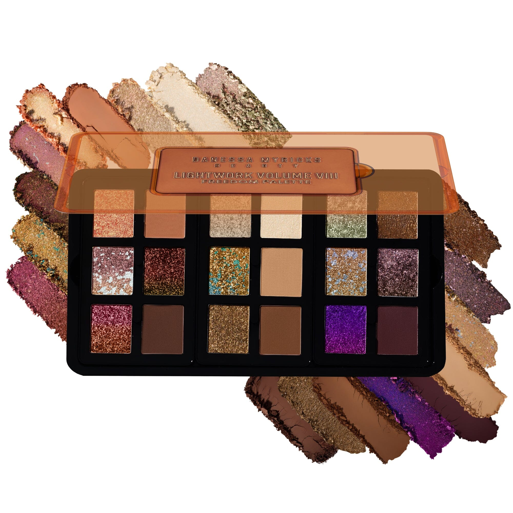
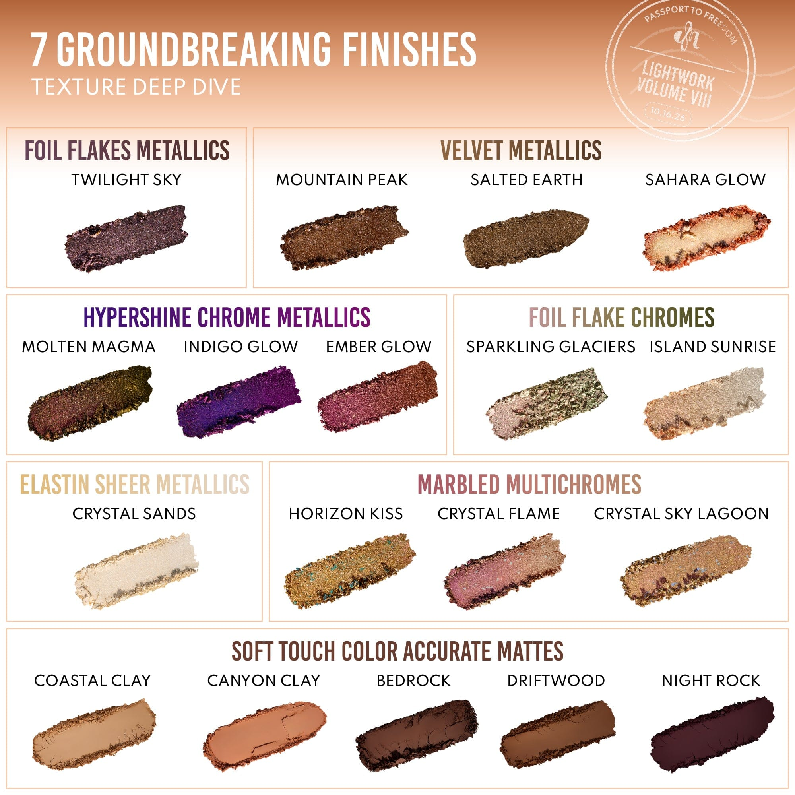
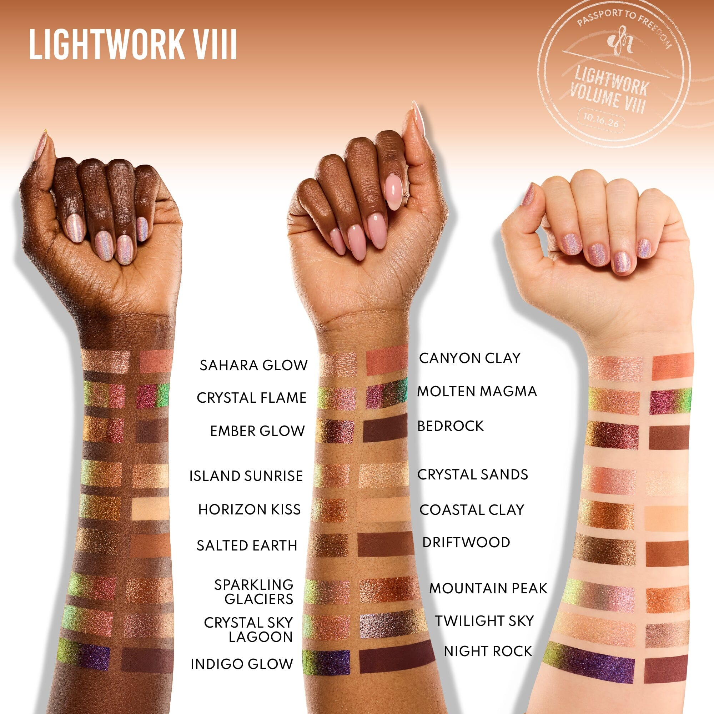
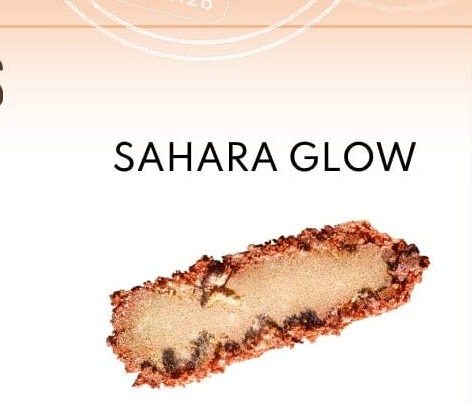

# Danessa Myricks Beauty 18色 光绘第八章·自由盘 Lightwork Volume VIII Freedom
*发布：2026*

> Lightwork Volume VIII Freedom 是 Danessa Myricks Beauty 光绘系列的第八章——以大地与天空为灵感，将18枚跨越哑光、丝绒金属、超闪铬光、箔片与大理石多变色的色号汇聚一盘，化旅途风景为颜彩。三个策展迷你子盘各自讲述不同的色彩故事：从温暖赭石大地哑光，到变幻金铜与蓝绿多变色，再到炽烈铬光与深邃夜色，每一格皆是一处独立的自由风景。"触手即是画笔"的弹性配方随指腹融化，无需刷具，让色彩的自由表达触手可及。

> *Lightwork Volume VIII Freedom is the eighth chapter in Danessa Myricks Beauty's Lightwork series — eighteen shades inspired by iconic landscapes, spanning earth-toned mattes, velvet metallics, hypershine chromes, foil flakes, and marbled multichromes. Three curated mini palettes each tell a distinct color story: from warm terracottas and earth mattes, to shifting gold-bronze and teal multichromes, to vivid chrome and deep night tones. The elastin-infused formula melts effortlessly with fingers or brushes, inviting free expression with every touch.*

**专利设计 Patent Pending Palette Design**

- 全磁性、可定制、可叠放的便携全脸盘
- 18款无限百搭色号，适用于眼部与面部
- 7种突破性质地工艺，满足所有需求
- 内含3个策展迷你子盘
- 弹性配方，触手即化，刷具可选
- 适合所有肤色与妆容风格

---

- Fully magnetic, customizable, stackable and collectible on-the-go all over face palette
- 18 infinitely wearable shades for eyes & face
- 7 groundbreaking finishes for all
- 3 curated mini palettes
- Finger forward formula, brush optional
- Designed for all skin levels and all makeup styles

---

### 7种突破性质地工艺 7 Groundbreaking Finishes

| 质地 Finish | 色号 Shades |
|---|---|
| Marbled Multichromes 大理石多变色 | Horizon Kiss, Crystal Flame, Crystal Sky Lagoon |
| Foil Flakes Metallics 箔片金属色 | Twilight Sky, Mountain Peak |
| Velvet Metallics 丝绒金属色 | Salted Earth, Sahara Glow |
| Hypershine Chrome Metallics 超闪铬金属色 | Molten Magma, Ember Glow, Indigo Glow |
| Foil Flake Chromes 箔片铬光色 | Sparkling Glaciers, Island Sunrise |
| Elastin Sheer Metallics 弹性透光金属色 | Crystal Sands |
| Soft Touch Color Accurate Mattes 丝柔精准色哑光 | Coastal Clay, Canyon Clay, Bedrock, Driftwood, Night Rock |

---

## Shade 1: Horizon Kiss — Warm gold-bronze Marbled Multichrome that shifts to teal.

Use: Apply all over lid for a dimension-shifting bronze-to-teal effect. Layer over a matte base for intensity. Excellent as an inner corner highlight or center-lid focus shade.

##### 色号 1：地平线之吻 (Horizon Kiss) —— 暖金铜色大理石多变色，视角转换可见青绿色移变。
用途：全眼铺色打造金铜变色效果，叠加哑光底色可增强表现力；也适合集中于眼头或眼中央点亮。

## Shade 2: Coastal Clay — Warm peach-terracotta Soft Touch Matte.

Use: Use as a base shade, crease shade, or all-over lid color for a natural warm look. Excellent for blending and building gradients with other clay tones.

##### 色号 2：海岸黏土 (Coastal Clay) —— 暖调蜜桃赭石色，丝柔精准色哑光质地。
用途：可作底色、眼窝过渡色或全眼自然暖调打底；与其他黏土系色号搭配渐变效果极佳。

## Shade 3: Sparkling Glaciers — Pale champagne with green-teal Foil Flake Chrome.

Use: Apply over any shade as a topper for a glacial shimmer effect. Use on the inner corner or brow bone for a bright, cool highlight.

**Caution: Do not use on lips.**

##### 色号 3：晶莹冰川 (Sparkling Glaciers) —— 淡香槟底色，含青绿色箔片光粒，箔片铬光色质地。
用途：可叠涂于任意色号之上打造冰川光感，用于眼头或眉骨可作冷调提亮。

**提示：请勿用于唇部。**

## Shade 4: Crystal Sands — Very sheer warm cream Elastin Sheer Metallic.

Use: Apply all over lid for a whisper-light metallic veil, or layer over any shade to add sheerness and luminosity. Beautiful on the brow bone and inner corner.

##### 色号 4：水晶细沙 (Crystal Sands) —— 极透薄暖奶白色，弹性透光金属色质地。
用途：全眼铺色打造轻透金属薄纱感，也可叠加于任意色号增添光润感；用于眉骨和眼头提亮效果出众。

## Shade 5: Salted Earth — Deep olive-green Velvet Metallic.

Use: Use in the crease or outer corner for earthy depth and definition. Layer under or over other shades for a nature-inspired, moody dimension.

##### 色号 5：咸土 (Salted Earth) —— 深橄榄绿色，丝绒金属色质地。
用途：可用于眼窝或眼尾打造大地系深邃感；与其他色号叠搭可创造自然灵感的立体层次。

## Shade 6: Sahara Glow — Warm burnt-orange Velvet Metallic.

Use: Apply all over lid for a bold warm metallic statement. Blend softly into the crease for a sun-kissed look, or concentrate on the center lid for dimension.

##### 色号 6：撒哈拉光辉 (Sahara Glow) —— 暖调焦橙色，丝绒金属色质地。
用途：全眼铺色打造大胆暖金属感，柔和晕染眼窝呈现阳光亲吻感，或集中于眼中央增加层次。

## Shade 7: Crystal Flame — Rosy-pink with silver-shifting Marbled Multichrome.

Use: Apply all over lid for an ethereal rosy-pink with color-shifting silver highlights. Use as an inner corner pop or layer over a neutral base to amplify the shift.

##### 色号 7：水晶焰 (Crystal Flame) —— 玫瑰粉色大理石多变色，带银色变幻高光。
用途：全眼铺色打造空灵玫粉变色效果，用于眼头增添层次，或叠加于中性底色上增强变色表现力。

## Shade 8: Molten Magma — Deep dark Hypershine Chrome Metallic with dramatic multi-angle shift.

Use: Apply all over lid for an intense, dramatic dark chrome effect. Finger application delivers maximum impact. Stunning as a liner or concentrated in the outer corner.

**Caution: Do not use on lips.**

##### 色号 8：熔岩岩浆 (Molten Magma) —— 极深暗色，超闪铬金属色质地，随光线角度呈现强烈变色效果。
用途：全眼铺色打造戏剧性极深铬光妆容，指腹涂抹效果最强；用作眼线或晕染眼尾均极为惊艳。

**提示：请勿用于唇部。**

## Shade 9: Crystal Sky Lagoon — Warm gold with turquoise-teal chunky Marbled Multichrome.

Use: Apply all over lid for a bold gold-to-teal shifting effect. Layer over a warm matte base for depth, or concentrate on the center lid to create a dimensional focal point.

##### 色号 9：水晶天空泻湖 (Crystal Sky Lagoon) —— 暖金底色搭配松石青绿大颗粒，大理石多变色质地。
用途：全眼铺色打造大胆金色至蓝绿变色效果，叠加于暖调哑光底色可增加深度，或集中于眼中央打造立体焦点。

## Shade 10: Driftwood — Warm caramel-tan Soft Touch Matte.

Use: Use as a versatile neutral base or crease shade for everyday wear. Excellent for building gradients with deeper or lighter shades. Pairs seamlessly with all metallic and chrome shades.

##### 色号 10：浮木 (Driftwood) —— 暖调焦糖棕米色，丝柔精准色哑光质地。
用途：可作百搭中性打底色或眼窝过渡色；适合日常使用，与深浅各色渐变融洽，是搭配所有金属色和铬光色的理想基础色。

## Shade 11: Island Sunrise — Warm peachy-gold Foil Flake Chrome.

Use: Apply all over lid for a warm, luminous foil effect. Layer over Coastal Clay or Driftwood for a warm summer glow. Beautiful as a highlighter on the cheekbones or brow bone.

##### 色号 11：岛屿日出 (Island Sunrise) —— 暖调蜜桃金色，箔片铬光色质地。
用途：全眼铺色打造温暖发光箔片效果，叠加于海岸黏土或浮木之上可呈现夏日暖光感；用于颧骨或眉骨高光效果出色。

## Shade 12: Twilight Sky — Deep wine-plum Foil Flakes Metallic.

Use: Apply all over lid for a rich wine metallic with foil dimension. Concentrate in the outer corner for dramatic depth. Can be used as a liner for a bold graphic effect.

**Caution: Do not use on lips.**

##### 色号 12：暮色苍天 (Twilight Sky) —— 深酒红李子色，箔片金属色质地。
用途：全眼铺色打造丰富酒红金属箔片效果，集中于眼尾可制造戏剧性深度；也可用作眼线打造大胆图形化妆效。

**提示：请勿用于唇部。**

## Shade 13: Ember Glow — Warm pink-red Hypershine Chrome Metallic.

Use: Apply all over lid for a bold pink-ember chrome statement. Layer over a matte base for maximum color impact. Stunning applied with a finger.

##### 色号 13：余烬红光 (Ember Glow) —— 暖调粉红色，超闪铬金属色质地。
用途：全眼铺色打造大胆粉红铬光妆感，叠加于哑光底色可最大化显色效果，指腹涂抹效果尤为惊艳。

## Shade 14: Bedrock — Deep warm brown Soft Touch Matte.

Use: Use in the crease for definition or along the lash line for a natural liner effect. Excellent as a blending shade to deepen any eye look. Pairs beautifully with all chrome and metallic shades.

##### 色号 14：基岩 (Bedrock) —— 深暖棕色，丝柔精准色哑光质地。
用途：可用于眼窝定型或沿睫毛根部自然描绘；是加深任何眼妆的理想晕染色，与所有铬光和金属色搭配和谐。

## Shade 15: Mountain Peak — Warm amber-gold Foil Flakes Metallic.

Use: Apply all over lid for a rich warm golden foil effect. Layer over Canyon Clay or Bedrock for added depth. Can also be used as a highlighter on the cheekbones.

**Caution: Do not use on lips.**

##### 色号 15：山峰 (Mountain Peak) —— 暖调琥珀金色，箔片金属色质地。
用途：全眼铺色打造丰富暖金箔片效果，叠加于峡谷黏土或基岩之上可增加深度；也可用于颧骨高光。

**提示：请勿用于唇部。**

## Shade 16: Canyon Clay — Warm medium terracotta Soft Touch Matte.

Use: Use as a crease shade or transitional tone to bridge matte and metallic shades. Excellent for a natural warm eye look or as a base beneath chrome shades.

##### 色号 16：峡谷黏土 (Canyon Clay) —— 暖调中深赭石色，丝柔精准色哑光质地。
用途：可用于眼窝或作过渡色衔接哑光与金属色；适合打造自然暖调眼妆或作铬光色底色。

## Shade 17: Indigo Glow — Electric deep purple Hypershine Chrome Metallic.

Use: Apply all over lid for a bold indigo chrome statement. Concentrate on the lid center for a vivid metallic pop. Stunning as a liner.

**Caution: Do not use on lips.**

##### 色号 17：靛蓝光辉 (Indigo Glow) —— 电光深紫色，超闪铬金属色质地。
用途：全眼铺色打造大胆靛蓝铬光妆感，集中于眼中央可产生强烈金属光感；用作眼线效果极为惊艳。

**提示：请勿用于唇部。**

## Shade 18: Night Rock — Deep dark plum-brown Soft Touch Matte.

Use: Use in the outer corner or along the lash line for deep, dramatic definition. Build for a classic smoky eye or blend softly for a lived-in look. Can also be used as a soft liner.

##### 色号 18：夜岩 (Night Rock) —— 深暗李子棕色，丝柔精准色哑光质地。
用途：可用于眼尾或睫毛根部打造深邃戏剧性轮廓，叠加可呈现经典烟熏眼，柔和晕染则呈现随性感；也可用作柔和眼线。
