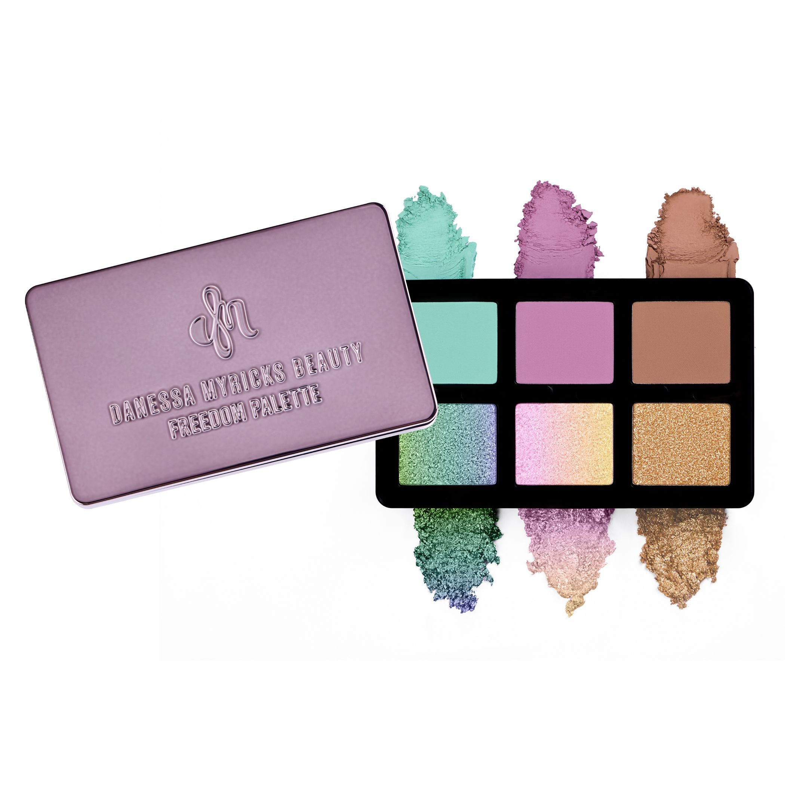
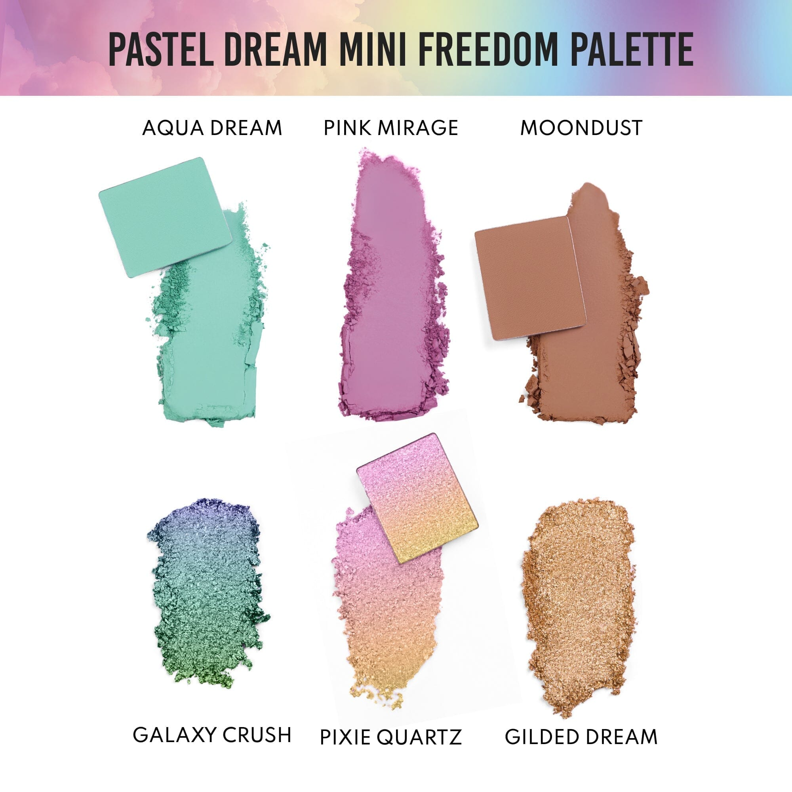
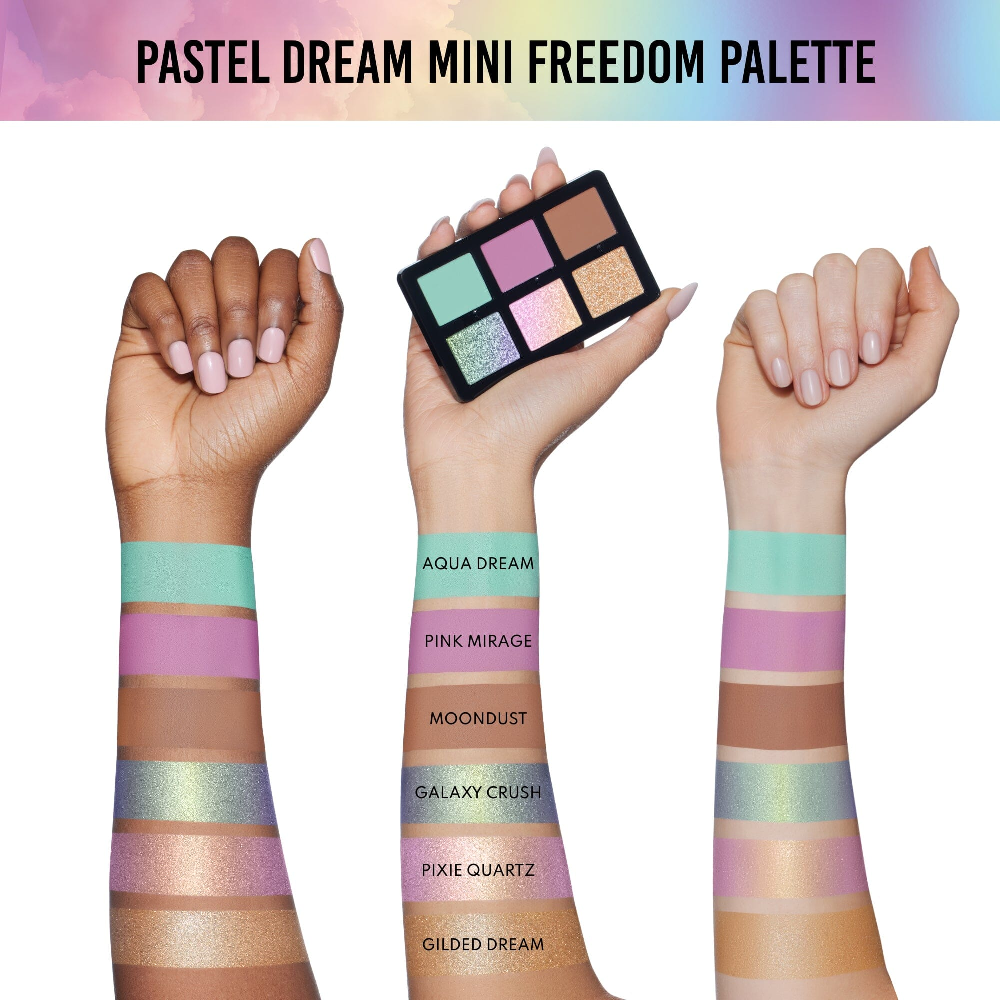
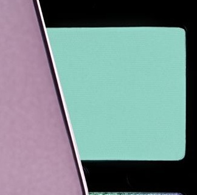
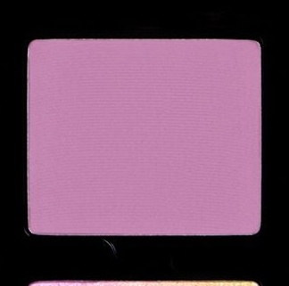
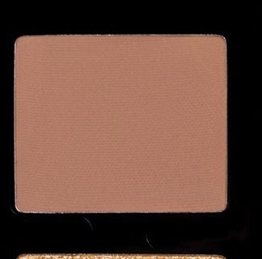
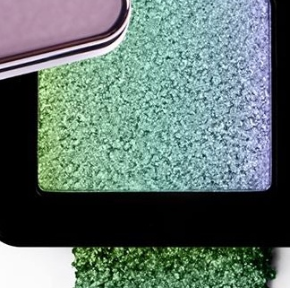
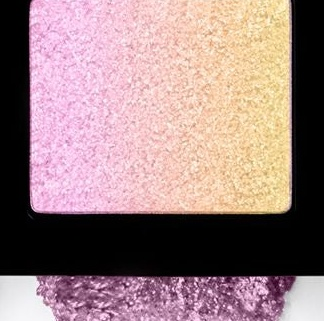
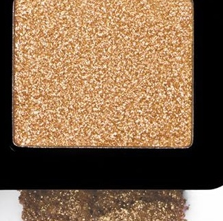

# Danessa Myricks Beauty 6色 梦幻迷你自由盘 Pastel Dream Mini Freedom Palette
*发布：2025*

> Pastel Dream Mini Freedom Palette 是 Danessa Myricks Beauty 为"以太之美"所作的小方——6枚色号将柔和的马卡龙哑光与虹彩箔片闪色并置，薄荷绿、兰花紫、暖棕与星河变色一盘俱全。专为随行设计，磁吸可叠放，兼容全脸使用。触手即化的配方让指腹成笔，一抹便是梦境。

> *The Pastel Dream Mini Freedom Palette is Danessa Myricks Beauty's pocket chapter on ethereal beauty — six shades pairing soft pastel mattes with multi-chrome foil-flake shimmers, from mint and orchid to warm nude and shifting galaxy tones. Magnetic, stackable, and designed for eyes, cheeks, and beyond, it delivers the brand's finger-forward formula in its most travel-friendly form.*

**专利设计 Patent Pending Palette Design**

- 全磁性、可定制、可叠放的便携全脸迷你盘
- 6款色号，适用于眼部、面部及唇部（色号 1 请勿用于唇部）
- 箔片闪色金属色 + 精准色哑光双质地
- 弹性配方，触手即化，刷具可选
- 适合所有肤色

---

- Fully magnetic, customizable, and stackable mini all-over face palette
- 6 shades for eyes, face & lips (Shade 1 not approved for lip use)
- Foil-flake metallic Shimmers + Color-accurate soft Mattes
- Finger forward formula, brush optional
- Designed for all skin levels

---

---

## Shade 1: Aqua Dream — Mint green Color Accurate Matte.

Use: Apply all over the lid for a cool pastel wash. Blend into the crease for a soft transitional tone, or use on the lower lash line for an unexpected pop of color. Excellent as a base for Galaxy Crush.

**Caution: Not approved for lip use.**

##### 色号 1：碧梦 (Aqua Dream) —— 薄荷绿色，精准色哑光质地。
用途：可全眼铺色打造清凉粉彩底妆，晕染眼窝作柔和过渡，或用于下睫毛根部增添清新亮色；作为星河碎梦的打底色效果出众。

**提示：请勿用于唇部。**

## Shade 2: Pink Mirage — Orchid purple Color Accurate Matte.

Use: Use all over the lid for a dreamy orchid base, or blend into the crease for soft definition. Pairs beautifully with Pixie Quartz on top for a dimensional pink-purple look. Can also be applied to cheeks for a soft flush.

##### 色号 2：粉幻 (Pink Mirage) —— 兰花紫色，精准色哑光质地。
用途：可全眼铺色打造梦幻兰紫底色，或晕染眼窝制造柔和定型；叠加精灵水晶之上可呈现立体粉紫妆感，也可用于颧骨打造柔和晕染腮红。

## Shade 3: Moondust — Warm rose-brown Color Accurate Matte.

Use: Use as a versatile crease or transition shade to ground the brighter pastels. Excellent as an all-over neutral lid color for everyday wear, or as a base beneath Gilded Dream for added warmth and depth.

##### 色号 3：月尘 (Moondust) —— 暖调玫棕色，精准色哑光质地。
用途：可用作百搭眼窝过渡色，衔接鲜亮粉彩色号与深色调；也可单独作为日常中性底色，或叠于镀金之梦之下增添暖度与层次。

## Shade 4: Galaxy Crush — Purple-to-green shifting Foil Flake Metallic.

Use: Gently tap onto the lid with fingers for a chromatic veil of shifting purple-to-green. Swipe for a bold foil finish. Layer over Aqua Dream for an enhanced color shift. Stunning as an inner corner accent or as a liner.

##### 色号 4：星河碎梦 (Galaxy Crush) —— 紫色至绿色渐变，箔片闪色金属色质地。
用途：用指腹轻点上色，打造紫绿变色铬光薄纱感；横向涂抹呈现大胆箔片质感；叠于碧梦之上可放大变色效果；用于眼头点亮或描绘眼线效果惊艳。

## Shade 5: Pixie Quartz — Pink-to-gold shifting Foil Flake Metallic.

Use: Tap with fingers onto the lid center for a luminous pink-to-gold chrome effect. Layer over Pink Mirage for a saturated fantasy look. Beautiful on the inner corner, brow bone, or as a highlighter on the cheekbones.

##### 色号 5：精灵水晶 (Pixie Quartz) —— 粉色至金色渐变，箔片闪色金属色质地。
用途：用指腹轻点眼中央，打造发光粉金铬光效果；叠加于粉幻之上可呈现高饱和幻想妆感；用于眼头、眉骨或颧骨高光亦极为出彩。

## Shade 6: Gilded Dream — Warm gold Foil Flake Metallic.

Use: Apply all over the lid for a radiant warm gold statement. Layer over Moondust as a warm metallic eye, or concentrate on the center lid for a dimensional focal point. Doubles as a cheekbone or cupid's bow highlighter.

##### 色号 6：镀金之梦 (Gilded Dream) —— 暖金色，箔片闪色金属色质地。
用途：全眼铺色打造温暖金光妆感；叠加于月尘之上呈现暖调金属眼妆；或集中于眼中央打造立体焦点；亦可用于颧骨或唇峰提亮。
